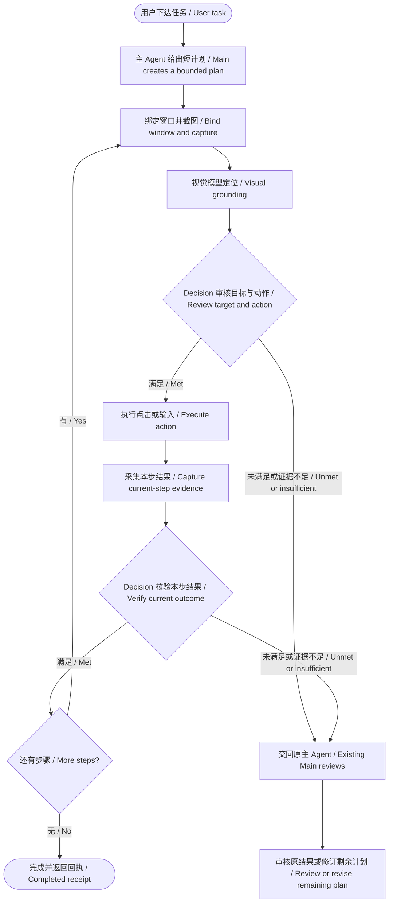

# Agent Review Instant

**What happens when a decision model meets computer use? / 当决策模型遇到 Computer Use，会发生什么？**

A simple browser task—open a website, search, follow a result—once took minutes in our tests. Preparation, grounding and repeated handoffs all contributed to the wait. In **Agent Review Instant 0.1.2**, we connected **OpenAI’s Decisions API** to the Windows runtime and gave it a focused job: check the current target or the result of the current step.

Main supplies a short plan. A vision model locates the target. The runtime acts. Decision checks the evidence. **Satisfied steps continue in the same session; unmet or unclear conditions return to the existing main agent.** Cropped target images and click annotations keep each check focused on the relevant evidence. The execution component installs independently; the learning workbench is optional.

一个打开网站、搜索、进入结果的简单任务，曾在我们的测试中耗时数分钟：准备、定位和反复交接都增加了等待。**0.1.2 将 OpenAI Decisions API 接入 Windows 运行时，专注判断当前目标或当前步骤的结果。** 主 Agent 给出短计划，视觉模型定位，运行时操作，Decision 核验证据。满足条件就在同一会话继续，未满足或证据不足才交回原主 Agent；裁剪与点击标注让审核聚焦相关证据。执行组件独立安装，学习工作台可选。

## 本次正式版 / This stable release

**执行组件 0.1.2 正式版。** [下载执行安装器](https://github.com/Desolate-Jix/agent-gui-runtime/releases/download/instant-v0.1.2/AgentGUIRuntimeExecution-Setup.exe) · [发行页与校验文件](https://github.com/Desolate-Jix/agent-gui-runtime/releases/tag/instant-v0.1.2) · [验证记录](docs/verification/EXECUTION_STABLE_012_20261012.md)。学习工作台保持 **0.1.0-preview.3**，本次不更新学习安装器。此前版本见[发行列表](https://github.com/Desolate-Jix/agent-gui-runtime/releases)。

**Execution 0.1.2 stable.** Source, installed Main and independent installed acceptance passed the scoped continuous flow. The optional learning workbench stays at **0.1.0-preview.3**; its installer is unchanged.

### 新决策模型接入 / New decision-model integration

本版接入 OpenAI 最新推出的 [Decisions API](https://developers.openai.com/api/docs/guides/decisions)，使用 **GPT-6 Luna（`gpt-6-luna`）的 Choice 能力**，根据当前步骤的截图证据直接选择继续或交回主 Agent。官方文档截至 2026-10-12 仍将该 API 标为 public beta；项目正式版不代表上游 API 已正式商用发布。

The integration uses **GPT-6 Luna through OpenAI Decisions API**, with **Choice** decisions over current-step image evidence. The upstream API remains in public beta as of 2026-10-12.

| Choice 结果 / Result | 执行行为 / Runtime behavior |
|---|---|
| `condition_met` | 满足当前条件，继续原计划 / Continue the existing plan |
| `condition_not_met` | 条件未满足，交原主 Agent / Return to the existing main agent |
| `evidence_insufficient` | 证据不足，交原主 Agent / Return to the existing main agent |

每个审核点使用一个三选一问题，不是整个任务只调用一次 API。Choice 的概率和置信度用于诊断，不再叠加旧概率阈值进行第二次否决。旧 predicate 配置继续按原语义工作。详见 [Choice 合同](docs/development/DECISION_CHOICE.md)。

Each checkpoint uses one three-way question. Probabilities are diagnostic in Choice mode; legacy predicate profiles retain their threshold semantics.

### 能做什么 / What you can do

- **浏览器和桌面操作**：自然语言定位，点击、替换输入、按键与滚动，例如输入网址、搜索内容、打开结果。 / Ground targets, click, replace text, press keys and scroll.
- **减少重复主 Agent 审核**：主 Agent 给出短计划，普通成功步骤由运行时与 Decision 完成闭环，异常交回原会话。 / Run supported short plans with Main intervention for exceptions.
- **聚焦当前目标**：候选Choice用单张概览＋完整目标细节图，让小字可读并保留整页弹层上下文，空心点标记不盖住中心。字段核验裁完整输入框，常规文字图把历史点击标记移到外沿以免遮字，输入后只比规定文字；普通点击结果只问本步结果。截图中局部遮挡退缩时保留原遮罩，遮罩内点禁止执行。完整哈希、身份与坐标认证留在本地。 / Candidate Choice uses one overview/detail image with readable small targets, full-page popup context and hollow marks. Field checks crop complete inputs, move historical-click marks to the margin of normal-size value views to preserve glyphs, and compare requested text; ordinary clicks check the current result. Receding occlusion retains its original mask, whose points cannot be dispatched. Full hash, identity and coordinate authentication remains local.
- **变化交给当前审核**：定位期间目标外观变化时，可用的 Choice 用当前标点图审核原点位，不再先被旧像素比例拦截；未通过认证不会输入，无可用 Choice 仍保留旧检查。 / Eligible Choice reviews a changed target on the current marked image through its existing request; authenticated approval remains required before dispatch.
- **默认视觉执行**：普通执行不依赖 UIA 整树或字段扫描；UIA 保留给学习与显式原生路线。 / Default execution is visual; UIA remains optional for native and learning routes.
- **录屏兼容**：精确匹配 NVIDIA 透明录屏覆盖窗，避免矩形遮挡误报；保留真实像素、点位命中和 Decision 审核。 / A narrow NVIDIA overlay exemption retains real hit tests and visual evidence; it does not allow arbitrary recording panels.

**Acceptance rule:** a new end-to-end flow must pass on its first complete attempt. After a failure, retain the original evidence, repair and run targeted regression, then evaluate a different fresh flow. A successful rerun does not erase the first failure.

**验收标准：新流程首次完整运行无错误才计通过。** 首败保留，修复并做针对性回归后改用不同新流程；旧流程复测成功不能改记首次通过。

## 执行流程 / Execution flow



当前源码的普通视觉输入为：**定位审核通过 → 连续点击、Ctrl+A、替换文字 → 仅核对规定内容 → 复用字段位置审核点击 → 点击后立即 Enter**。不检查空框或焦点，连续动作内部不插入截图或模型调用。详见[视觉输入说明](docs/development/VISUAL_EXECUTION_INPUT.md)。

The visual input path binds click/select-all/replacement, checks the requested value, then reuses verified field geometry for a fresh point review and click→Enter. No extra grounding, focus inference or intervening capture is added inside the compound actions.

## What has improved, and what remains / 已有进展与后续方向

The latest fresh task was **DuckDuckGo → search “NumPy ndarray documentation” → open the first matching official NumPy result**. Main submitted the plan once. The runtime, Luna grounding and Decision completed two rounds in the same window/session without Main repair or automatic retry. Zero-input cancellation and normal window/host cleanup passed; the independent test browser profile and cache were retained.

最新完整任务是 **DuckDuckGo → 搜索“NumPy ndarray documentation” → 打开首个匹配的 NumPy 官方结果**。主 Agent 一次提交计划，运行时、Luna 定位与 Decision 在同一窗口/会话完成两轮，无主 Agent 修补或自动重试；零输入取消和正常关闭通过，独立浏览器资料与缓存保留。

| Acceptance / 验收 | Result / 结果 |
|---|---|
| Main, source / 源码 | Two rounds + cancellation + cleanup passed / 两轮、取消、收尾通过 |
| Main, installed / 安装版 | Two rounds + cancellation + cleanup passed / 两轮、取消、收尾通过 |
| Independent Sol, same installed candidate / 同候选独立复验 | Two rounds + cancellation + cleanup passed / 两轮、取消、收尾通过 |

This demonstrates that supported ordinary steps can run without a Main-agent round trip at every action. It is a scoped acceptance result, not a claim of universal accuracy. Earlier failed attempts are retained separately in the [release record](docs/verification/EXECUTION_STABLE_012_20261012.md).

这些结果验证了受支持的普通步骤可以连续执行，减少逐步回到主 Agent 的等待；它们不是通用准确率证明。此前首败单独保留，不用复测成功覆盖。

### Actual action-stage time and token use / 实际动作阶段耗时与 token 用量

These are the recorded action-stage durations from the **two installed Main runs**, rather than API response times:

以下是**安装版 Main 连续两轮**记录的动作阶段耗时，而非单次 API 响应时间：

| Action stage / 动作阶段 | Recorded range / 实测范围 |
|---|---|
| Locate the address field → replace the URL → press Enter → capture the page / 定位地址栏 → 替换网址 → Enter → 页面截图 | **9.2–9.5 s / 秒** |
| Locate the search field → enter the query → submit → capture the results / 定位搜索框 → 输入查询 → 提交 → 结果截图 | **9.1–10.1 s / 秒** |

The durations include grounding, the input sequence and post-action capture. **Final page-result verification is additional; these are not full-task totals.** There is no matching successful baseline from the previous version, so we cannot yet claim how many seconds each action saved or a percentage speedup. Exact per-round measurements and the timing boundary are in the [release verification record](docs/verification/EXECUTION_STABLE_012_20261012.md).

计时包含定位、输入序列和操作后截图，**最终页面结果审核另计，不是完整任务总耗时**。目前没有同口径、成功完成的旧版基线，因此不宣称每步缩短多少秒或提升多少百分比；逐轮原始数值与计时边界见验证记录。

The two-round installed Main acceptance, including cancellation verification, used **20 Decision requests and 22,930 Decision input tokens**, plus **7 separate visual-grounding requests**. Grounding token usage is additional. These are measured usage totals, not token savings against an older release; HTTP-only timings remain in the verification record.

安装版 Main 两轮验收（含取消检查）使用 **20 次 Decision 请求、22,930 个 Decision 输入 token**，另有 **7 次视觉定位请求**，定位 token 另计。这是实际用量，不是相对旧版节省的 token；单请求 HTTP 计时保留在验证记录中。

The usage changes are deliberately focused: candidate review receives one overview/detail marked image; text verification receives a complete enlarged input crop, with historical-click ticks moved outside the text in normal-size value views. One checkpoint asks one current-step Choice. Target wording distinguishes “first matching” from “first overall”; workflow controls and later results stay outside that target. Full source/coordinate/receipt authentication remains local.

用法优化集中在证据：目标审核用一张概览＋细节标注图，输入核验用完整放大的字段裁剪，常规尺寸的文字图将历史点击刻度移到文字外侧。每个审核点只问一个本步问题，明确“首个匹配”和“整体第一”的区别，流程控制与后续结果另放；完整来源、坐标和回执仍在本地认证。

On a fixed 19-request field diagnostic, all 16 ordinary positive/counterexamples were correct and all three gray-completion cases returned to Main; exact predeclared labels matched18/19. HTTP times were123–197ms at374–594 input tokens. This small selected-image result does not establish general accuracy. Simply shortening prompts or uploading larger images did not consistently improve later candidate judgments; rejected variants and limitations are recorded in the [target-usage diagnosis](docs/verification/DECISION_TARGET_USAGE_20261013.md).

固定19次字段诊断中，16个普通正反例全部正确，3个灰色补全样本全部转Main；精确预设标签符合18/19，HTTP123–197毫秒、374–594输入token。该小样本不代表通用准确率。后来候选诊断显示，单纯缩短提示词或增加全图并非稳定改进，失败方案和限制均保留。

The next goal is broader real-task coverage and a consistent before-and-after benchmark, with fewer repeated planning and judgment calls. The optional learning workbench can preserve recurring work as workflows people review and edit, while Decision checks changing evidence. Neither component promises unattended completion of arbitrary tasks.

后续目标是覆盖更多真实任务，建立同口径的新旧版本对照，并减少重复规划和审核。可选学习工作台将重复工作保存为可审核、可修改的流程，Decision检查每次变化的证据；当前不承诺任意任务无人干预完成。

## 模型选择：本地模型不是必需品 / Local models are optional

**视觉定位与 Decision 判断是独立角色**：Luna 视觉 API 负责“点哪里”；Decisions API 负责“当前条件是否满足”。也可以由本地 VISTA 或图像 Agent 定位，按需启用 Decision。

**Grounding and judgment are separate.** Decision does not generate coordinates or replace the planner.

| 视觉来源 / Grounding | 本地权重 / Local weights | 所需配置 / Setup |
|---|---|---|
| 外部视觉 API / `external_api` | 不需要 / No | 图像端点、模型 ID、密钥环境变量 / Endpoint, model ID, key environment variable |
| 当前 Agent / `agent_current` | 不需要 / No | 支持图像的客户端 / Image-capable client |
| 视觉子 Agent / `agent_delegate` | 不需要 / No | 客户端指定并复用的视觉会话 / Explicit reusable visual delegate |
| 本地 VISTA / `local` | 需要 / Yes | 本地依赖与 VISTA-4B / Local dependencies and weights |

不配置 Decision 时不会调用判断 API；可使用基础单步、v1/v2 兼容计划，或显式 `field_evidence_mode="legacy"` 的原生组合输入，由主 Agent 审核结果。默认视觉组合输入要求 Decision auto 可用，缺失时会在输入前拒绝，不会自动切换路线。API 路线需要本机 Windows 执行框架，但不需要下载本地视觉模型或使用本地 GPU。服务商按实际 API 使用计费。

Without Decision, use basic actions, compatible v1/v2 plans or explicit legacy/native input sequences with Main review. Default visual sequences require an available auto-mode Decision service and reject before input if unavailable; there is no implicit route switch. API grounding needs the local runtime, but no local vision weights or GPU.

## 安装与配置 / Install and configure

要求 Windows x64、Python 3.11 和 [uv](https://docs.astral.sh/uv/getting-started/installation/)。执行安装器提供维护源码与配置入口；首次配置按所选路线安装依赖，不附带模型权重或密钥。以下路径请按安装位置修改。

为兼容既有执行组件升级，安装目录与快捷方式可保留历史 Preview 名称；产品版本、安装窗口和卸载条目使用正式版名称。 / The historical Preview folder/shortcut name is retained for upgrade compatibility; the installed version and product display name identify the stable release.

Requires Windows x64, Python 3.11 and uv. The installer supplies the runtime and setup scripts; first-time setup installs selected dependencies. Model weights and API keys are not bundled.

### 外部 Luna 视觉 API + Decision Choice

1. 安装执行组件，将 [Luna 视觉配置](configs/vision-api-openai-luna.example.json)和 [Decision Choice 配置](configs/decision-profile.visual-execution.example.json)复制到自己的配置目录。 / Install execution and copy the example profiles.
2. 让启动 MCP 的进程继承 `OPENAI_API_KEY`，不要把密钥写进配置 JSON、聊天或日志。 / Supply the key through the MCP process environment.
3. 在安装目录运行以下两条命令，先装轻量依赖，再生成同时含视觉和 Decision 的配置。 / Install lightweight dependencies, then generate the combined configuration:

```powershell
.\scripts\setup_instant.ps1 -RecognitionSource external_api -ApiProfile "D:\AgentReviewConfig\vision-api.json" -DataDirectory "D:\AgentReviewInstantData"
.\.venv-agent\Scripts\python.exe .\scripts\configure_instant_mcp.py --python "$PWD\.venv-agent\Scripts\python.exe" --recognition-source external_api --api-profile "D:\AgentReviewConfig\vision-api.json" --decision-profile "D:\AgentReviewConfig\decision.json" --data-dir "D:\AgentReviewInstantData" --enable-local-input
```

将生成的 `mcp-config.local.json` 或 `.toml` 中 `agent-review-instant` 条目合并到客户端，保留其他服务器，然后重新连接。上述最终配置使用普通权限宿主；管理员应用的提权配置见[安装指南](FRIEND_SETUP.md)。配置生成不会发送 API 请求。

Merge the generated server entry into your client and reconnect. The final command configures the ordinary host; use the setup guide for elevated applications. Configuration generation makes no API request.

### 当前 Agent 或本地模型 / Agent or local grounding

```powershell
# 图像 Agent，无本地权重 / Image-capable agent, no local weights
.\scripts\setup_instant.ps1 -RecognitionSource agent_current -DataDirectory "D:\AgentReviewInstantData"

# 本地 VISTA，先查看准备范围 / Local VISTA, preview setup first
.\scripts\setup_instant.ps1 -RecognitionSource local -ModelDirectory "D:\AgentReviewModels\VISTA-4B" -DataDirectory "D:\AgentReviewInstantData" -DownloadModel -WhatIf
```

选择本地路线后去掉 `-WhatIf` 执行准备。本地使用官方 [VISTA-4B](https://huggingface.co/inclusionAI/VISTA-4B) Transformers 权重，硬件规划仅适用于本地路线。详见[安装指南](FRIEND_SETUP.md)和[外部视觉 API](docs/development/EXTERNAL_VISION_API.md)。

## Agent 接入 / Agent integration

MCP stdio 提供七个核心工具：`instant_start`、`instant_status`、`instant_run`、`instant_submit`、`instant_result`、`instant_image`、`instant_stop`，另有 `instant_recovery_preview` 与 `instant_recover_session` 两个恢复工具。

保持同一会话和单一桌面输入所有者。支持单步、组合输入与 1–8 步线性计划。等待到期不等于取消，应查询原请求 ID，不要重新发送已执行的输入。

Use one persistent session and one input owner. Submit a single action, input sequence or supported 1–8 step plan. Poll the original ID after wait expiry; do not replay input. See [Agent guide](AGENT_GUIDE.md), [task plans](docs/development/TASK_PLAN.md) and [Decision configuration](docs/development/DECISION_API.md).

## Earlier evidence and limits / 早期证据与边界

- 本次开发早期的源码复测在保留的独立 Edge 资料目录中自动完成 **Google 网址 → 搜索 java → 首个普通链接**，到达 Java 官网，**3/3 步、零主 Agent 接管**，测试窗口与宿主正常关闭。 / An earlier source rerun completed all three steps automatically, with no Main takeover and normal cleanup.
- NVIDIA 覆盖窗白名单实际生效，缓存保留。首轮漏接失败及用户关闭窗口的中断分别保留，不把复测改记为首次成功。 / Overlay handling was exercised; first failures and manual interruption remain recorded.
- 默认替换离线回归 **591 项通过**，白名单与门禁回归 **237 项通过**。两组有重叠，不相加为独立用例。新安装与连续验收另见[发布记录](docs/verification/EXECUTION_STABLE_012_20261012.md)。 / Overlapping source checks are separate from installed acceptance.
- 不宣称通用准确率、全流程加速倍数或长期稳定性。单轮成功不代表所有网站都可自动完成；API、网络、页面变化与接管仍影响响应时间。 / No general accuracy or end-to-end speed multiplier is claimed.

[白名单实测](docs/verification/RECORDING_OVERLAY_ALLOWLIST_20261012.md) · [默认替换回归](docs/verification/DEFAULT_REPLACE_20261012.md) · [历史开发记录](https://github.com/Desolate-Jix/agent-gui-runtime/blob/main/docs/verification/EXECUTION_DEVELOPMENT_CHECKPOINTS_20261012.md)

## 可选学习工作台 / Optional learning workbench

学习工作台用于采集、人工审核与修改可复用界面和工作流，独立安装，仍为 [0.1.0-preview.3](https://github.com/Desolate-Jix/agent-gui-runtime/releases/tag/learning-v0.1.0-preview.3)。本次不更新其安装器，也不要求安装学习工作台。

The optional workbench supports capture, human review and editing of reusable interfaces and workflows. Its existing preview remains unchanged. See the [learning quickstart](docs/LEARNING_PREVIEW_QUICKSTART.md).

## 维护结构 / Maintained structure

`app/execution` 协调动作与计划，`app/judgment` 处理 Decision，`app/core` 维护截图与输入，`app/vision` 提供视觉定位。历史 `learning_memory` 模块中仍有执行共享依赖；按实际依赖打包，不按目录名称删除，也不因此安装学习工作台。

Execution, judgment, input and grounding share the maintained runtime. Historically named learning modules may be required shared dependencies; they do not imply a workbench installation.

## License

[ISC License](LICENSE). Dependencies and model weights retain their own licenses.
