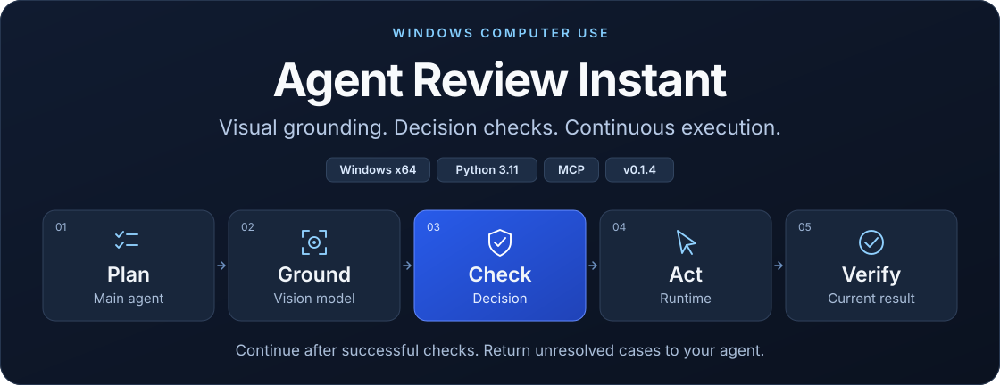

**English** · [简体中文](README.zh-CN.md)

<h1>
  <picture>
    <source media="(max-width: 600px)" srcset="docs/assets/readme-hero.mobile.svg">
    
  </picture>
</h1>

**Run multi-step Windows tasks from your AI agent.**

Visual grounding finds the target. Decision checks the current step. 
Successful steps continue; unresolved cases return to your agent.

**[Download v0.1.3](https://github.com/Desolate-Jix/agent-gui-runtime/releases/download/instant-v0.1.3/AgentGUIRuntimeExecution-Setup.exe)** · [Quick start](#quick-start) · [Architecture](#architecture) · [Evaluation](#evaluation)

Agent Review Instant is a Windows computer-use runtime for MCP-compatible agents. Give it a short plan to navigate an application, click targets, replace text, press keys or scroll. It executes supported steps in one session and checks their results, reducing the need to return to the main agent after every successful action.

**API vision needs no local model weights or GPU.** Use an external vision API, your image-capable agent, or a local model. The **execution runtime 0.1.3** installs independently; the **learning workbench 0.1.0-preview.3** is optional.

## What you can do

| Capability | What it means in practice |
| --- | --- |
| **Keep a task moving** | Run a supported 1–8 step plan in the same session—for example, open a search engine, enter a query and follow a result. |
| **Check the step that just happened** | Ground targets from screenshots. Use cropped, annotated evidence to check a target or the requested result with Decision. |
| **Recover with the original agent** | If Decision does not accept, the standard Luna vision model reviews the same evidence once. Unresolved cases return with evidence; after reviewing it, the original agent can explicitly continue without replaying completed actions. |

## Quick start

You need **Windows x64, Python 3.11, [uv](https://docs.astral.sh/uv/getting-started/installation/)** and an MCP-compatible agent. The installer includes source and setup scripts; first-time setup installs dependencies. Keys and model weights are not bundled.

1. **[Download and install execution 0.1.3](https://github.com/Desolate-Jix/agent-gui-runtime/releases/tag/instant-v0.1.3).** The release page includes checksums.
2. **Choose your vision source.** For external Luna + Decision, copy the [vision profile](configs/vision-api-openai-luna.example.json) and [Decision profile](configs/decision-profile.visual-execution.example.json), then make `OPENAI_API_KEY` available to the MCP process.
3. **Run setup and connect your agent.** Follow the [setup commands](docs/EXECUTION_GUIDE.md#install-and-configure), merge the generated `agent-review-instant` MCP entry into your client, and reconnect. Keep other server entries intact.

| Vision source | Local model required? | Setup |
| --- | --- | --- |
| External API | No | [API profiles and credentials](docs/development/EXTERNAL_VISION_API.md) |
| Current agent or reusable visual subagent | No | [Agent integration](AGENT_GUIDE.md) |
| Local VISTA-4B | Yes | [Local setup](FRIEND_SETUP.md) |

Default visual input sequences require Decision in auto mode. Without Decision, basic actions and explicit legacy/native routes remain available with main-agent review; the runtime does not silently switch routes. All routes require the local Windows runtime. API usage is billed by the provider.

**Source update (version remains 0.1.3):** Decision and secondary review each support their own endpoint, model and key environment variable. Defaults remain OpenAI Decisions + ordinary Luna. This requires Decisions/Responses-compatible services; the published 0.1.3 installer is unchanged. [Configuration and compatibility →](docs/development/DECISION_PROVIDERS.md)

## Engineering evidence

**A complete browser task, measured twice:** open Bing → search “Rust standard library collections documentation” → open the first ordinary result. Both rounds used the installed 0.1.3 candidate in the same window and session.

| Full-plan time · first / second round | API tokens · both rounds | Release regression |
| :---: | :---: | :---: |
| **30.8 s / 27.4 s** | **41,097** | **1,029 checks passed** |
| Exact: 30.809 s / 27.354 s | 20 Decision + 6 grounding calls | 52 selected test files |

Both rounds finished without main-agent intervention or secondary Luna review. These are task-specific plan times, **not a controlled speedup against an older release**. API totals exclude the main and worker agents' subscription usage. The test count is the 0.1.3 release snapshot, not a live CI status. [Timing, cancellation and recovery evidence →](docs/verification/EXECUTION_SPEED_20261015.md)

Prompt evaluation used **39 real UI screenshots across 30 scenario families**. On the held-out set, three-way label agreement rose from **92.5% to 95.0%**, with **1.64% fewer Decision input tokens**. Pass/nonpass accuracy stayed at 95%; the two-stage result stayed at 149/160, including 7 false accepts and 1 false rejection with the adopted prompts. Labels were AI-reviewed: **these are not general GUI success rates**. [Method, split and failure cases →](docs/verification/DECISION_PROMPT_BENCHMARK_20261015.md)

## How it works

**User task → Main-agent plan → Ground → Check → Act → Verify → Continue**

The vision model supplies coordinates. OpenAI's Decisions API checks the target or the current step's result using Choice. A valid pass continues the plan; a nonpass gets one ordinary Luna review before returning to the original main agent if unresolved. Decision does not replace the planner.

The runtime binds evidence to the request, window and screenshot, and validates coordinates and freshness. Default execution uses the visual route; UIA is retained for learning and explicit native routes. Keep one persistent session and one desktop input owner.

**In 0.1.3:** shared observations, preloaded plans and reused HTTP connections reduce repeated preparation. The installed two-round task avoided 10 redundant outer captures. Evidence-bound continuation lets the main agent review a completed step without repeating its action.

[Detailed execution flow →](docs/EXECUTION_GUIDE.md#how-decision-and-the-vision-model-work-together) · [Task-plan contract →](docs/development/TASK_PLAN.md) · [Choice contract →](docs/development/DECISION_CHOICE.md)

## Optional learning workbench

Capture reusable interfaces and workflows, then review and edit them before reuse. The **learning workbench 0.1.0-preview.3** has its own installer and is not required for execution. This execution release does not update it.

[Learning quick start](docs/LEARNING_PREVIEW_QUICKSTART.md) · [Learning download](https://github.com/Desolate-Jix/agent-gui-runtime/releases/tag/learning-v0.1.0-preview.3)

## Current limits

- Models can reject correct evidence or accept incorrect evidence. A primary false pass skips secondary review; this remains a known limitation. Arbitrary unattended tasks are not guaranteed.
- The installer is unsigned. Acceptance used an existing Python environment; first-time dependency setup on a clean machine is not yet verified. [Release scope and history](docs/EXECUTION_GUIDE.md#release-boundaries-and-history)

## Documentation

| Start using it | Understand and integrate |
| --- | --- |
| [Installation guide](FRIEND_SETUP.md) | [Execution guide and detailed flow](docs/EXECUTION_GUIDE.md) |
| [Agent / MCP guide](AGENT_GUIDE.md) | [Decision API configuration](docs/development/DECISION_API.md) |
| [External vision API](docs/development/EXTERNAL_VISION_API.md) | [Visual text input](docs/development/VISUAL_EXECUTION_INPUT.md) |
| [Release notes and checksums](https://github.com/Desolate-Jix/agent-gui-runtime/releases/tag/instant-v0.1.3) | [Timing and acceptance](docs/verification/EXECUTION_SPEED_20261015.md) |

---

[ISC License](LICENSE). Dependencies and model weights retain their own licenses. The banner illustrates the workflow; it is not a recorded run.
