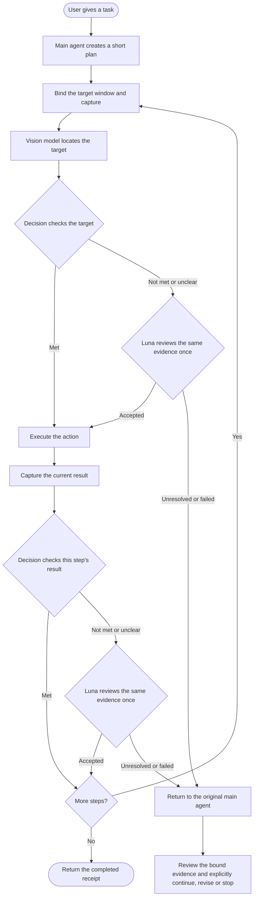
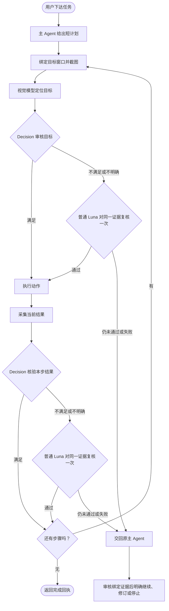

# Agent Review Instant

[English](#english) · [简体中文](#简体中文)

## English

### Windows computer use with focused visual checks

Agent Review Instant lets an MCP-compatible agent operate Windows applications: locate a target from a screenshot, click, replace text, press keys and scroll. The main agent supplies a short plan; the runtime executes supported steps in the same session and checks their results. This avoids returning to the main agent after every successful action.

**Execution 0.1.3 is the current stable release.** The learning workbench is a separate, optional installation and remains at **0.1.0-preview.3**. API-based vision does **not** require local model weights or a local GPU.

[Download the Windows execution installer](https://github.com/Desolate-Jix/agent-gui-runtime/releases/download/instant-v0.1.3/AgentGUIRuntimeExecution-Setup.exe) · [Release notes and checksums](https://github.com/Desolate-Jix/agent-gui-runtime/releases/tag/instant-v0.1.3)

### How Decision and the vision model work together

The vision model answers **“Where should the action happen?”** OpenAI's [Decisions API](https://developers.openai.com/api/docs/guides/decisions), using GPT-6 Luna (`gpt-6-luna`) in Choice mode, answers **“Is this target or this step's result correct?”** Decision does not generate coordinates or replace the main agent's planner.

| Choice result | What happens next |
| --- | --- |
| `condition_met` | Continue the existing plan. |
| `condition_not_met` | Ask the standard Luna vision model to review the same evidence once. Continue if it accepts; otherwise return to the original main agent. |
| `evidence_insufficient` | Use the same one-time Luna review. Return to the original main agent if the result remains unclear or the review fails. |

Each checkpoint asks one current-step question; a task can require several API calls. Choice probabilities are recorded for diagnosis and do not trigger an additional probability-threshold rejection. Legacy predicate profiles retain their own threshold behavior. See the [Choice contract](docs/development/DECISION_CHOICE.md).

Target checks use cropped, annotated images, with an overview and target detail where needed. Text checks compare the requested content in the complete input field. Default execution uses vision rather than UIA tree or field scans; UIA remains available for learning and explicit native routes. A narrowly matched NVIDIA recording-overlay exception avoids false rectangle-based obstruction reports while retaining screenshot evidence and point checks.



Visual text entry combines **click → Ctrl+A → replace text**, verifies only the requested text, then reuses the field position for a fresh click-point check and **click → Enter**. It does not infer focus or classify empty fields. No screenshot or model call is inserted inside either combined action. See [visual input](docs/development/VISUAL_EXECUTION_INPUT.md).

### What changed in 0.1.3

- Reuse the same observation when possible, preload a plan into one persistent client, optimize BGRA conversion and keep HTTP connections pooled for 60 seconds. The measured two-round installed task avoided **10 redundant outer screenshot captures**.
- Use shorter page-result and entered-text questions selected through training, validation and held-out evaluation. Graphic-target and input-target questions, and configured thresholds, are unchanged.
- Let the runtime bind Luna replies to the original request and screenshot with `response_binding="runtime"`, instead of asking the model to copy long IDs. Dimensions, coordinates, source and screenshot freshness are still validated; incorrect IDs remain errors under the legacy contract.
- Preserve useful grounding-failure diagnostics with credential and image-data redaction. Cancellation before input dispatch is recorded as zero input, rather than an unknown outcome.
- Allow the main agent to inspect the evidence from a rejected completed step and explicitly continue the same run without repeating that action.

### Measured speed, token use and limits

The task was **open Bing → search “Rust standard library collections documentation” → open the first ordinary result**, repeated twice in the same window and session.

| Run | First round | Second round | API tokens across both rounds |
| --- | ---: | ---: | ---: |
| Current source | 33.218 s | 30.549 s | 41,173 |
| Installed 0.1.3 candidate | **30.809 s** | **27.354 s** | **41,097** |

Both installed rounds completed without main-agent intervention: **20 Decision calls, 6 grounding calls and 0 secondary Luna reviews** in total. These are complete-plan times for this task. They are not single-call response times or a controlled speedup comparison against an older version. Token totals cover runtime API calls, excluding the main and worker agents' subscription usage.

Cancellation and recovery were also tested. The main agent reviewed bound evidence and continued the original run without repeating the menu click. An independent Sol agent tested the same installed candidate: cancellation, a menu step requiring main-agent review, and two Python `itertools` searches. All **7 steps and cleanup** passed, using **51,072 API tokens**. That recovery required agent assistance and was not fully autonomous.

The final selected execution regression passed **1,029 checks across 52 test files**. The package also passed isolated entrypoint/dependency checks and 43 package-contract checks; these groups are reported separately and are not summed as unique tests. First failures remain recorded. A repaired flow's successful rerun is not relabeled as first-attempt success. See the [timing and acceptance record](docs/verification/EXECUTION_SPEED_20261015.md).

#### Prompt benchmark

The benchmark contains **39 real UI screenshots, 30 scenario families and 254 AI-reviewed cases**, split by family into 104 training, 70 validation and 80 held-out cases. Each held-out case was run twice per strategy: 160 responses, not 160 independent scenarios.

| Held-out metric | Baseline | Adopted prompts |
| --- | ---: | ---: |
| Three-way agreement with the reference label | 148/160 (92.5%) | 152/160 (95.0%) |
| Pass/nonpass accuracy | 95.0% | 95.0% |
| Decision input tokens | 179,196 | 176,260 (−1.64%) |
| Agreement after secondary Luna review | 149/160 | 149/160 |

With the adopted prompts, secondary review corrected 3 of 4 initial false rejections but introduced 3 false accepts. The final two-stage result contained **7 false accepts and 1 false rejection**. A false pass from Decision skips secondary review; protection against this remains a known, deferred defect. The labels were reviewed by AI, not human ground truth. These results do not establish general GUI accuracy, improved safety, fewer main-agent interventions or faster complete actions. See the [benchmark method and limitations](docs/verification/DECISION_PROMPT_BENCHMARK_20261015.md).

### Choose a vision route

| Route | Local weights required? | Configuration |
| --- | --- | --- |
| External vision API: `external_api` | No | Image endpoint, model ID and key environment variable |
| Current agent: `agent_current` | No | An image-capable client |
| Visual subagent: `agent_delegate` | No | A selected, reusable visual-agent session |
| Local VISTA: `local` | Yes | Local dependencies and VISTA-4B weights |

Without Decision, use basic actions, compatible v1/v2 plans or explicit `field_evidence_mode="legacy"` native input sequences, with the main agent checking results. Default visual input sequences require an available Decision service in auto mode and reject before input if it is unavailable; they do not silently switch routes. API providers charge for actual usage. The Windows runtime is required for every route.

### Install and configure

Requires **Windows x64, Python 3.11 and [uv](https://docs.astral.sh/uv/getting-started/installation/)**. The installer supplies the maintained source and setup scripts; initial setup installs dependencies for the chosen route. Model weights and API keys are not bundled. Adjust the example paths to your installation. Historical Preview directory or shortcut names may remain for upgrade compatibility; the product version, installer and uninstall entry identify the stable release.

For external Luna vision plus Decision:

1. Install the execution component. Copy the [Luna profile](configs/vision-api-openai-luna.example.json) and [Decision Choice profile](configs/decision-profile.visual-execution.example.json) to your configuration directory.
2. Make `OPENAI_API_KEY` available to the process that launches MCP. Keep the key out of JSON profiles, chats and logs.
3. From the installation directory, install the lightweight dependencies and generate the combined configuration:

```powershell
.\scripts\setup_instant.ps1 -RecognitionSource external_api -ApiProfile "D:\AgentReviewConfig\vision-api.json" -DataDirectory "D:\AgentReviewInstantData"
.\.venv-agent\Scripts\python.exe .\scripts\configure_instant_mcp.py --python "$PWD\.venv-agent\Scripts\python.exe" --recognition-source external_api --api-profile "D:\AgentReviewConfig\vision-api.json" --decision-profile "D:\AgentReviewConfig\decision.json" --data-dir "D:\AgentReviewInstantData" --enable-local-input
```

Merge the `agent-review-instant` entry from the generated `mcp-config.local.json` or `.toml` into your client, preserve other servers and reconnect. These commands configure an ordinary-permission host and make no API request during configuration. See the [setup guide](FRIEND_SETUP.md) for elevated applications.

For current-agent grounding or a preview of local setup:

```powershell
.\scripts\setup_instant.ps1 -RecognitionSource agent_current -DataDirectory "D:\AgentReviewInstantData"
.\scripts\setup_instant.ps1 -RecognitionSource local -ModelDirectory "D:\AgentReviewModels\VISTA-4B" -DataDirectory "D:\AgentReviewInstantData" -DownloadModel -WhatIf
```

Remove `-WhatIf` to perform local setup. Local use requires the official [VISTA-4B](https://huggingface.co/inclusionAI/VISTA-4B) Transformers weights; local hardware requirements apply only to that route. See [external vision API setup](docs/development/EXTERNAL_VISION_API.md).

### Agent integration and optional learning

MCP stdio exposes seven core tools: `instant_start`, `instant_status`, `instant_run`, `instant_submit`, `instant_result`, `instant_image` and `instant_stop`, plus `instant_recovery_preview` and `instant_recover_session`.

Keep one persistent session and one desktop input owner. Supported requests include single actions, combined input and linear plans of 1–8 steps. Wait expiry is not cancellation: poll the original request ID rather than replaying input. See the [agent guide](AGENT_GUIDE.md), [task plans](docs/development/TASK_PLAN.md) and [Decision configuration](docs/development/DECISION_API.md).

The [learning workbench 0.1.0-preview.3](https://github.com/Desolate-Jix/agent-gui-runtime/releases/tag/learning-v0.1.0-preview.3) captures reusable interfaces and workflows for human review and editing. It installs independently, is optional and is not updated in this release. See the [learning quickstart](docs/LEARNING_PREVIEW_QUICKSTART.md).

Maintained code is organized around `app/execution` for plans and actions, `app/judgment` for Decision, `app/core` for capture/input and `app/vision` for grounding. Some execution dependencies retain historical `learning_memory` names; they do not require the learning workbench to be installed.

### Release boundaries and history

The installer is unsigned. Acceptance used an existing Python environment and does not prove dependency setup on a new machine. The published installer is the unchanged accepted candidate; its bundled README is the build-time snapshot. This repository README and the release page report the final acceptance status. Existing installations require an explicit upgrade. Neither execution nor learning promises unattended completion of arbitrary tasks.

Earlier development failures and results remain in the [0.1.2 acceptance record](docs/verification/EXECUTION_STABLE_012_20261012.md), [target-check diagnosis](docs/verification/DECISION_TARGET_USAGE_20261013.md) and [0.1.3 verification record](docs/verification/EXECUTION_SPEED_20261015.md). Earlier checkpoints describe their original state, not the current release status.

[ISC License](LICENSE). Dependencies and model weights retain their own licenses.

---

## 简体中文

### 通过视觉核验执行 Windows 桌面任务

Agent Review Instant 让支持 MCP 的 Agent 操作 Windows 应用：从截图定位目标，执行点击、替换输入、按键和滚动。主 Agent 提供一个短计划，运行时在同一会话中执行受支持的步骤并核验结果，减少每次成功操作后都返回主 Agent 的等待。

**当前执行正式版为 0.1.3。** 学习工作台独立安装，是可选组件，版本保持 **0.1.0-preview.3**。使用外部视觉 API **不需要下载本地模型权重，也不需要本地 GPU**。

[下载 Windows 执行安装器](https://github.com/Desolate-Jix/agent-gui-runtime/releases/download/instant-v0.1.3/AgentGUIRuntimeExecution-Setup.exe) · [发布说明与校验文件](https://github.com/Desolate-Jix/agent-gui-runtime/releases/tag/instant-v0.1.3)

### Decision 和视觉模型如何配合

视觉模型回答 **“在哪里操作？”**，OpenAI [Decisions API](https://developers.openai.com/api/docs/guides/decisions) 通过 GPT-6 Luna（`gpt-6-luna`）的 Choice 模式回答 **“这个目标或本步结果是否符合要求？”**。Decision 不生成坐标，也不替代主 Agent 制订计划。

| Choice 结果 | 后续行为 |
| --- | --- |
| `condition_met` | 继续原计划。 |
| `condition_not_met` | 由普通 Luna 视觉模型对同一证据复核一次。复核通过则继续，否则交回原主 Agent。 |
| `evidence_insufficient` | 同样进行一次普通 Luna 复核。结果仍不明确或复核失败时，交回原主 Agent。 |

每个审核点只问一个当前步骤的问题；一个任务可能调用多次 API。Choice 的概率仅用于诊断，不再叠加概率阈值进行第二次否决；旧 predicate 配置仍保留其阈值语义。详见 [Choice 合同](docs/development/DECISION_CHOICE.md)。

目标审核使用裁剪、标注后的图片，必要时在同图保留概览和目标细节。输入核验在完整字段中比较规定内容。默认执行使用视觉，不依赖 UIA 整树或字段扫描；UIA 保留给学习模式和显式原生路线。精确匹配的 NVIDIA 录屏覆盖窗例外可避免矩形遮挡误报，同时保留截图证据和点位检查。



视觉输入将 **点击 → Ctrl+A → 替换文字** 绑定为连续动作，只核验规定文字，再复用字段位置重新审核点击点，执行 **点击 → Enter**。不推断焦点，不判断空框，两组连续动作内部均不插入截图或模型调用。详见 [视觉输入说明](docs/development/VISUAL_EXECUTION_INPUT.md)。

### 0.1.3 更新了什么

- 在适用时复用同次观察，将计划预装到同一个持续连接的客户端，优化 BGRA 转换，并让 HTTP 连接池保留连接 60 秒。安装版两轮实测减少了 **10 次外层重复截图**。
- 通过训练集、验证集和保留集评测，采用更短的页面结果、输入内容问句。图形目标和输入目标问句、配置阈值保持不变。
- 使用 `response_binding="runtime"`，由运行时将 Luna 返回结果绑定到原请求和截图，不再要求模型抄写长 ID。仍校验尺寸、坐标、来源和截图新鲜度；旧协议中的错误 ID 仍会被拒绝。
- 保留有用的定位失败诊断，并对凭证和图片数据脱敏。派发输入前取消会记录为零输入，不再被误记为结果未知。
- 当已完成步骤被模型误拒时，主 Agent 可以审核原证据，明确继续原运行，避免重复执行已完成动作。

### 实测速度、token 用量与限制

测试任务为 **打开 Bing → 搜索“Rust standard library collections documentation”→ 打开第一个普通结果**，在同一窗口、同一会话中连续运行两轮。

| 测试版本 | 第一轮 | 第二轮 | 两轮 API token 合计 |
| --- | ---: | ---: | ---: |
| 当前源码 | 33.218 秒 | 30.549 秒 | 41,173 |
| 0.1.3 安装候选 | **30.809 秒** | **27.354 秒** | **41,097** |

安装版两轮均无主 Agent 接管，合计调用 **20 次 Decision、6 次视觉定位、0 次普通 Luna 复核**。这些是该任务的完整计划耗时，不是单次 API 响应时间，也不是与旧版本的受控提速对比。token 合计仅包含运行时 API 调用，不含主 Agent、工作子 Agent 的套餐用量。

取消和恢复也做了测试：主 Agent 审核绑定证据后续行原任务，没有重复点击菜单。独立 Sol Agent 使用同一个安装候选，测试取消、一个需要主 Agent 审核的菜单步骤，以及两轮 Python `itertools` 搜索，**7 个步骤及收尾全部通过**，使用 **51,072 个 API token**。其中的恢复需要 Agent 辅助，不能算作全自动完成。

最终选定的执行回归覆盖 **52 个测试文件，1,029 项检查通过**。交付包还通过了隔离环境中的真实入口及依赖检查、43 项包契约检查；各组分开报告，不相加为独立用例总数。首次失败记录保留；修复后复测成功不会改记为首次通过。详见 [计时与验收记录](docs/verification/EXECUTION_SPEED_20261015.md)。

#### 提示词 benchmark

评测包含 **39 张真实界面截图、30 个场景族、254 项经过 AI 复核的案例**，按场景族划分为 104 项训练、70 项验证和 80 项保留案例。每个保留案例在每种策略下运行两次，因此是 160 次返回，不是 160 个独立场景。

| 保留集指标 | 原提示词 | 当前采用的提示词 |
| --- | ---: | ---: |
| 三分类结果与参考标签的一致率 | 148/160（92.5%） | 152/160（95.0%） |
| 通过／不通过准确率 | 95.0% | 95.0% |
| Decision 输入 token | 179,196 | 176,260（−1.64%） |
| 普通 Luna 复核后的最终一致结果 | 149/160 | 149/160 |

当前提示词下，普通 Luna 纠正了第一层 4 次误拒中的 3 次，但新增了 3 次误放；两级最终结果有 **7 次误放、1 次误拒**。Decision 误放时会跳过二次复核，相关防护仍是暂缓处理的已知缺陷。标签由 AI 复核，并非人工真值。这些数据不能证明通用 GUI 准确率、安全性、主 Agent 介入次数或完整动作速度得到改善。详见 [评测方法与限制](docs/verification/DECISION_PROMPT_BENCHMARK_20261015.md)。

### 选择视觉来源

| 路线 | 需要本地权重吗？ | 所需配置 |
| --- | --- | --- |
| 外部视觉 API：`external_api` | 不需要 | 图像端点、模型 ID、密钥环境变量 |
| 当前 Agent：`agent_current` | 不需要 | 支持图像的客户端 |
| 视觉子 Agent：`agent_delegate` | 不需要 | 明确选择并持续复用的视觉会话 |
| 本地 VISTA：`local` | 需要 | 本地依赖及 VISTA-4B 权重 |

不配置 Decision 时，可使用基础动作、兼容的 v1/v2 计划，或明确设置 `field_evidence_mode="legacy"` 的原生组合输入，由主 Agent 核验结果。默认视觉组合输入要求 Decision 的 auto 模式可用；不可用时会在输入前拒绝，不会静默切换路线。API 服务商按实际用量收费。所有路线均需要本机 Windows 运行时。

### 安装与配置

要求 **Windows x64、Python 3.11 和 [uv](https://docs.astral.sh/uv/getting-started/installation/)**。安装器提供维护源码与配置脚本；首次配置按所选路线安装依赖，不附带模型权重或 API 密钥。请按实际安装位置调整示例路径。为兼容升级，目录或快捷方式可能保留历史 Preview 名称；产品版本、安装窗口及卸载条目会标明正式版。

使用外部 Luna 视觉 API 和 Decision：

1. 安装执行组件，将 [Luna 配置](configs/vision-api-openai-luna.example.json) 和 [Decision Choice 配置](configs/decision-profile.visual-execution.example.json) 复制到自己的配置目录。
2. 让启动 MCP 的进程继承 `OPENAI_API_KEY`。不要把密钥写进 JSON 配置、聊天或日志。
3. 在安装目录运行以下命令，安装轻量依赖，再生成组合配置：

```powershell
.\scripts\setup_instant.ps1 -RecognitionSource external_api -ApiProfile "D:\AgentReviewConfig\vision-api.json" -DataDirectory "D:\AgentReviewInstantData"
.\.venv-agent\Scripts\python.exe .\scripts\configure_instant_mcp.py --python "$PWD\.venv-agent\Scripts\python.exe" --recognition-source external_api --api-profile "D:\AgentReviewConfig\vision-api.json" --decision-profile "D:\AgentReviewConfig\decision.json" --data-dir "D:\AgentReviewInstantData" --enable-local-input
```

将生成的 `mcp-config.local.json` 或 `.toml` 中的 `agent-review-instant` 条目合并到客户端，保留其他服务器后重新连接。上述命令配置普通权限宿主，生成配置时不会发送 API 请求。管理员应用的配置见 [安装指南](FRIEND_SETUP.md)。

使用当前 Agent 定位，或预览本地模型准备范围：

```powershell
.\scripts\setup_instant.ps1 -RecognitionSource agent_current -DataDirectory "D:\AgentReviewInstantData"
.\scripts\setup_instant.ps1 -RecognitionSource local -ModelDirectory "D:\AgentReviewModels\VISTA-4B" -DataDirectory "D:\AgentReviewInstantData" -DownloadModel -WhatIf
```

去掉 `-WhatIf` 后才会实际准备本地环境。本地路线使用官方 [VISTA-4B](https://huggingface.co/inclusionAI/VISTA-4B) Transformers 权重；本地硬件要求只适用于该路线。另见 [外部视觉 API 配置](docs/development/EXTERNAL_VISION_API.md)。

### Agent 接入与可选学习工作台

MCP stdio 提供七个核心工具：`instant_start`、`instant_status`、`instant_run`、`instant_submit`、`instant_result`、`instant_image`、`instant_stop`，另有 `instant_recovery_preview` 和 `instant_recover_session` 两个恢复工具。

保持同一会话、同一桌面输入所有者。支持单步动作、组合输入和 1–8 步线性计划。等待到期不等于取消；应查询原请求 ID，避免重放输入。详见 [Agent 指南](AGENT_GUIDE.md)、[任务计划](docs/development/TASK_PLAN.md) 和 [Decision 配置](docs/development/DECISION_API.md)。

[学习工作台 0.1.0-preview.3](https://github.com/Desolate-Jix/agent-gui-runtime/releases/tag/learning-v0.1.0-preview.3) 用于采集可复用界面和工作流，供人工审核、修改。它独立安装、可选使用，本次不更新。详见 [学习版快速开始](docs/LEARNING_PREVIEW_QUICKSTART.md)。

维护代码中，`app/execution` 负责计划与动作，`app/judgment` 负责 Decision，`app/core` 负责截图与输入，`app/vision` 负责视觉定位。部分执行共享依赖仍保留历史 `learning_memory` 名称，不意味着必须安装学习工作台。

### 发布边界与历史记录

安装器未签名。本轮验收使用已有 Python 环境，尚未证明全新机器的依赖安装流程。公开安装器与已验收候选一致，包内 README 保留构建时快照；最新验收状态见仓库 README 和发布页。已有安装需要手动升级。执行模式与学习模式均不承诺任意任务无人干预完成。

历史开发失败与结果保留在 [0.1.2 验收记录](docs/verification/EXECUTION_STABLE_012_20261012.md)、[目标审核诊断](docs/verification/DECISION_TARGET_USAGE_20261013.md) 和 [0.1.3 验证记录](docs/verification/EXECUTION_SPEED_20261015.md)。历史检查点描述当时状态，不代表当前发布状态。

[ISC 许可证](LICENSE)。依赖和模型权重遵循各自许可证。
