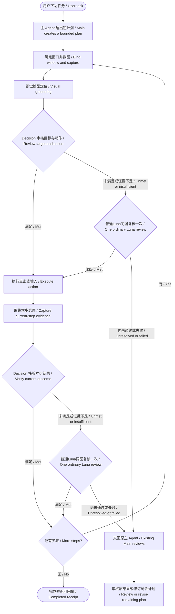

# Agent Review Instant

## 0.1.3 执行正式版 / Execution stable

执行正式版为**0.1.3**，已完成隔离包、Main安装验收及Sol独立验收；学习工作台保持**0.1.0-preview.3**。 / Execution stable is**0.1.3**, with package, Main installed and independent Sol acceptance completed. The optional learning workbench stays at**0.1.0-preview.3**.

- 同次截图复用、同会话预装计划、HTTP连接保留；两轮少10次外层重复采图。安装版Bing→搜索Rust文档→首个普通结果实测**30.809秒／27.354秒，合计41,097 API tokens**，两轮无Main接管。 / Observation sharing and preloaded same-session execution completed the scoped task twice without Main handoff.
- 模型误拒时仍由**Decision→普通Luna→原主Agent**兜底；已实测绑定原证据审核、显式续行、不重复已完成点击及正常收尾。Sol另用Python itertools搜索验证同会话两轮，含一次Main角色辅助。 / Bound review and explicit continuation were tested, including independent assisted recovery; perfect model judgment is not required.
- 真实截图benchmark：39张原图、30场景族、254项AI复核标注；保留集三分类一致率**92.5%→95.0%**，输入token少**1.64%**，通过／不通过准确率仍95%。两级最终149/160，误放仍是已知缺陷，不宣称通用准确率、整步提速或安全收益。 / The frozen benchmark shows limited exact-label/token gains; binary routing is unchanged and cascade errors remain.
- API路线不强制本地模型权重；本地、当前Agent和外部视觉API入口继续保留。新Luna协议由Runtime绑定请求/截图身份，保留严格坐标与新鲜度检查。 / Local weights remain optional for API use; runtime-owned provenance avoids model ID transcription without weakening action gates.

[完整流程计时与验收 / Flow evidence](docs/verification/EXECUTION_SPEED_20261015.md) · [Benchmark口径与限制 / Benchmark method](docs/verification/DECISION_PROMPT_BENCHMARK_20261015.md)

<details>
<summary>历史开发检查点（不代表当前验收状态） / Historical checkpoints</summary>

**当前源码实测 / Current source live result:** 新协议源码在同一会话完成两轮 Bing→搜索`Rust standard library collections documentation`→首个普通结果，**33.218秒／30.549秒，两轮41,173 tokens**；6步完成，20次Decision、6次定位、0次普通复核，少10次外层重复采图，正常关窗和宿主收尾通过。另一批请求中取消通过；Bing菜单实际已打开，但两层模型均误拒，流程按设计交Main，首批Main核图后取消并正常收尾；随后独立新批已实测**原证据审核→显式继续原会话→地址栏进入Google→正常收尾**，菜单只点击一次。按用户最新确认，保留模型误拒，由原主Agent兜底，不要求模型每次正确、不为此调阈值或刷通过。新包和同冻结候选独立验收仍待完成，正式版仍0.1.2，学习版不变。 / Runtime-bound source completed two continuous Bing-to-Rust-documentation rounds in 33.218s/30.549s using41,173 tokens total, with20 primary decisions,6 groundings and no ordinary reviews. Ten duplicate outer captures were removed; normal cleanup passed. A separate cancellation passed, but both judges rejected a visibly open Bing menu and correctly handed off to Main. Main cancelled and cleaned up the first batch. A fresh follow-up passed bound Main review, explicit same-run continuation to Google and normal cleanup, without repeating the menu click. The user accepts Main as the backstop for model errors; perfect automatic judgment is not a release prerequisite. Rebuilt-package and independent acceptance remain pending. [证据与限制 / Evidence and limits](docs/verification/EXECUTION_SPEED_20261015.md).

**此前协议修复检查点 / Earlier protocol-fix checkpoint:** 一次历史图诊断复现了Luna抄错请求ID（`…92ab…`→`…92eb…`），导致目标已定位仍被拒。现增加显式`response_binding="runtime"`：维护Luna示例由Runtime绑定原请求/截图身份，模型不生成这两个ID；旧协议仍严格拒绝错ID。失败诊断补齐，172项相关离线检查通过，同图新协议一次真实API返回有效定位，**尚未重做新源码的连续桌面、取消恢复或新包验收**。以下candidate01耗时是旧冻结候选数据；Decision benchmark、阈值及正式0.1.2未改。 / A recorded-image probe reproduced an echoed request-ID typo. Explicit runtime binding now owns request/capture IDs while the legacy contract remains strict. Diagnostic and binding regressions passed172 checks; one read-only API probe returned valid grounding. Current source has not passed fresh desktop/installer acceptance. Candidate01 timings below remain historical frozen evidence. [协议与诊断 / Protocol and diagnostics](docs/development/EXTERNAL_VISION_API.md).

**冻结候选01检查点 / Frozen candidate01 checkpoint:** 源码与安装候选均完成同会话两轮 DuckDuckGo→搜索`Python decimal documentation`→首个普通结果；源码 **31.476／32.214秒、41,806 tokens**，安装候选 **35.388／30.563秒、41,948 tokens**（每组两轮合计）。安装候选每组20次Decision、6次定位、0次普通复核，少10次外层重复采图。取消原请求、正常关窗和测试卸载通过；但Edge菜单恢复被两层拒绝，Bing菜单定位结果合同校验失败，**恢复验收未通过，独立桌面验收未跑，尚未发布**。正确输入被误拒的Google首败也保留。不同任务不能作旧版受控提速比较；正式下载仍为0.1.2，学习版不变。 / Source and installed candidates completed the scoped two-round task in31.476s/32.214s and35.388s/30.563s respectively, using41,806 and41,948 tokens per pair. Cancellation and normal cleanup passed, but menu recovery failed; independent desktop acceptance has not run. This is an unreleased candidate, not a general reliability or controlled speedup claim. [完整结果与限制 / Results and limits](docs/verification/EXECUTION_SPEED_20261015.md).

**2026-10-15 未发布0.1.3候选 / Unreleased0.1.3 candidate:** 历史04正常流程及06取消恢复检查完成后，按冻结的训练／验证／保留集比较提示词；最终0.1.3恢复验收状态见上。80个保留案例、每例两次，Decision三分类符合标签的比例从148/160（92.5%）到152/160（95.0%），输入token少1.64%；但两组误放和误拒均各4次，通过／不通过准确率均95%。改善来自“不满足”与“证据不足”的区分，**未证明减少Main介入或整步提速**。仅收敛页面结果与输入内容问句；图形、输入框定位问句及阈值不变。 / Historical pipeline checks preceded frozen train/validation/held-out evaluation; final-candidate recovery remains incomplete. Exact three-class agreement improved from92.5% to95.0%, with1.64% fewer input tokens, while binary routing accuracy stayed unchanged. This does not establish fewer Main handoffs or faster actions.

普通Luna复核另外实测164次。当前问句组纠正4次误拒中的3次，同时新增3次误放；最终7次误放、1次误拒，三分类149/160（93.125%）。二层不是准确率或安全性的保证，第一层误放仍跳过复核。标签为AI初标与Main AI复核，不能当作人工标注或通用准确率；正式安装版仍为0.1.2，候选尚未发布。 / A separate164-request secondary evaluation corrected three of four false rejections in the new-prompt group but introduced three false accepts; final exact agreement was149/160, with seven false accepts and one false rejection. Review is not an accuracy or safety guarantee. Labels are AI-reviewed; the published installer remains0.1.2. [评测口径与限制 / Method and limits](docs/verification/DECISION_PROMPT_BENCHMARK_20261015.md) · [同阶段观察复用 / Same-phase observation sharing](docs/development/SETTLED_OBSERVATION.md).

**以下为历史检查点，不代表当前发布状态。 / The following entries are historical checkpoints, not current release status.**

**2026-10-15 最新流程优化 / Latest pipeline update:** 正常流程在04候选中连续完成 Google→搜索`python json`→首个普通结果，分别 **37.647秒、26.325秒**，无Main接管；同次前图复用共省10次外层采图，BGRA解码及60秒连接保留已落地。随后修复“派发前取消被组合输入误记为未知”：Main451项相关检查通过，06冻结源码实测取消原请求→同会话打开菜单→地址栏进入Google两步完成，原取消零输入，窗口和宿主正常关闭。04与06相差这4个取消处理源文件；旧失败保留。这些是限定场景证据，任务／视口不同，不能宣称通用稳定性或受控提速比例。benchmark付费比较仍后置，版本号与安装包未更新。 / The04 candidate completed two fresh continuous Google-to-Python-documentation rounds in37.647s and26.325s without Main intervention and removed10 duplicate outer captures. A subsequent four-file cancellation fix passed451 Main checks; frozen06 passed request-phase cancellation and same-session menu/navigation with normal cleanup. Initial failures remain recorded. These scoped results are not a general reliability or controlled speedup claim; benchmark evaluation and release packaging remain pending. [完整证据 / Evidence](docs/verification/EXECUTION_SPEED_20261015.md).

下面同日较早记录是历史检查点，以本条最新两轮结果为准。 / Earlier same-day entries below are historical checkpoints.

**2026-10-15 流程提速开发中 / Pipeline optimization in progress:** 纯视觉步骤合并重复即时诊断与最终观察，调用方预装完整计划并在同一连接连续执行；保留新鲜证据、Decision→普通Luna→Main及原跳转等待。宽输入框增加点击处细节视图，窗口枚举可跳过已消失的单个句柄。Main新增关联回归245项通过。新Google→搜索python pathlib→打开Python文档首轮自动完成44.908秒；第二轮在输入前被两层拒绝，已取消并正常收尾，故连续验收仍未通过，也不能把不同任务与旧Java任务作受控提速比较。原浏览器资料保留，安装包未更新；先优化流程，再做大样本benchmark。 / Observation consolidation and a preloaded same-session caller reduce redundant work while preserving review and freshness gates. A fresh pathlib flow completed in44.908s; round two required review before input and was cancelled with normal cleanup. Continuous acceptance and controlled speed gains remain unproven. [实测与限制 / Evidence and limits](docs/verification/EXECUTION_SPEED_20261015.md).

**2026-10-15 最新完整实测 / Latest full live check:** 修复后Google→搜索java→打开首个普通结果Java官网，三步首次完成，无Main接管；两次普通Luna纠正地址栏误拒，无超时。自动计划53.5秒；窗口就绪至最终截图93.1秒，含初始核对及调度。沿用原独立Edge资料，未清理缓存；单轮不代表连续稳定或安装包已更新。 / One complete Google-to-Java flow passed automatically with two successful secondary corrections. Plan53.5s; window-ready to final capture93.1s including caller inspection/orchestration. Browser data retained; one pass is not continuous acceptance. [原始计时、用量与收尾 / Evidence and limits](docs/verification/GOOGLE_JAVA_FIXED_20261015.md).

**2026-10-15 最新未发布源码：短提示词＋独立复核时限 / Latest unreleased source: short questions and separate review timing.** 当前目标仍按原动作只核对“图形/按钮是否符合目标”或“点是否在指定输入框内”；简短单问在选型样本9/12、保留集8/8，旧提示词分别3/12、6/8，响应约0.23秒，20次配对请求输入token约少4.4%。样本只有4组截图，不宣称通用准确率。普通Luna改为独立12秒额度、主层8秒，仍受原整步截止约束；真实3次复核均在2.37–2.60秒返回，但最难地址栏图仍被两层误拒并交Main。相关Main回归368项通过，裁剪、阈值及安装包未改。 / Short instructions outperform the prior wording on this small fixed selection/held-out sample. Separate review timing prevents primary-budget starvation, while unresolved cases still return to Main. General accuracy is unproven; released installers are unchanged. [当前逻辑 / Current flow](docs/development/TARGET_CHECK.md) · [提示词对照 / Prompt comparison](docs/verification/TARGET_CHECK_PROMPT_20261014.md) · [时限修复 / Deadline repair](docs/verification/ORDINARY_REVIEW_TIMEOUT_20261014.md) · [此前完整实测 / Earlier live flow](docs/verification/TARGET_CHECK_LIVE_20261014.md).

以下同日身份分类与实测记录为此前方案的历史，不能替代上述新逻辑的验收。 / The same-day identity-classification records below are historical, not acceptance of the revised route.

**2026-10-14 源码实机检查 / Source live check:** 直接身份分类已在同一 Edge 窗口连续完成两轮“搜索→打开官方文档”，整轮约34.5秒、25.3秒，无 Main 接管；只读错目标反例经 Decision 与普通 Luna 双重识别后返回审核。179项相关离线通过，扩展回归仍有8项失败；未更新安装包，不宣称通用准确率或旧版速度收益。 / Two consecutive real documentation flows completed without Main handoff; a wrong-target replay traversed both models and required review. Focused checks passed179; eight broader failures remain. No installer update or general accuracy/speedup claim. [完整计时、用量与限制 / Timings, usage and limits](docs/verification/TARGET_IDENTITY_LIVE_20261014.md).

**2026-10-14 未发布：直接识别控件身份 / Unreleased: direct target identity.** 新 v3 计划可声明具体身份选项；Decision 识别标记处控件，本地比对期望身份。不符合或无法识别时，普通 Luna 用同一问题和标图复核，通过续行，否则返回原 Main。期望答案不上传，两层原始结果分别保留；旧计划、发布安装包不自动变更。 / New v3 plans can classify concrete target identities, compare locally and invoke one ordinary Luna review on mismatch/unknown. Expected identity stays local; legacy plans and installed releases are unchanged. [接入与边界 / Integration and limits](docs/development/TARGET_IDENTITY_REVIEW.md). 受控二选一复测三组均10/10，但只有两张图片，不能证明通用准确率提升。 / All three controlled groups scored10/10 on two images, not general GUI accuracy. [受控复测 / Controlled rerun](docs/verification/SYMBOL_CASCADE_CONTROLLED_20261014.md).

实验口径补充 / Experiment qualification: 两级重放与旧实验问题、上下文不同，且没有自动触发第二层，不能用其分数判断两级总体效果；原始记录不变。 / The replay is not a controlled comparison and did not traverse stage two; its scores do not establish general cascade efficacy. [复核说明 / Audit](docs/verification/DECISION_CASCADE_AUDIT_20261014.md).

**2026-10-14 两级实测限制 / Live cascade limitation:** 同两张「＋/×」图各5次，自动路线正确5/10，第一层全部通过、第二层触发0次；同新提示词普通 Luna 的独立诊断正确2/10。**未证明准确率提升。** 已修复普通响应合法 `phase: final_answer` 被适配器误拒的问题，误放防护仍按要求暂缓。 / The two-image replay scored 5/10 with zero secondary calls; separate ordinary Luna diagnostics scored 2/10. Accuracy improvement is unproven. A legal response-phase parsing defect was fixed; false-accept protection remains deferred. [完整计时、token 与首败记录 / Timings, tokens and initial failure](docs/verification/DECISION_CASCADE_REPLAY_20261014.md).

**2026-10-14 未发布：图形优先＋两级审核 / Unreleased: visual-first two-stage review.** 新 Choice 示例配置启用 `ordinary_review: "on_reject"`：Decision 先识别标记中心的实际图形/控件；满足条件直接继续，不满足或证据不足时，用普通 Luna 对同一截图证据复核一次。以第二层选择为最终模型结论，仍不满足或不确定则携带两层证据交回原主 Agent。两次请求共用预算和总时限，认证回读不重派。**已知缺陷：Decision 误放会跳过第二层，本轮暂不修复。** 源码与离线检查不代表安装版、实机速度或准确率已更新；旧冻结配置不自动迁移。 / New Choice example profiles enable one ordinary Luna review of the same evidence after a valid negative/uncertain Decision choice; the second choice controls the model outcome, with unresolved cases handed to the existing Main. Both requests share a cap and deadline; authenticated replay never resends. **Known defect: a false pass from Decision bypasses review.** Existing frozen profiles and released installers are unchanged. See [design, configuration and limits / 设计、配置与限制](docs/development/DECISION_LUNA_REVIEW.md).

**2026-10-14 未发布源码修复 / Unreleased source repair:** 当前 `task_plan_run.caller_controls` 提供审核参数（只需调用方补 `verdict`、`reason`）及成功审核后的独立续行参数。缺失、未知和允许字段会明确列出；原证据、当前审核包及输入门禁保持原校验。离线协议回归不代表安装版或实机验收已更新。 / Task-plan status now projects exact review bindings and, after successful caller review, a separate explicit continue request. Field rejection names missing, unknown and allowed keys. Existing evidence, packet and input checks remain; offline checks do not update installed or live acceptance. See [caller contract](docs/development/TASK_PLAN.md#caller-control-parameters--调用方控制参数).

**What happens when a decision model meets computer use? / 当决策模型遇到 Computer Use，会发生什么？**

A simple browser task—open a website, search, follow a result—once took minutes in our tests. Preparation, grounding and repeated handoffs all contributed to the wait. In **Agent Review Instant 0.1.2**, we connected **OpenAI’s Decisions API** to the Windows runtime and gave it a focused job: check the current target or the result of the current step.

Main supplies a short plan. A vision model locates the target. The runtime acts. Decision checks the evidence. **Satisfied steps continue in the same session; unmet or unclear conditions return to the existing main agent.** Cropped target images and click annotations keep each check focused on the relevant evidence. The execution component installs independently; the learning workbench is optional.

一个打开网站、搜索、进入结果的简单任务，曾在我们的测试中耗时数分钟：准备、定位和反复交接都增加了等待。**0.1.2 将 OpenAI Decisions API 接入 Windows 运行时，专注判断当前目标或当前步骤的结果。** 主 Agent 给出短计划，视觉模型定位，运行时操作，Decision 核验证据。满足条件就在同一会话继续，未满足或证据不足才交回原主 Agent；裁剪与点击标注让审核聚焦相关证据。执行组件独立安装，学习工作台可选。

</details>

## 本次正式版 / This stable release

**执行组件 0.1.3 正式版。** [下载执行安装器](https://github.com/Desolate-Jix/agent-gui-runtime/releases/download/instant-v0.1.3/AgentGUIRuntimeExecution-Setup.exe) · [发行页与校验文件](https://github.com/Desolate-Jix/agent-gui-runtime/releases/tag/instant-v0.1.3) · [验证记录](docs/verification/EXECUTION_SPEED_20261015.md)。学习工作台保持 **0.1.0-preview.3**，本次不更新学习安装器。此前版本见[发行列表](https://github.com/Desolate-Jix/agent-gui-runtime/releases)。

**Execution 0.1.3 stable.** Scoped installed continuity passed; Main and independent Sol also verified evidence-bound assisted recovery without repeating completed actions. The optional learning workbench stays at **0.1.0-preview.3**; its installer is unchanged.

### Decisions API 与两级复核 / Decisions API and two-stage review

本版延续 OpenAI [Decisions API](https://developers.openai.com/api/docs/guides/decisions)，使用 **GPT-6 Luna（`gpt-6-luna`）的 Choice 能力**，根据当前步骤的截图证据直接选择继续或交回主 Agent。官方文档截至 2026-10-12 仍将该 API 标为 public beta；项目正式版不代表上游 API 已正式商用发布。

The integration uses **GPT-6 Luna through OpenAI Decisions API**, with **Choice** decisions over current-step image evidence and one ordinary Luna review on nonpass; unresolved cases return to the existing Main. The upstream API remains in public beta as of 2026-10-12.

| Choice 结果 / Result | 执行行为 / Runtime behavior |
|---|---|
| `condition_met` | 满足当前条件，继续原计划 / Continue the existing plan |
| `condition_not_met` | 普通Luna同证据复核一次；仍未通过再交原主Agent / One ordinary Luna review, then Main if unresolved |
| `evidence_insufficient` | 普通Luna同证据复核一次；仍不确定再交原主Agent / One ordinary Luna review, then Main if still unclear |

每个审核点使用一个三选一问题，不是整个任务只调用一次 API。Choice 的概率和置信度用于诊断，不再叠加旧概率阈值进行第二次否决。旧 predicate 配置继续按原语义工作。详见 [Choice 合同](docs/development/DECISION_CHOICE.md)。

Each checkpoint uses one three-way question. Probabilities are diagnostic in Choice mode; legacy predicate profiles retain their threshold semantics.

### 能做什么 / What you can do

- **浏览器和桌面操作**：自然语言定位，点击、替换输入、按键与滚动，例如输入网址、搜索内容、打开结果。 / Ground targets, click, replace text, press keys and scroll.
- **减少重复主 Agent 审核**：主 Agent 给出短计划，普通成功步骤由运行时与 Decision 完成闭环，异常交回原会话。 / Run supported short plans with Main intervention for exceptions.
- **聚焦当前目标**：候选Choice用单张概览＋完整目标细节图，让小字可读并保留整页弹层上下文，空心点标记不盖住中心。字段核验裁完整输入框，常规文字图把历史点击标记移到外沿以免遮字，输入后只比规定文字；普通点击结果只问本步结果。截图中局部遮挡退缩时保留原遮罩，遮罩内点禁止执行。完整哈希、身份与坐标认证留在本地。 / Candidate Choice uses one overview/detail image with readable small targets, full-page popup context and hollow marks. Field checks crop complete inputs, move historical-click marks to the margin of normal-size value views to preserve glyphs, and compare requested text; ordinary clicks check the current result. Receding occlusion retains its original mask, whose points cannot be dispatched. Full hash, identity and coordinate authentication remains local.
- **变化交给当前审核**：定位期间目标外观变化时，可用的 Choice 用当前标点图审核原点位，不再先被旧像素比例拦截；未通过认证不会输入，无可用 Choice 仍保留旧检查。 / Eligible Choice reviews a changed target on the current marked image through its existing request; authenticated approval remains required before dispatch.
- **默认视觉执行**：普通执行不依赖 UIA 整树或字段扫描；UIA 保留给学习与显式原生路线。 / Default execution is visual; UIA remains optional for native and learning routes.
- **录屏兼容**：精确匹配 NVIDIA 透明录屏覆盖窗，避免矩形遮挡误报；保留真实像素、点位命中和 Decision 审核。 / A narrow NVIDIA overlay exemption retains real hit tests and visual evidence; it does not allow arbitrary recording panels.

**Acceptance rule:** a new end-to-end flow must pass on its first complete attempt. After a failure, retain the original evidence, repair and run targeted regression, then evaluate a different fresh flow. A successful rerun does not erase the first failure.

**验收标准：新流程首次完整运行无错误才计通过。** 首败保留，修复并做针对性回归后改用不同新流程；旧流程复测成功不能改记首次通过。

## 执行流程 / Execution flow

以下为0.1.3正式版的两层审核流程。旧安装包不会随源码自动升级，以实际安装版本为准。 / This diagram describes the0.1.3 two-stage review. Existing installations require an explicit upgrade.



当前源码的普通视觉输入为：**定位审核通过 → 连续点击、Ctrl+A、替换文字 → 仅核对规定内容 → 复用字段位置审核点击 → 点击后立即 Enter**。不检查空框或焦点，连续动作内部不插入截图或模型调用。详见[视觉输入说明](docs/development/VISUAL_EXECUTION_INPUT.md)。

The visual input path binds click/select-all/replacement, checks the requested value, then reuses verified field geometry for a fresh point review and click→Enter. No extra grounding, focus inference or intervening capture is added inside the compound actions.

## What has improved, and what remains / 已有进展与后续方向

The latest fresh task was **DuckDuckGo → search “NumPy ndarray documentation” → open the first matching official NumPy result**. Main submitted the plan once. The runtime, Luna grounding and Decision completed two rounds in the same window/session without Main repair or automatic retry. Zero-input cancellation and normal window/host cleanup passed; the independent test browser profile and cache were retained.

最新完整任务是 **DuckDuckGo → 搜索“NumPy ndarray documentation” → 打开首个匹配的 NumPy 官方结果**。主 Agent 一次提交计划，运行时、Luna 定位与 Decision 在同一窗口/会话完成两轮，无主 Agent 修补或自动重试；零输入取消和正常关闭通过，独立浏览器资料与缓存保留。

| Acceptance / 验收 | Result / 结果 |
|---|---|
| Main, source / 源码 | Two rounds + cancellation + cleanup passed / 两轮、取消、收尾通过 |
| Main, installed / 安装版 | Two rounds + cancellation + cleanup passed / 两轮、取消、收尾通过 |
| Independent Sol, same installed candidate / 同候选独立复验 | Two rounds + cancellation + cleanup passed / 两轮、取消、收尾通过 |

This demonstrates that supported ordinary steps can run without a Main-agent round trip at every action. It is a scoped acceptance result, not a claim of universal accuracy. Earlier failed attempts are retained separately in the [release record](docs/verification/EXECUTION_STABLE_012_20261012.md).

这些结果验证了受支持的普通步骤可以连续执行，减少逐步回到主 Agent 的等待；它们不是通用准确率证明。此前首败单独保留，不用复测成功覆盖。

### 0.1.2 action-stage evidence / 0.1.2 历史整步耗时与 token 用量

以下为0.1.2历史流程；0.1.3两轮整计划数据见页首，任务不同不能计算受控提速比例。 / These are0.1.2 historical flows; current plan times appear above and are not controlled old-version comparisons.

These are the recorded action-stage durations from the **two installed Main runs**, rather than API response times:

以下是**安装版 Main 连续两轮**记录的动作阶段耗时，而非单次 API 响应时间：

| Action stage / 动作阶段 | Recorded range / 实测范围 |
|---|---|
| Locate the address field → replace the URL → press Enter → capture the page / 定位地址栏 → 替换网址 → Enter → 页面截图 | **9.2–9.5 s / 秒** |
| Locate the search field → enter the query → submit → capture the results / 定位搜索框 → 输入查询 → 提交 → 结果截图 | **9.1–10.1 s / 秒** |

The durations include grounding, the input sequence and post-action capture. **Final page-result verification is additional; these are not full-task totals.** There is no matching successful baseline from the previous version, so we cannot yet claim how many seconds each action saved or a percentage speedup. Exact per-round measurements and the timing boundary are in the [release verification record](docs/verification/EXECUTION_STABLE_012_20261012.md).

计时包含定位、输入序列和操作后截图，**最终页面结果审核另计，不是完整任务总耗时**。目前没有同口径、成功完成的旧版基线，因此不宣称每步缩短多少秒或提升多少百分比；逐轮原始数值与计时边界见验证记录。

The two-round installed Main acceptance, including cancellation verification, used **20 Decision requests and 22,930 Decision input tokens**, plus **7 separate visual-grounding requests**. Grounding token usage is additional. These are measured usage totals, not token savings against an older release; HTTP-only timings remain in the verification record.

安装版 Main 两轮验收（含取消检查）使用 **20 次 Decision 请求、22,930 个 Decision 输入 token**，另有 **7 次视觉定位请求**，定位 token 另计。这是实际用量，不是相对旧版节省的 token；单请求 HTTP 计时保留在验证记录中。

The usage changes are deliberately focused: candidate review receives one overview/detail marked image; text verification receives a complete enlarged input crop, with historical-click ticks moved outside the text in normal-size value views. One checkpoint asks one current-step Choice. Target wording distinguishes “first matching” from “first overall”; workflow controls and later results stay outside that target. Full source/coordinate/receipt authentication remains local.

用法优化集中在证据：目标审核用一张概览＋细节标注图，输入核验用完整放大的字段裁剪，常规尺寸的文字图将历史点击刻度移到文字外侧。每个审核点只问一个本步问题，明确“首个匹配”和“整体第一”的区别，流程控制与后续结果另放；完整来源、坐标和回执仍在本地认证。

On a fixed 19-request field diagnostic, all 16 ordinary positive/counterexamples were correct and all three gray-completion cases returned to Main; exact predeclared labels matched18/19. HTTP times were123–197ms at374–594 input tokens. This small selected-image result does not establish general accuracy. Simply shortening prompts or uploading larger images did not consistently improve later candidate judgments; rejected variants and limitations are recorded in the [target-usage diagnosis](docs/verification/DECISION_TARGET_USAGE_20261013.md).

固定19次字段诊断中，16个普通正反例全部正确，3个灰色补全样本全部转Main；精确预设标签符合18/19，HTTP123–197毫秒、374–594输入token。该小样本不代表通用准确率。后来候选诊断显示，单纯缩短提示词或增加全图并非稳定改进，失败方案和限制均保留。

The next goal is broader real-task coverage and a consistent before-and-after benchmark, with fewer repeated planning and judgment calls. The optional learning workbench can preserve recurring work as workflows people review and edit, while Decision checks changing evidence. Neither component promises unattended completion of arbitrary tasks.

后续目标是覆盖更多真实任务，建立同口径的新旧版本对照，并减少重复规划和审核。可选学习工作台将重复工作保存为可审核、可修改的流程，Decision检查每次变化的证据；当前不承诺任意任务无人干预完成。

## 模型选择：本地模型不是必需品 / Local models are optional

**视觉定位与 Decision 判断是独立角色**：Luna 视觉 API 负责“点哪里”；Decisions API 负责“当前条件是否满足”。也可以由本地 VISTA 或图像 Agent 定位，按需启用 Decision。

**Grounding and judgment are separate.** Decision does not generate coordinates or replace the planner.

| 视觉来源 / Grounding | 本地权重 / Local weights | 所需配置 / Setup |
|---|---|---|
| 外部视觉 API / `external_api` | 不需要 / No | 图像端点、模型 ID、密钥环境变量 / Endpoint, model ID, key environment variable |
| 当前 Agent / `agent_current` | 不需要 / No | 支持图像的客户端 / Image-capable client |
| 视觉子 Agent / `agent_delegate` | 不需要 / No | 客户端指定并复用的视觉会话 / Explicit reusable visual delegate |
| 本地 VISTA / `local` | 需要 / Yes | 本地依赖与 VISTA-4B / Local dependencies and weights |

不配置 Decision 时不会调用判断 API；可使用基础单步、v1/v2 兼容计划，或显式 `field_evidence_mode="legacy"` 的原生组合输入，由主 Agent 审核结果。默认视觉组合输入要求 Decision auto 可用，缺失时会在输入前拒绝，不会自动切换路线。API 路线需要本机 Windows 执行框架，但不需要下载本地视觉模型或使用本地 GPU。服务商按实际 API 使用计费。

Without Decision, use basic actions, compatible v1/v2 plans or explicit legacy/native input sequences with Main review. Default visual sequences require an available auto-mode Decision service and reject before input if unavailable; there is no implicit route switch. API grounding needs the local runtime, but no local vision weights or GPU.

## 安装与配置 / Install and configure

要求 Windows x64、Python 3.11 和 [uv](https://docs.astral.sh/uv/getting-started/installation/)。执行安装器提供维护源码与配置入口；首次配置按所选路线安装依赖，不附带模型权重或密钥。以下路径请按安装位置修改。

为兼容既有执行组件升级，安装目录与快捷方式可保留历史 Preview 名称；产品版本、安装窗口和卸载条目使用正式版名称。 / The historical Preview folder/shortcut name is retained for upgrade compatibility; the installed version and product display name identify the stable release.

Requires Windows x64, Python 3.11 and uv. The installer supplies the runtime and setup scripts; first-time setup installs selected dependencies. Model weights and API keys are not bundled.

### 外部 Luna 视觉 API + Decision Choice

1. 安装执行组件，将 [Luna 视觉配置](configs/vision-api-openai-luna.example.json)和 [Decision Choice 配置](configs/decision-profile.visual-execution.example.json)复制到自己的配置目录。 / Install execution and copy the example profiles.
2. 让启动 MCP 的进程继承 `OPENAI_API_KEY`，不要把密钥写进配置 JSON、聊天或日志。 / Supply the key through the MCP process environment.
3. 在安装目录运行以下两条命令，先装轻量依赖，再生成同时含视觉和 Decision 的配置。 / Install lightweight dependencies, then generate the combined configuration:

```powershell
.\scripts\setup_instant.ps1 -RecognitionSource external_api -ApiProfile "D:\AgentReviewConfig\vision-api.json" -DataDirectory "D:\AgentReviewInstantData"
.\.venv-agent\Scripts\python.exe .\scripts\configure_instant_mcp.py --python "$PWD\.venv-agent\Scripts\python.exe" --recognition-source external_api --api-profile "D:\AgentReviewConfig\vision-api.json" --decision-profile "D:\AgentReviewConfig\decision.json" --data-dir "D:\AgentReviewInstantData" --enable-local-input
```

将生成的 `mcp-config.local.json` 或 `.toml` 中 `agent-review-instant` 条目合并到客户端，保留其他服务器，然后重新连接。上述最终配置使用普通权限宿主；管理员应用的提权配置见[安装指南](FRIEND_SETUP.md)。配置生成不会发送 API 请求。

Merge the generated server entry into your client and reconnect. The final command configures the ordinary host; use the setup guide for elevated applications. Configuration generation makes no API request.

### 当前 Agent 或本地模型 / Agent or local grounding

```powershell
# 图像 Agent，无本地权重 / Image-capable agent, no local weights
.\scripts\setup_instant.ps1 -RecognitionSource agent_current -DataDirectory "D:\AgentReviewInstantData"

# 本地 VISTA，先查看准备范围 / Local VISTA, preview setup first
.\scripts\setup_instant.ps1 -RecognitionSource local -ModelDirectory "D:\AgentReviewModels\VISTA-4B" -DataDirectory "D:\AgentReviewInstantData" -DownloadModel -WhatIf
```

选择本地路线后去掉 `-WhatIf` 执行准备。本地使用官方 [VISTA-4B](https://huggingface.co/inclusionAI/VISTA-4B) Transformers 权重，硬件规划仅适用于本地路线。详见[安装指南](FRIEND_SETUP.md)和[外部视觉 API](docs/development/EXTERNAL_VISION_API.md)。

## Agent 接入 / Agent integration

MCP stdio 提供七个核心工具：`instant_start`、`instant_status`、`instant_run`、`instant_submit`、`instant_result`、`instant_image`、`instant_stop`，另有 `instant_recovery_preview` 与 `instant_recover_session` 两个恢复工具。

保持同一会话和单一桌面输入所有者。支持单步、组合输入与 1–8 步线性计划。等待到期不等于取消，应查询原请求 ID，不要重新发送已执行的输入。

Use one persistent session and one input owner. Submit a single action, input sequence or supported 1–8 step plan. Poll the original ID after wait expiry; do not replay input. See [Agent guide](AGENT_GUIDE.md), [task plans](docs/development/TASK_PLAN.md) and [Decision configuration](docs/development/DECISION_API.md).

## Earlier evidence and limits / 早期证据与边界

- 本次开发早期的源码复测在保留的独立 Edge 资料目录中自动完成 **Google 网址 → 搜索 java → 首个普通链接**，到达 Java 官网，**3/3 步、零主 Agent 接管**，测试窗口与宿主正常关闭。 / An earlier source rerun completed all three steps automatically, with no Main takeover and normal cleanup.
- NVIDIA 覆盖窗白名单实际生效，缓存保留。首轮漏接失败及用户关闭窗口的中断分别保留，不把复测改记为首次成功。 / Overlay handling was exercised; first failures and manual interruption remain recorded.
- 默认替换离线回归 **591 项通过**，白名单与门禁回归 **237 项通过**。两组有重叠，不相加为独立用例。新安装与连续验收另见[发布记录](docs/verification/EXECUTION_STABLE_012_20261012.md)。 / Overlapping source checks are separate from installed acceptance.
- 不宣称通用准确率、全流程加速倍数或长期稳定性。单轮成功不代表所有网站都可自动完成；API、网络、页面变化与接管仍影响响应时间。 / No general accuracy or end-to-end speed multiplier is claimed.

[白名单实测](docs/verification/RECORDING_OVERLAY_ALLOWLIST_20261012.md) · [默认替换回归](docs/verification/DEFAULT_REPLACE_20261012.md) · [历史开发记录](https://github.com/Desolate-Jix/agent-gui-runtime/blob/main/docs/verification/EXECUTION_DEVELOPMENT_CHECKPOINTS_20261012.md)

## 可选学习工作台 / Optional learning workbench

学习工作台用于采集、人工审核与修改可复用界面和工作流，独立安装，仍为 [0.1.0-preview.3](https://github.com/Desolate-Jix/agent-gui-runtime/releases/tag/learning-v0.1.0-preview.3)。本次不更新其安装器，也不要求安装学习工作台。

The optional workbench supports capture, human review and editing of reusable interfaces and workflows. Its existing preview remains unchanged. See the [learning quickstart](docs/LEARNING_PREVIEW_QUICKSTART.md).

## 维护结构 / Maintained structure

`app/execution` 协调动作与计划，`app/judgment` 处理 Decision，`app/core` 维护截图与输入，`app/vision` 提供视觉定位。历史 `learning_memory` 模块中仍有执行共享依赖；按实际依赖打包，不按目录名称删除，也不因此安装学习工作台。

Execution, judgment, input and grounding share the maintained runtime. Historically named learning modules may be required shared dependencies; they do not imply a workbench installation.

## License

[ISC License](LICENSE). Dependencies and model weights retain their own licenses.
