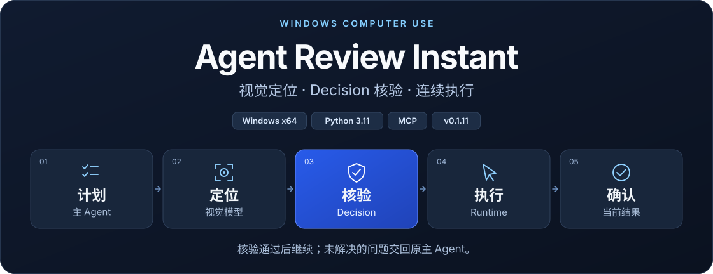
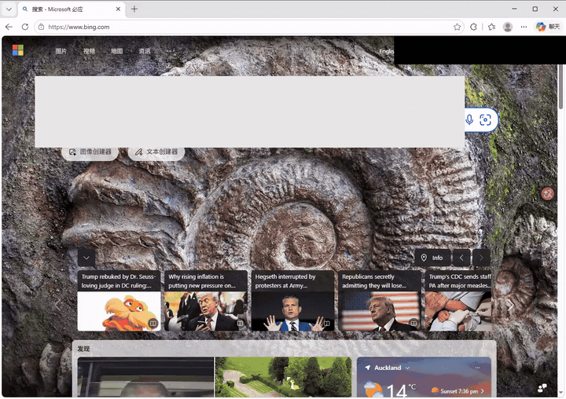
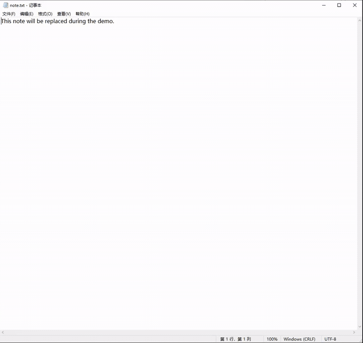
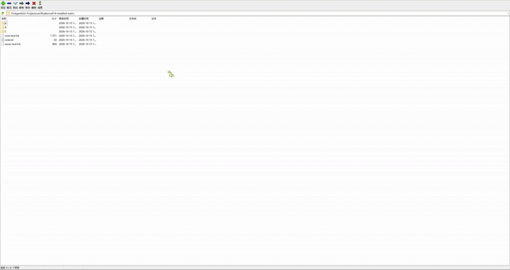

[English](README.md) · **简体中文**

<h1>
  <picture>
    <source media="(max-width: 600px)" srcset="docs/assets/readme-hero.zh-CN.mobile.svg">
    
  </picture>
</h1>

**执行版 0.1.5 — 让你的 AI Agent 连续执行 Windows 桌面任务。**

视觉模型定位目标，Decision 核验当前步骤。 
通过后继续执行；未解决的问题交回原主 Agent。

**[下载执行版 v0.1.5](https://github.com/Desolate-Jix/agent-gui-runtime/releases/download/instant-v0.1.5/AgentGUIRuntimeExecution-Setup-0.1.5-20261017-01.exe)** · [实录演示](#demos) · [快速开始](#quick-start) · [运行架构](#architecture) · [实测表现](#evaluation)

**审核后，继续原输入命令。** 原规划 Agent（Main）可检查已结算的文字输入，明确续行同一命令，不重复输入。[独立验收状态与校验文件 →](https://github.com/Desolate-Jix/agent-gui-runtime/releases/tag/instant-v0.1.5)

Agent Review Instant 是面向 MCP Agent 的 Windows 桌面执行运行时。Agent 给出一份明确的线性计划，它就可以在应用中导航、点击目标、替换文字、按键和滚动。受支持的步骤在同一会话中执行并核验结果，减少每次成功操作后都返回主 Agent 的等待。

**使用外部视觉 API，不需要本地模型权重或 GPU。** 你可以选择外部视觉 API、支持图像的 Agent，或者本地模型。**执行运行时 0.1.5** 可独立安装使用。

## 实录演示（0.1.4）

以下为 **0.1.4** 已发布视频的压缩预览，降低尺寸与帧率，**不加速播放**。浏览器与记事本片剪去了开头等待，GIF 长度不代表性能。[完整视频与真实计划耗时 →](#evaluation)

  

Google URL → 搜索 java → 打开首个普通结果。[完整 MP4](https://github.com/Desolate-Jix/agent-gui-runtime/releases/download/instant-v0.1.4/AgentGUIRuntime-0.1.4-Browser.mp4)

  

编辑便笺 → File → Save。[完整 MP4](https://github.com/Desolate-Jix/agent-gui-runtime/releases/download/instant-v0.1.4/AgentGUIRuntime-0.1.4-Notepad-FullWindow.mp4)

  

导航 A → nested → Up → root → B → bundle.zip。[完整 MP4](https://github.com/Desolate-Jix/agent-gui-runtime/releases/download/instant-v0.1.4/AgentGUIRuntime-0.1.4-7Zip.mp4)

## 能做什么

| 能力 | 实际作用 |
| --- | --- |
| **连续完成一个任务** | 在同一会话中连续执行多步任务，例如打开搜索引擎、输入关键词、进入搜索结果。 |
| **只核验当前步骤** | 从截图定位目标，用裁剪和标注后的证据，让 Decision 检查目标位置或本步是否达到要求。 |
| **交回原 Agent 处理异常** | Decision 未通过时，普通 Luna 对同一证据复核一次。仍未解决则携带证据交回原主 Agent；审核后可明确续行，避免重复已完成动作。 |

## 快速开始

需要 **Windows x64、Python 3.11、[uv](https://docs.astral.sh/uv/getting-started/installation/)** 和支持 MCP 的 Agent。安装器提供源码及配置脚本，首次配置时安装依赖，不附带密钥或模型权重。

1. **[下载安装执行版 0.1.5](https://github.com/Desolate-Jix/agent-gui-runtime/releases/tag/instant-v0.1.5)。** 校验文件及最终包的独立验收状态见该版本发布说明。
2. **选择视觉来源。** 使用外部 Luna + Decision 时，复制[视觉配置](configs/vision-api-openai-luna.example.json)和 [Decision 配置](configs/decision-profile.visual-execution.example.json)，让 MCP 进程能够读取 `OPENAI_API_KEY`。
3. **运行配置脚本，接入 Agent。** 按[安装命令](docs/EXECUTION_GUIDE.zh-CN.md#安装与配置)操作，将生成的 `agent-review-instant` MCP 条目合并到客户端后重新连接，保留其他服务器条目。

| 视觉来源 | 需要本地模型吗？ | 配置入口 |
| --- | --- | --- |
| 外部 API | 不需要 | [API 配置与凭证](docs/development/EXTERNAL_VISION_API.md) |
| 当前 Agent 或持续复用的视觉子 Agent | 不需要 | [Agent 接入](AGENT_GUIDE.md) |
| 本地 VISTA-4B | 需要 | [本地配置](FRIEND_SETUP.md) |

默认视觉组合输入需要 Decision 的 auto 模式可用。不配置 Decision 时，仍可使用基础动作和显式 legacy／原生路线，由主 Agent 核验；运行时不会静默切换路线。所有路线都需要本机 Windows 运行时，API 服务商按实际用量收费。

**0.1.5 的服务配置：** Decision 与普通模型复核均可独立配置接口、模型和密钥环境变量，默认仍为 OpenAI Decisions + 普通 Luna；替换服务须兼容 Decisions／Responses 协议。这些设置首次包含于 2026-10-15 重打包的 0.1.3 安装器。[配置方法与兼容范围 →](docs/development/DECISION_PROVIDERS.zh-CN.md)

**Amadeus／Pi：** 下载 [MCP＋Pi Skill 扩展 0.0.2](https://github.com/Desolate-Jix/agent-gui-runtime/releases/download/instant-v0.1.5/amadeus_agent_gui_runtime-0.0.2-py3-none-any.whl)，按[扩展指南](integrations/amadeus/agent-review-instant/README.zh-CN.md)安装；需要兼容 Host 和既有 Runtime 安装，无需插件商店。

## 工程验证与实测

**0.1.5 同版本更新 — 构建 20261017-01：** Enter 后自适应观察，当前结果复核与下一步只读定位并行。新安装包使用同一冻结载荷完成以下任务：

| 安装态任务 | 第一轮 | 第二轮 | 两轮 API 请求合计 | 两轮已报告 token 合计 |
| --- | ---: | ---: | ---: | ---: |
| 记事本：编辑 → File → Save | **20.744 秒** | **18.191 秒** | 21 | 37,482 |
| Edge：Bing → 搜索 → 维基百科文章 | **27.043 秒** | **27.430 秒** | 27 | 42,111 |
| 7-Zip：目录／预制 ZIP 浏览 | **25.918 秒** | **24.324 秒** | 18 | 47,585 |

**六个计划／18 步均首次自动完成。** Main 验收记事本和 Edge，独立 Sol 验收 7-Zip；原始截图、记事本磁盘内容精确核对及本轮窗口／宿主收尾均通过。表中每轮是包含视觉核验的完整三步计划，耗时不含启动、轮间人工查看和收尾。7-Zip 未测试压缩或解压。

安装态共 **66 次 API：定位 18＋Decision 46＋普通复核 2；127,178 个已报告 token**，无缺失用量。预取消费副本只计一次，不含 Main／工作 Agent 套餐用量；限定场景通过不等于通用成功率。

**真实动作间隔，源码 A → B：** **记事本 5.803→5.597 秒、7-Zip 7.805→7.254 秒、Edge 10.786→9.280 秒**。按相邻逻辑步骤的首次真实鼠标按下统计中位数，每应用／组四个匹配区间。A 已含此前普通点击／SSL 优化，B 再加入 Enter 观察和并行，并非旧安装器与新安装器的直接对照。Edge 的一轮 B 比 A 慢，模型、网络和缓存波动未受控。**尚未达到四秒操作间隔目标。** 模型、提示词及通过规则不变。

**验证：** 395 项相关检查通过；竞态修复后 82 项重叠检查通过，不相加为独立测试数。实测前后 **659 个安装载荷文件哈希**一致；新建隔离 Python 3.11 环境，安装 **45 个锁定 API 路线依赖**，真实功能入口验证通过。[完整测量、源码对照用量与限制 →](docs/verification/EXECUTION_015_REFRESH_20261017.md) · [日期安装包与校验文件 →](https://github.com/Desolate-Jix/agent-gui-runtime/releases/tag/instant-v0.1.5)

**0.1.5 原构建的已安装 Amadeus／Pi 路线：** 两项正常合成记事本任务完成六步、磁盘精确核对与收尾；无 Main 语义接管，外层自纠错仍保留。最终源码回归 **135 项通过**。最终安装包另经独立验收，三步记事本计划首次通过，**27.70 秒／10 次 API 请求**，文件内容与收尾通过。这是单个限定样本，总 token 数未知。[范围与限制 →](docs/verification/AMADEUS_PI_MAIN_REVIEW_20261015.md) · [发布说明与校验文件 →](https://github.com/Desolate-Jix/agent-gui-runtime/releases/tag/instant-v0.1.5)

**0.1.4 历史安装态任务，浏览器之外：** 通过维护的视觉执行路线，在记事本和 7-Zip 中使用全新内容。

| 任务 | 实际结果 | 计划耗时 |
| --- | --- | ---: |
| 记事本第一轮：编辑 → File → Save | 3 步全部自动完成，保存的 UTF-8 alpha 内容完全匹配 | 30.621 秒 |
| 记事本同窗口第二轮 | 3 步全部自动完成，保存的 UTF-8 beta 内容完全匹配 | 22.873 秒 |
| 7-Zip：A → nested → Up → root → B → bundle.zip | 6 步全部自动完成，压缩包内 package 目录可见 | 69.515 秒 |

安装版 12 步全部无 Main 审核完成，一次普通复核自动解决。本轮窗口关闭及宿主收尾通过。独立 Sol 随后完成全新记事本 3 步和 7-Zip 3 步任务，磁盘／原图核对及收尾通过。7-Zip 范围为目录及预制 ZIP 导航，没有测试压缩或解压。

**0.1.4 历史实录演示：** [记事本，完整窗口](https://github.com/Desolate-Jix/agent-gui-runtime/releases/download/instant-v0.1.4/AgentGUIRuntime-0.1.4-Notepad-FullWindow.mp4) · [浏览器](https://github.com/Desolate-Jix/agent-gui-runtime/releases/download/instant-v0.1.4/AgentGUIRuntime-0.1.4-Browser.mp4) · [7-Zip](https://github.com/Desolate-Jix/agent-gui-runtime/releases/download/instant-v0.1.4/AgentGUIRuntime-0.1.4-7Zip.mp4)。新记事本／浏览器片剪掉首次等待，保留首次输入前约 1 秒；后续动作和等待均为 **1× 原速**，无旁白。成片为 **19.8 秒／27.2 秒**，原始完整三步计划耗时为 **28.0 秒／31.4 秒**。[录制范围与剪辑说明 →](docs/verification/DEMO_RECORDING_20261015.md)

另有历史 0.1.4 source02 的 **12 步计划及后续 4 步**证据。非空线性计划不设固定步数上限，预算及证据检查继续有效。此前源码误拒及公共客户端回执上限导致的失败，继续记为失败。[本轮结果、精确计时及失败历史 →](docs/verification/MULTI_APP_EXECUTION_20261015.md) · [长计划回归 →](docs/verification/UNBOUNDED_TASK_PLANS_20261015.md)

**0.1.3 历史浏览器任务：** 安装候选在同一窗口／会话中两轮完成 Bing → Rust collections 文档，耗时 **30.809 秒／27.354 秒**，使用 **41,097 个 API token**，无 Main 接管或普通 Luna 复核。这些是历史指定任务耗时，不构成受控提速比较；token 不含 Main／worker 套餐用量。[计时与恢复证据 →](docs/verification/EXECUTION_SPEED_20261015.md) · [逐操作拆分 →](docs/verification/EXECUTION_OPERATION_TIMINGS_20261015.md)

0.1.3 历史提示词评测包含 **39 张真实界面截图、30 个场景族**。保留集三分类标签一致率由 **92.5% 提升至 95.0%**，Decision 输入 token 减少 **1.64%**。通过／不通过准确率仍为 95%；两级最终结果仍为 149/160，当前提示词下包含 7 次误放和 1 次误拒。标签由 AI 复核，**这些数据不等于通用 GUI 任务成功率**。[查看方法、数据划分与失败案例 →](docs/verification/DECISION_PROMPT_BENCHMARK_20261015.md)

## 如何运行

**用户下达任务 → 主 Agent 给出计划 → 定位 → 核验 → 执行 → 确认结果 → 继续**

视觉模型提供坐标，OpenAI Decisions API 通过 Choice 核验目标或当前步骤的结果。有效通过则继续；未通过时由普通 Luna 复核一次，仍未解决再交回原主 Agent。Decision 不替代主 Agent 规划任务。

运行时将证据绑定到请求、窗口和截图，校验坐标与截图新鲜度。默认执行走视觉路线，UIA 保留为显式原生路线。持续复用同一会话，同一时间仅保留一个桌面输入执行者。

**0.1.3 的改进：** 复用观察结果、预装计划、保留 HTTP 连接，减少重复准备；安装版两轮任务减少了 10 次外层重复截图。主 Agent 可基于绑定证据审核已完成步骤并续行，无需重复该动作。

**0.1.5 — Main 审核：** 已结算文字输入后的双模型非通过判断通过认证后，读取绑定原图，明确继续同一命令，不重复输入。余下提交动作仍保留 fresh-target 与结果核验门禁。旧 live04 在未发布载荷上使用显式 TEST 注入，不是自然误拒或性能结果。[合同 →](docs/development/MAIN_FIELD_REVIEW_RESUME.md) · [验收与限制 →](docs/verification/AMADEUS_PI_MAIN_REVIEW_20261015.md)

[详细执行流程 →](docs/EXECUTION_GUIDE.zh-CN.md#decision-和视觉模型如何配合) · [任务计划协议 →](docs/development/TASK_PLAN.md) · [Choice 协议 →](docs/development/DECISION_CHOICE.md)

## 当前限制

- **自 0.1.4 起的线性计划：** 非空计划不设固定步数上限；唯一步骤 ID、逐步核验、内容大小限制、证据检查、取消和 API／时间预算继续有效。已有 0.1.3 安装在升级前保留构建时协议。[源码验证](docs/verification/UNBOUNDED_TASK_PLANS_20261015.md)

- 模型可能误拒，也可能误放。第一层误放会跳过二次复核，这是已知限制；不承诺任意任务都能无人干预完成。
- 安装器未签名。本次已验证新建隔离 Python 环境；未新增全新机器首次依赖安装及正常注册表／快捷方式集成验收。[发布范围与历史记录](docs/EXECUTION_GUIDE.zh-CN.md#发布边界与历史记录)

## 文档导航

| 开始使用 | 理解架构与接入 |
| --- | --- |
| [安装指南](FRIEND_SETUP.md) | [执行详细指南与完整流程图](docs/EXECUTION_GUIDE.zh-CN.md) |
| [Agent / MCP 指南](AGENT_GUIDE.md) | [Decision API 配置](docs/development/DECISION_API.md) |
| [外部视觉 API](docs/development/EXTERNAL_VISION_API.md) | [视觉文字输入](docs/development/VISUAL_EXECUTION_INPUT.md) |
| [0.1.5 发布说明与校验文件](https://github.com/Desolate-Jix/agent-gui-runtime/releases/tag/instant-v0.1.5) | [0.1.4 历史多应用证据](docs/verification/MULTI_APP_EXECUTION_20261015.md) |

---

[ISC 许可证](LICENSE)。依赖和模型权重遵循各自许可证。横幅为工作流程示意，不是实机录屏。

## 可选 benchmark 数据

[Benchmark 备份](https://github.com/Desolate-Jix/agent-gui-runtime-benchmarks) 保存在独立的**公开仓库**，可按需下载。冻结套件包含 **39 张原图、30 个界面族、254 个标注案例**。数据集图片、标注和原始评测记录不随执行安装器分发，安装时也不会自动下载；需要时单独克隆。
