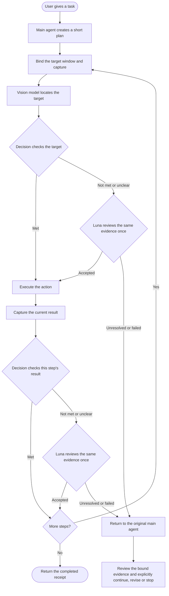

# Execution guide

[Home](../README.md) · [简体中文](EXECUTION_GUIDE.zh-CN.md)

## Windows computer use with focused visual checks

Agent Review Instant lets an MCP-compatible agent operate Windows applications: locate a target from a screenshot, click, replace text, press keys and scroll. The main agent supplies a short plan; the runtime executes supported steps in the same session and checks their results. This avoids returning to the main agent after every successful action.

**Execution 0.1.3 is the current stable release.** The learning workbench is a separate, optional installation and remains at **0.1.0-preview.3**. API-based vision does **not** require local model weights or a local GPU.

[Download the Windows execution installer](https://github.com/Desolate-Jix/agent-gui-runtime/releases/download/instant-v0.1.3/AgentGUIRuntimeExecution-Setup.exe) · [Release notes and checksums](https://github.com/Desolate-Jix/agent-gui-runtime/releases/tag/instant-v0.1.3)

**Source update (version remains 0.1.3):** Decision and secondary review can be configured independently through `--decision-profile`, with the existing defaults preserved. The 2026-10-15 rebuilt 0.1.3 installer includes these settings; reinstall to update an existing installation. See [provider configuration](development/DECISION_PROVIDERS.md) for the complete example, protocol requirements and session-restart behavior. The flow below describes the default OpenAI/Luna setup; compatible replacements occupy the same two roles.

## How Decision and the vision model work together

The vision model answers **“Where should the action happen?”** OpenAI's [Decisions API](https://developers.openai.com/api/docs/guides/decisions), using GPT-6 Luna (`gpt-6-luna`) in Choice mode, answers **“Is this target or this step's result correct?”** Decision does not generate coordinates or replace the main agent's planner.

| Choice result | What happens next |
| --- | --- |
| `condition_met` | Continue the existing plan. |
| `condition_not_met` | Ask the standard Luna vision model to review the same evidence once. Continue if it accepts; otherwise return to the original main agent. |
| `evidence_insufficient` | Use the same one-time Luna review. Return to the original main agent if the result remains unclear or the review fails. |

Each checkpoint asks one current-step question; a task can require several API calls. Choice probabilities are recorded for diagnosis and do not trigger an additional probability-threshold rejection. Legacy predicate profiles retain their own threshold behavior. See the [Choice contract](development/DECISION_CHOICE.md).

Target checks use cropped, annotated images, with an overview and target detail where needed. Text checks compare the requested content in the complete input field. Default execution uses vision rather than UIA tree or field scans; UIA remains available for learning and explicit native routes. A narrowly matched NVIDIA recording-overlay exception avoids false rectangle-based obstruction reports while retaining screenshot evidence and point checks.



Visual text entry combines **click → Ctrl+A → replace text**, verifies only the requested text, then reuses the field position for a fresh click-point check and **click → Enter**. It does not infer focus or classify empty fields. No screenshot or model call is inserted inside either combined action. See [visual input](development/VISUAL_EXECUTION_INPUT.md).

## What changed in 0.1.3

- Reuse the same observation when possible, preload a plan into one persistent client, optimize BGRA conversion and keep HTTP connections pooled for 60 seconds. The measured two-round installed task avoided **10 redundant outer screenshot captures**.
- Use shorter page-result and entered-text questions selected through training, validation and held-out evaluation. Graphic-target and input-target questions, and configured thresholds, are unchanged.
- Let the runtime bind Luna replies to the original request and screenshot with `response_binding="runtime"`, instead of asking the model to copy long IDs. Dimensions, coordinates, source and screenshot freshness are still validated; incorrect IDs remain errors under the legacy contract.
- Preserve useful grounding-failure diagnostics with credential and image-data redaction. Cancellation before input dispatch is recorded as zero input, rather than an unknown outcome.
- Allow the main agent to inspect the evidence from a rejected completed step and explicitly continue the same run without repeating that action.

## Measured speed, token use and limits

The task was **open Bing → search “Rust standard library collections documentation” → open the first ordinary result**, repeated twice in the same window and session.

| Run | First round | Second round | API tokens across both rounds |
| --- | ---: | ---: | ---: |
| Current source | 33.218 s | 30.549 s | 41,173 |
| Installed 0.1.3 candidate | **30.809 s** | **27.354 s** | **41,097** |

Both installed rounds completed without main-agent intervention: **20 Decision calls, 6 grounding calls and 0 secondary Luna reviews** in total. These are complete-plan times for this task. They are not single-call response times or a controlled speedup comparison against an older version. Token totals cover runtime API calls, excluding the main and worker agents' subscription usage.

Cancellation and recovery were also tested. The main agent reviewed bound evidence and continued the original run without repeating the menu click. An independent Sol agent tested the same installed candidate: cancellation, a menu step requiring main-agent review, and two Python `itertools` searches. All **7 steps and cleanup** passed, using **51,072 API tokens**. That recovery required agent assistance and was not fully autonomous.

The final selected execution regression passed **1,029 checks across 52 test files**. The package also passed isolated entrypoint/dependency checks and 43 package-contract checks; these groups are reported separately and are not summed as unique tests. First failures remain recorded. A repaired flow's successful rerun is not relabeled as first-attempt success. See the [timing and acceptance record](verification/EXECUTION_SPEED_20261015.md).

### Prompt benchmark

The benchmark contains **39 real UI screenshots, 30 scenario families and 254 AI-reviewed cases**, split by family into 104 training, 70 validation and 80 held-out cases. Each held-out case was run twice per strategy: 160 responses, not 160 independent scenarios.

| Held-out metric | Baseline | Adopted prompts |
| --- | ---: | ---: |
| Three-way agreement with the reference label | 148/160 (92.5%) | 152/160 (95.0%) |
| Pass/nonpass accuracy | 95.0% | 95.0% |
| Decision input tokens | 179,196 | 176,260 (−1.64%) |
| Agreement after secondary Luna review | 149/160 | 149/160 |

With the adopted prompts, secondary review corrected 3 of 4 initial false rejections but introduced 3 false accepts. The final two-stage result contained **7 false accepts and 1 false rejection**. A false pass from Decision skips secondary review; protection against this remains a known, deferred defect. The labels were reviewed by AI, not human ground truth. These results do not establish general GUI accuracy, improved safety, fewer main-agent interventions or faster complete actions. See the [benchmark method and limitations](verification/DECISION_PROMPT_BENCHMARK_20261015.md).

## Choose a vision route

| Route | Local weights required? | Configuration |
| --- | --- | --- |
| External vision API: `external_api` | No | Image endpoint, model ID and key environment variable |
| Current agent: `agent_current` | No | An image-capable client |
| Visual subagent: `agent_delegate` | No | A selected, reusable visual-agent session |
| Local VISTA: `local` | Yes | Local dependencies and VISTA-4B weights |

Without Decision, use basic actions, compatible v1/v2 plans or explicit `field_evidence_mode="legacy"` native input sequences, with the main agent checking results. Default visual input sequences require an available Decision service in auto mode and reject before input if it is unavailable; they do not silently switch routes. API providers charge for actual usage. The Windows runtime is required for every route.

## Install and configure

Requires **Windows x64, Python 3.11 and [uv](https://docs.astral.sh/uv/getting-started/installation/)**. The installer supplies the maintained source and setup scripts; initial setup installs dependencies for the chosen route. Model weights and API keys are not bundled. Adjust the example paths to your installation. Historical Preview directory or shortcut names may remain for upgrade compatibility; the product version, installer and uninstall entry identify the stable release.

For external Luna vision plus Decision:

1. Install the execution component. Copy the [Luna profile](../configs/vision-api-openai-luna.example.json) and [Decision Choice profile](../configs/decision-profile.visual-execution.example.json) to your configuration directory.
2. Make `OPENAI_API_KEY` available to the process that launches MCP. Keep the key out of JSON profiles, chats and logs.
3. From the installation directory, install the lightweight dependencies and generate the combined configuration:

```powershell
.\scripts\setup_instant.ps1 -RecognitionSource external_api -ApiProfile "D:\AgentReviewConfig\vision-api.json" -DataDirectory "D:\AgentReviewInstantData"
.\.venv-agent\Scripts\python.exe .\scripts\configure_instant_mcp.py --python "$PWD\.venv-agent\Scripts\python.exe" --recognition-source external_api --api-profile "D:\AgentReviewConfig\vision-api.json" --decision-profile "D:\AgentReviewConfig\decision.json" --data-dir "D:\AgentReviewInstantData" --enable-local-input
```

Merge the `agent-review-instant` entry from the generated `mcp-config.local.json` or `.toml` into your client, preserve other servers and reconnect. These commands configure an ordinary-permission host and make no API request during configuration. See the [setup guide](../FRIEND_SETUP.md) for elevated applications.

For current-agent grounding or a preview of local setup:

```powershell
.\scripts\setup_instant.ps1 -RecognitionSource agent_current -DataDirectory "D:\AgentReviewInstantData"
.\scripts\setup_instant.ps1 -RecognitionSource local -ModelDirectory "D:\AgentReviewModels\VISTA-4B" -DataDirectory "D:\AgentReviewInstantData" -DownloadModel -WhatIf
```

Remove `-WhatIf` to perform local setup. Local use requires the official [VISTA-4B](https://huggingface.co/inclusionAI/VISTA-4B) Transformers weights; local hardware requirements apply only to that route. See [external vision API setup](development/EXTERNAL_VISION_API.md).

## Agent integration and optional learning

MCP stdio exposes seven core tools: `instant_start`, `instant_status`, `instant_run`, `instant_submit`, `instant_result`, `instant_image` and `instant_stop`, plus `instant_recovery_preview` and `instant_recover_session`.

Keep one persistent session and one desktop input owner. Supported requests include single actions, combined input and linear plans. The current `task_plan` schema accepts 1–8 steps per submission; this is not a total action limit for a task or session. After a plan completes, subsequent plans can be submitted in the same session through normal admission. Wait expiry is not cancellation: poll the original request ID rather than replaying input. See the [agent guide](../AGENT_GUIDE.md), [task plans](development/TASK_PLAN.md) and [Decision configuration](development/DECISION_API.md).

The [learning workbench 0.1.0-preview.3](https://github.com/Desolate-Jix/agent-gui-runtime/releases/tag/learning-v0.1.0-preview.3) captures reusable interfaces and workflows for human review and editing. It installs independently, is optional and is not updated in this release. See the [learning quickstart](LEARNING_PREVIEW_QUICKSTART.md).

Maintained code is organized around `app/execution` for plans and actions, `app/judgment` for Decision, `app/core` for capture/input and `app/vision` for grounding. Some execution dependencies retain historical `learning_memory` names; they do not require the learning workbench to be installed.

## Release boundaries and history

The installer is unsigned. Acceptance used an existing Python environment and does not prove dependency setup on a new machine. The 2026-10-15 installer rebuild adds independent provider configuration and the current bilingual guides. Earlier browser timings and model benchmarks describe the original accepted candidate and were not repeated for this rebuild. The release page records the rebuild source and checksums. Existing installations require an explicit upgrade. Neither execution nor learning promises unattended completion of arbitrary tasks.

Earlier development failures and results remain in the [0.1.2 acceptance record](verification/EXECUTION_STABLE_012_20261012.md), [target-check diagnosis](verification/DECISION_TARGET_USAGE_20261013.md) and [0.1.3 verification record](verification/EXECUTION_SPEED_20261015.md). Earlier checkpoints describe their original state, not the current release status.

[ISC License](../LICENSE). Dependencies and model weights retain their own licenses.
