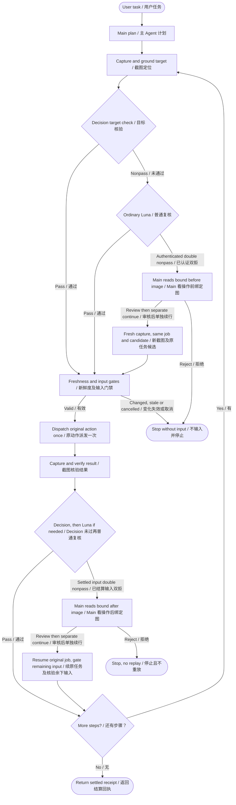

# Execution 0.1.7 guide

**0.1.7 (2026-10-24):** `--current-agent` adds a persistent basic-click loop. The current image-capable Agent reads original images, grounds targets and judges results without an independent Runtime vision/Decision API; its hosting service quota still applies. A 20-step live 7-Zip source run and refusal/cancellation controls passed. Installed 0.1.7 separately passed five Calculator clicks (C → 1 → + → 2 → =, showing 3), cancellation controls and cleanup. See the [release record](releases/EXECUTION_017_20261024.md) and the distinct [source live evidence](verification/CURRENT_AGENT_LIVE_20261024.md).

**Historical 0.1.6 (2026-10-23):** authenticated loopback HTTP MCP alongside stdio, Python 3.12 for new API/Agent environments, and Main review/continuation after authenticated pre-action double refusal. Temporary queue-lock contention is retried with all gates rechecked. Thresholds, prompts and provider defaults are unchanged. [Download Runtime 0.1.6](https://github.com/Desolate-Jix/agent-gui-runtime/releases/tag/instant-v0.1.6) · [Amadeus 0.0.4 setup](../integrations/amadeus/agent-review-instant/README.md) · [Recovery acceptance and limits](verification/MAIN_PRE_ACTION_REVIEW_20261023.md).

**Historical 0.1.5 refresh (2026-10-17):** adaptive observation after Enter and next-step read-only grounding alongside current-result verification. In a small source comparison, actual action-interval medians changed **5.803→5.597 s (Notepad), 7.805→7.254 s (7-Zip), 10.786→9.280 s (Edge)**. New-candidate six three-step plans completed automatically, with independent image/disk checks and cleanup. Model settings and acceptance rules are unchanged. These are source measurements, not general accuracy claims; the four-second objective is not yet reached. [Method, complete task times, calls and limitations →](verification/EXECUTION_015_REFRESH_20261017.md) · [Dated installer acceptance and hashes →](https://github.com/Desolate-Jix/agent-gui-runtime/releases/tag/instant-v0.1.5)

[Home](../README.md) · [简体中文](EXECUTION_GUIDE.zh-CN.md)

## Choose a mode

| Main mode | Responsibilities and requirements |
| --- | --- |
| **Use the current Agent** | Your connected main agent reads original Runtime images, locates the target and judges the result; Runtime keeps evidence, input gates, dispatch and receipts. No separate vision or Decision API is needed for the supported click loop. The hosting agent's service and quota still apply. |
| **Use an external model API** | Runtime calls explicitly configured vision and Decision services for supported execution. Requires provider configuration and credentials; provider usage charges apply. |

**0.1.7 current-agent entry:** `execution_client.py --current-agent` selects the managed adapter. `configure_instant_mcp.py --current-agent` only generates route configuration; it does not select the high-level JSONL adapter. The adapter supports basic clicks, not text input, keys, scrolling, task plans or administrator mode. See [setup and capability matrix](development/CURRENT_AGENT_MODE.md). The Decision flow and historical evidence below belong to the configured API route; local/delegated vision remain advanced options.

## Windows computer use with focused visual checks

Agent Review Instant lets an MCP-compatible agent operate Windows applications: locate a target from a screenshot, click, replace text, press keys and scroll. The main agent supplies an explicit linear plan; the runtime executes supported steps in the same session and checks their results. This avoids returning to the main agent after every successful action.

**Historical execution 0.1.5 added Main review followed by explicit continuation of the original typed-input command.** Installed Amadeus/Pi normal-task evidence is recorded below; independent final-package acceptance status is in the [0.1.5 release notes](https://github.com/Desolate-Jix/agent-gui-runtime/releases/tag/instant-v0.1.5). The older measurements and demos retain their original versions.

**Historical 0.1.4 passed scoped installed Notepad and 7-Zip workflows, including independent Sol acceptance.** Main completed three plans (3+3+6 steps); Sol completed two fresh plans (3+3 steps). All five completed automatically. See the [multi-application report](verification/MULTI_APP_EXECUTION_20261015.md) for timings, original failures and installation boundaries. API-based vision does **not** require local model weights or a local GPU.

[0.1.7 artifacts, checksums and installed acceptance status](releases/EXECUTION_017_20261024.md)

**Provider configuration in 0.1.6:** Decision and secondary review can be configured independently through `--decision-profile`, with the existing defaults preserved. These settings first shipped in the 2026-10-15 rebuilt 0.1.3 installer. See [provider configuration](development/DECISION_PROVIDERS.md) for the complete example, protocol requirements and session-restart behavior. The flow below describes the default OpenAI/Luna setup; compatible replacements occupy the same two roles.

## How Decision and the vision model work together

The vision model answers **“Where should the action happen?”** OpenAI's [Decisions API](https://developers.openai.com/api/docs/guides/decisions), using GPT-6 Luna (`gpt-6-luna`) in Choice mode, answers **“Is this target or this step's result correct?”** Decision does not generate coordinates or replace the main agent's planner.

| Choice result | What happens next |
| --- | --- |
| `condition_met` | Continue the existing plan. |
| `condition_not_met` | Ask the standard Luna vision model to review the same evidence once. Continue if it accepts; otherwise return to the original main agent. |
| `evidence_insufficient` | Use the same one-time Luna review. Return to the original main agent if the result remains unclear or the review fails. |

Each checkpoint asks one current-step question; a task can require several API calls. Choice probabilities are recorded for diagnosis and do not trigger an additional probability-threshold rejection. Legacy predicate profiles retain their own threshold behavior. See the [Choice contract](development/DECISION_CHOICE.md).

Target checks use cropped, annotated images, with an overview and target detail where needed. Text checks compare the requested content in the complete input field. Default execution uses vision rather than UIA tree or field scans; UIA remains available through explicit native routes. A narrowly matched NVIDIA recording-overlay exception avoids false rectangle-based obstruction reports while retaining screenshot evidence and point checks.



Visual text entry combines **click → Ctrl+A → replace text**, verifies only the requested text, then reuses the field position for a fresh click-point check and **click → Enter**. It does not infer focus or classify empty fields. No screenshot or model call is inserted inside either combined action. See [visual input](development/VISUAL_EXECUTION_INPUT.md).

## 0.1.5: review and continue original typed input

When authenticated dual-model nonpass occurs after the original input has settled, the live job can wait at `field_review_packet.v1`. An image-capable Main reads the original bound after image, uses the exact `caller_controls.review.request`, then the separately returned `caller_controls.continue.request`. Review only records a verdict; continue resumes the same run/step/command without selecting or typing again. Any remaining submit suffix still uses the normal fresh-target/input gates and result verification.

**0.1.6 pre-action Main review:** the shared Runtime also adds
`pre_action_review_packet.v1` for authenticated candidate double refusals before
input. This is the same execution contract for direct MCP callers and Amadeus
Pi. Read the original execution through a new `agent_command_status` request,
then use that status request's `instant_image(view="before")`. Main reviews the
bound candidate and explicitly continues the original wait using the returned
recipes. The original job and grounding candidate remain; review does not click.
Continue takes a fresh screenshot and preserves the target-region, identity,
geometry, visibility, cancellation and input gates before one native dispatch.
Installed candidate05 acceptance passed five direct Runtime steps and four native
Pi steps after explicit TEST double refusal, with unchanged thresholds. This is
functional recovery evidence, not an accuracy or speed benchmark; see the
[installed results and limits](verification/MAIN_PRE_ACTION_REVIEW_20261023.md).
Neither a version marker nor saved approval JSON authorizes input. See the
[pre-action design and acceptance boundary](development/MAIN_PRE_ACTION_REVIEW.md).

While the original command is unfinished, submit `agent_command_status` with `command_id=packet.execution_request_id` under a new outer request ID, then call `instant_image` using that status request ID. Missing controls, unknown input, changed evidence, cancellation or restart do not authorize replay. Close owned windows before stopping and verifying Runtime cleanup.

Installed Runtime 0.1.5 + Amadeus extension 0.0.2 completed two normal synthetic Notepad tasks in the same product/Chat, using separate Work/Runtime sessions: six successful steps, exact disk results and owned-window/host cleanup. There were 21 Runtime model HTTP requests and no Main semantic override; two outer tool errors were self-corrected before Runtime dispatch. Earlier live04 Main recovery used explicit TEST dual-refusal injection on an older payload, not a natural-error rate or speed comparison. [Contract](development/MAIN_FIELD_REVIEW_RESUME.md) · [Evidence and limits](verification/AMADEUS_PI_MAIN_REVIEW_20261015.md)

The separate [Amadeus local-wheel guide](../integrations/amadeus/agent-review-instant/README.md) covers compatible Host requirements and setup. Final source checks passed 135 tests; do not add the overlapping older 115-check group. Independent final-package desktop acceptance status is in the [release notes](https://github.com/Desolate-Jix/agent-gui-runtime/releases/tag/instant-v0.1.5). The Lively-copy wallpaper diagnosis is separately scoped in the verification record; its patch is not included in Runtime or the wheel.

## Historical 0.1.4: linear plans and non-browser source evidence

Nonempty linear caller plans no longer have a fixed step-count cap. Each step still requires a unique ID, supported action and explicit verification. Context-size limits, evidence/window bindings, cancellation and API/time budgets remain; this does not grant unlimited execution or change learned-program loop guards.

| Historical 0.1.4 source task | Result | Plan time |
| --- | --- | ---: |
| Notepad source01, edit → File → Save, first round | 3/3 automatically completed; disk UTF-8 alpha text matched exactly | 26.244 s |
| Notepad source01, same-window second round | 3/3 automatically completed; disk UTF-8 beta text matched exactly | 30.715 s |
| 7-Zip repaired source02, fresh 12-step navigation | 12/12 and the public-client terminal receipt completed automatically | 131.898 s |
| 7-Zip source02, same-window 4-step continuation | 4/4 completed automatically | 46.382 s |

Each app reused its own window, followed by verified owned-window closure and host cleanup. Repaired 7-Zip source02 has **16 successful history rows**, no Main review, **32 Decision calls, 16 grounding calls, 0 ordinary reviews and 126,868 API tokens** across those 16 steps only. Main inspected the bound final `journey_complete.txt` image. The task navigated directories and a prepared ZIP, including its inner file; it did not compress or extract. Notepad source01 predates the public-client repair and is not a source02 retest.

The first 7-Zip failure remains a failure: step 8 text was falsely rejected without Enter, **101.139 s to failure**. A later source01 10-step backend completed, but the old public-client receipt cap caused `result_unknown`, **112.697 s to error**. The shared-client repair passed **140 checks across 5 modules in 12.54 s** before the fresh source02 live rerun. Earlier source contracts passed **382 checks across 12 files**, with **10 component tests** reported separately. Groups overlap and are not summed as unique tests. Source success does not establish installed or independent acceptance; those results belong in the release notes. See [current evidence and exact timings](verification/MULTI_APP_EXECUTION_20261015.md).

## Historical changes in 0.1.3

- Reuse the same observation when possible, preload a plan into one persistent client, optimize BGRA conversion and keep HTTP connections pooled for 60 seconds. The measured two-round installed task avoided **10 redundant outer screenshot captures**.
- Use shorter page-result and entered-text questions selected through training, validation and held-out evaluation. Graphic-target and input-target questions, and configured thresholds, are unchanged.
- Let the runtime bind Luna replies to the original request and screenshot with `response_binding="runtime"`, instead of asking the model to copy long IDs. Dimensions, coordinates, source and screenshot freshness are still validated; incorrect IDs remain errors under the legacy contract.
- Preserve useful grounding-failure diagnostics with credential and image-data redaction. Cancellation before input dispatch is recorded as zero input, rather than an unknown outcome.
- Allow the main agent to inspect the evidence from a rejected completed step and explicitly continue the same run without repeating that action.

## Historical 0.1.3 speed, token use and limits

This historical 0.1.3 task was **open Bing → search “Rust standard library collections documentation” → open the first ordinary result**, repeated twice in the same window and session. It is not a 0.1.4 measurement.

| Run | First round | Second round | API tokens across both rounds |
| --- | ---: | ---: | ---: |
| 0.1.3 source | 33.218 s | 30.549 s | 41,173 |
| Installed 0.1.3 candidate | **30.809 s** | **27.354 s** | **41,097** |

Both installed rounds completed without main-agent intervention: **20 Decision calls, 6 grounding calls and 0 secondary Luna reviews** in total. These are complete-plan times for this task. They are not single-call response times or a controlled speedup comparison against an older version. Token totals cover runtime API calls, excluding the main and worker agents' subscription usage.

Cancellation and recovery were also tested. The main agent reviewed bound evidence and continued the original run without repeating the menu click. An independent Sol agent tested the same installed candidate: cancellation, a menu step requiring main-agent review, and two Python `itertools` searches. All **7 steps and cleanup** passed, using **51,072 API tokens**. That recovery required agent assistance and was not fully autonomous.

The final selected execution regression passed **1,029 checks across 52 test files**. The package also passed isolated entrypoint/dependency checks and 43 package-contract checks; these groups are reported separately and are not summed as unique tests. First failures remain recorded. A repaired flow's successful rerun is not relabeled as first-attempt success. See the [timing and acceptance record](verification/EXECUTION_SPEED_20261015.md).

### Historical 0.1.3 prompt benchmark

The benchmark contains **39 real UI screenshots, 30 scenario families and 254 AI-reviewed cases**, split by family into 104 training, 70 validation and 80 held-out cases. Each held-out case was run twice per strategy: 160 responses, not 160 independent scenarios.

| Held-out metric | Baseline | Adopted prompts |
| --- | ---: | ---: |
| Three-way agreement with the reference label | 148/160 (92.5%) | 152/160 (95.0%) |
| Pass/nonpass accuracy | 95.0% | 95.0% |
| Decision input tokens | 179,196 | 176,260 (−1.64%) |
| Agreement after secondary Luna review | 149/160 | 149/160 |

With the adopted prompts, secondary review corrected 3 of 4 initial false rejections but introduced 3 false accepts. The final two-stage result contained **7 false accepts and 1 false rejection**. A false pass from Decision skips secondary review; protection against this remains a known, deferred defect. The labels were reviewed by AI, not human ground truth. These results do not establish general GUI accuracy, improved safety, fewer main-agent interventions or faster complete actions. See the [benchmark method and limitations](verification/DECISION_PROMPT_BENCHMARK_20261015.md).

## Choose a vision route

| Route | Local weights required? | Configuration |
| --- | --- | --- |
| External vision API: `external_api` | No | Image endpoint, model ID and key environment variable |
| Current agent: `agent_current` | No | Explicit image-transport/current-vision capability declarations; [new source adapter](development/CURRENT_AGENT_MODE.md) |
| Visual subagent: `agent_delegate` | No | A selected, reusable visual-agent session |
| Local VISTA: `local` | Yes | Local dependencies and VISTA-4B weights |

Without Decision, use basic actions, compatible v1/v2 plans or explicit `field_evidence_mode="legacy"` native input sequences, with the main agent checking results. Default visual input sequences require an available Decision service in auto mode and reject before input if it is unavailable; they do not silently switch routes. API providers charge for actual usage. The Windows runtime is required for every route.

## Install and configure

Requires **Windows x64 and [uv](https://docs.astral.sh/uv/getting-started/installation/)**. API/Agent setup recommends Python 3.12 and retains supported 3.11 environments; local-model setup still requires Python 3.11. The installer supplies the maintained source and setup scripts; initial setup installs dependencies for the chosen route. Model weights and API keys are not bundled. Adjust the example paths to your installation. Historical Preview directory or shortcut names may remain for upgrade compatibility; the product version, installer and uninstall entry identify the component version. Consult the [0.1.7 release record](releases/EXECUTION_017_20261024.md) for installer checksums and exact acceptance scope.

For external Luna vision plus Decision:

1. Install the execution component. Copy the [Luna profile](../configs/vision-api-openai-luna.example.json) and [Decision Choice profile](../configs/decision-profile.visual-execution.example.json) to your configuration directory.
2. Make `OPENAI_API_KEY` available to the process that launches MCP. Keep the key out of JSON profiles, chats and logs.
3. From the installation directory, install the lightweight dependencies and generate the combined configuration:

```powershell
.\scripts\setup_instant.ps1 -RecognitionSource external_api -ApiProfile "D:\AgentReviewConfig\vision-api.json" -DataDirectory "D:\AgentReviewInstantData"
.\.venv-agent\Scripts\python.exe .\scripts\configure_instant_mcp.py --python "$PWD\.venv-agent\Scripts\python.exe" --recognition-source external_api --api-profile "D:\AgentReviewConfig\vision-api.json" --decision-profile "D:\AgentReviewConfig\decision.json" --data-dir "D:\AgentReviewInstantData" --enable-local-input
```

Merge the `agent-review-instant` entry from the generated `mcp-config.local.json` or `.toml` into your client, preserve other servers and reconnect. These commands configure an ordinary-permission host and make no API request during configuration. See the [setup guide](../FRIEND_SETUP.md) for elevated applications.

Current-agent mode is available in the 0.1.7 entry. Initial `setup_instant.ps1` can download dependencies. The configuration command below only writes Runtime-local JSON/TOML, makes no network request and does not edit global client settings:

```powershell
.\scripts\setup_instant.ps1 -RecognitionSource agent_current -DataDirectory "D:\AgentReviewInstantData"
.\.venv-agent\Scripts\python.exe .\scripts\configure_instant_mcp.py --current-agent --python "$PWD\.venv-agent\Scripts\python.exe" --data-dir "D:\AgentReviewInstantData"
```

The generator does not declare client vision or grant input. The new persistent JSONL entry requires explicit client capabilities; add `--allow-actions` only with operator authorization. [Full entry example and command limits](development/CURRENT_AGENT_MODE.md#connect-and-declare-capabilities). Do not combine the new `--current-agent` selection with API, Decision, delegate or local-model options. Existing explicit `--recognition-source agent_current` configurations retain their optional Decision configuration.

For a preview of advanced local setup:

```powershell
.\scripts\setup_instant.ps1 -RecognitionSource local -ModelDirectory "D:\AgentReviewModels\VISTA-4B" -DataDirectory "D:\AgentReviewInstantData" -DownloadModel -WhatIf
```

Remove `-WhatIf` to perform local setup. Local use requires the official [VISTA-4B](https://huggingface.co/inclusionAI/VISTA-4B) Transformers weights; local hardware requirements apply only to that route. See [external vision API setup](development/EXTERNAL_VISION_API.md).

## HTTP MCP for Amadeus

Install Runtime 0.1.6, prepare its API environment, and start `scripts/start_instant_mcp_http.py` in a dedicated console. The service binds only `127.0.0.1`; its named environment-variable connection token is separate from model API keys. Install the 0.0.4 wheel, configure `runtime_url` and secret `connection_token`, bind MCP + Skill to Pi, enable, restart the backend, then create a new Work. The extension neither launches Runtime nor receives its provider keys. Follow the [complete commands and migration instructions](../integrations/amadeus/agent-review-instant/README.md). stdio clients can keep their existing integration.

The 0.0.4 wheel retains its fixed `instant-v0.1.6` download URL and API-route Skill. This round does not establish current-agent acceptance in Amadeus. A compatible HTTP contract does not require reinstalling an unchanged wheel for every Runtime patch. Automatic updating is not implemented; see the [Amadeus](development/AMADEUS_UPDATE_STRATEGY.md) and [Runtime](development/RUNTIME_UPDATE_STRATEGY.md) strategies.

## Agent integration

MCP stdio and the authenticated HTTP service expose the same core tools: `instant_start`, `instant_status`, `instant_run`, `instant_submit`, `instant_result`, `instant_image` and `instant_stop`, plus `instant_recovery_preview` and `instant_recover_session`.

Keep one persistent session and one desktop input owner. Supported requests include single actions, combined input and linear plans. Execution 0.1.6 retains 0.1.4 support for nonempty linear plans without a fixed step-count cap, while retaining per-step validation, context-size limits, evidence checks, cancellation and API/time budgets. Existing 0.1.3 installations retain their build-time contract until explicitly upgraded. See [source checks](verification/UNBOUNDED_TASK_PLANS_20261015.md). Wait expiry is not cancellation: poll the original request ID rather than replaying input. See the [agent guide](../AGENT_GUIDE.md), [task plans](development/TASK_PLAN.md) and [Decision configuration](development/DECISION_API.md).

Maintained code is organized around `app/execution` for plans and actions, `app/judgment` for Decision, `app/core` for capture/input and `app/vision` for grounding. Some execution dependencies retain historical `learning_memory` names; they do not require the learning workbench to be installed.

## Release boundaries and history

The 0.1.7 source live run covers only the current-agent basic-click loop. Separate installed acceptance passed the five-click Calculator task, post-action/awaiting-grounding cancellation checks and cleanup; details belong in the [current release record](releases/EXECUTION_017_20261024.md). This adds no performance, free-use or general success-rate claim.

This guide separates 0.1.6 controlled pre-action recovery evidence from installed 0.1.5 normal-task evidence from historical 0.1.4 source/installed results and retained first failures. Independent final-package acceptance is recorded in the release notes, not inferred from source success. The installer is unsigned; checks using an existing Python environment do not prove clean-machine dependency setup. The 2026-10-15 0.1.3 rebuild first included independent provider configuration. Browser timings and prompt benchmarks above belong to 0.1.3, and the Notepad/7-Zip demos and measurements retain 0.1.4: none are new 0.1.5 performance results. Existing installations need an explicit upgrade. Arbitrary unattended completion and full character/wallpaper composition are not promised.

Earlier development failures and results remain in the [0.1.2 acceptance record](verification/EXECUTION_STABLE_012_20261012.md), [target-check diagnosis](verification/DECISION_TARGET_USAGE_20261013.md) and [0.1.3 verification record](verification/EXECUTION_SPEED_20261015.md). Earlier checkpoints describe their original state, not the current release status.

[ISC License](../LICENSE). Dependencies and model weights retain their own licenses.
