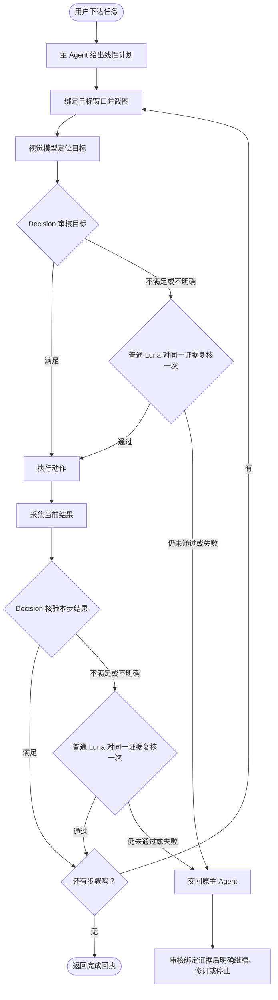

# 执行模式 0.1.5 详细指南

[返回首页](../README.zh-CN.md) · [English](EXECUTION_GUIDE.md)

## 通过视觉核验执行 Windows 桌面任务

Agent Review Instant 让支持 MCP 的 Agent 操作 Windows 应用：从截图定位目标，执行点击、替换输入、按键和滚动。主 Agent 提供一份明确的线性计划，运行时在同一会话中执行受支持的步骤并核验结果，减少每次成功操作后都返回主 Agent 的等待。

**执行版 0.1.5 新增 Main 审核后明确继续原文字输入命令。** 下方记录已安装 Amadeus／Pi 的正常任务证据；最终包的独立验收状态见 [0.1.5 发布说明](https://github.com/Desolate-Jix/agent-gui-runtime/releases/tag/instant-v0.1.5)。旧测量与演示保留原版本归属。

**历史执行版 0.1.4 已通过限定范围的记事本与 7-Zip 安装态流程，包括 Sol 独立验收。** Main 完成三个计划（3+3+6 步），Sol 完成两个全新计划（3+3 步），五个计划均自动完成。耗时、原始失败与安装验收边界见[多应用报告](verification/MULTI_APP_EXECUTION_20261015.md)。学习工作台仍为独立、可选的 **0.1.0-preview.3** 组件。使用外部视觉 API **不需要下载本地模型权重，也不需要本地 GPU**。

[0.1.5 Windows 执行安装器](https://github.com/Desolate-Jix/agent-gui-runtime/releases/download/instant-v0.1.5/AgentGUIRuntimeExecution-Setup.exe) · [0.1.5 发布说明、校验文件与独立验收状态](https://github.com/Desolate-Jix/agent-gui-runtime/releases/tag/instant-v0.1.5)

**0.1.5 的服务配置：** 通过 `--decision-profile` 可分别配置 Decision 与普通复核服务，默认方案保持不变。这些设置首次包含于 2026-10-15 重打包的 0.1.3 安装器。完整示例、协议要求和会话重启方式见[服务配置说明](development/DECISION_PROVIDERS.zh-CN.md)。下方流程描述默认 OpenAI／Luna 方案；兼容替换服务承担相同的两层职责。

## Decision 和视觉模型如何配合

视觉模型回答 **“在哪里操作？”**，OpenAI [Decisions API](https://developers.openai.com/api/docs/guides/decisions) 通过 GPT-6 Luna（`gpt-6-luna`）的 Choice 模式回答 **“这个目标或本步结果是否符合要求？”**。Decision 不生成坐标，也不替代主 Agent 制订计划。

| Choice 结果 | 后续行为 |
| --- | --- |
| `condition_met` | 继续原计划。 |
| `condition_not_met` | 由普通 Luna 视觉模型对同一证据复核一次。复核通过则继续，否则交回原主 Agent。 |
| `evidence_insufficient` | 同样进行一次普通 Luna 复核。结果仍不明确或复核失败时，交回原主 Agent。 |

每个审核点只问一个当前步骤的问题；一个任务可能调用多次 API。Choice 的概率仅用于诊断，不再叠加概率阈值进行第二次否决；旧 predicate 配置仍保留其阈值语义。详见 [Choice 合同](development/DECISION_CHOICE.md)。

目标审核使用裁剪、标注后的图片，必要时在同图保留概览和目标细节。输入核验在完整字段中比较规定内容。默认执行使用视觉，不依赖 UIA 整树或字段扫描；UIA 保留给学习模式和显式原生路线。精确匹配的 NVIDIA 录屏覆盖窗例外可避免矩形遮挡误报，同时保留截图证据和点位检查。



视觉输入将 **点击 → Ctrl+A → 替换文字** 绑定为连续动作，只核验规定文字，再复用字段位置重新审核点击点，执行 **点击 → Enter**。不推断焦点，不判断空框，两组连续动作内部均不插入截图或模型调用。详见 [视觉输入说明](development/VISUAL_EXECUTION_INPUT.md)。

## 0.1.5：审核并继续原文字输入

原输入已结算后发生通过认证的双模型非通过判断时，活跃 job 可停在 `field_review_packet.v1`。支持图像的 Main 读取绑定 after 原图，使用确切 `caller_controls.review.request`，再单独调用返回的 `caller_controls.continue.request`。review 只记录结论；continue 续行同一 run／step／command，不重新全选或输入。剩余 submit 后缀仍经过正常 fresh-target／输入门禁与结果核验。

原命令未结束时，用新的外层 request ID 提交 `agent_command_status`，其中 `command_id=packet.execution_request_id`，再对该 status request ID 调 `instant_image`。缺少 controls、未知输入、证据变化、取消或重启均不能授权重放。先关闭自有窗口，再停止并确认 Runtime 清理。

已安装 Runtime 0.1.5＋Amadeus 扩展 0.0.2 在同一产品／Chat 内完成两项正常合成记事本任务，各用独立 Work／Runtime session：六步成功、磁盘精确匹配、自有窗口与宿主收尾通过。共 21 次 Runtime 模型 HTTP，没有 Main 语义 override；两项外层工具错误均在 Runtime 派发前自行纠正。旧 live04 Main 恢复使用较早载荷上的显式 TEST 双拒绝注入，不是自然误拒率或提速比较。[合同](development/MAIN_FIELD_REVIEW_RESUME.md) · [证据与限制](verification/AMADEUS_PI_MAIN_REVIEW_20261015.md)

独立的 [Amadeus 本地 wheel 指南](../integrations/amadeus/agent-review-instant/README.zh-CN.md) 说明兼容 Host 与安装步骤。最终源码检查 135 项通过，不能与旧 115 项重叠分组相加。最终包的独立实机验收状态见[发布说明](https://github.com/Desolate-Jix/agent-gui-runtime/releases/tag/instant-v0.1.5)。Lively 副本壁纸诊断在验证记录中单列，其补丁不随 Runtime 或 wheel 分发。

## 0.1.4 历史：线性计划与非浏览器源码实测

非空线性调用方计划不再设置固定步数上限。每一步仍须具有唯一 ID、受支持的动作和明确核验；内容大小、证据／窗口绑定、取消及 API／时间预算继续有效，不代表无限执行，也不改变已学习程序的循环保护。

| 0.1.4 历史源码任务 | 结果 | 计划耗时 |
| --- | --- | ---: |
| 记事本 source01 第一轮：编辑 → File → Save | 3/3 自动完成，磁盘 UTF-8 alpha 内容完全匹配 | 26.244 秒 |
| 记事本 source01 同窗口第二轮 | 3/3 自动完成，磁盘 UTF-8 beta 内容完全匹配 | 30.715 秒 |
| 7-Zip 修复后 source02 全新 12 步导航 | 12/12 及公共客户端终态回执均自动完成 | 131.898 秒 |
| 7-Zip source02 同窗口后续 4 步 | 4/4 自动完成 | 46.382 秒 |

每个软件均复用各自窗口，随后本轮窗口关闭及宿主收尾通过。修复后 7-Zip source02 的 **16 条历史全部成功**，无需 Main 审核；这 16 步合计 **32 次 Decision、16 次定位、0 次普通复核、126,868 个 API token**。Main 已目视核对绑定的 `journey_complete.txt` 末图。任务只导航目录及预制 ZIP，包含内部文件，没有压缩或解压。记事本 source01 早于公共客户端修复，不冒充 source02 复测。

首次 7-Zip 失败继续保留：第 8 步文字误拒，未按 Enter，**101.139 秒至失败**。之后 source01 的 10 步后端完成，但公共客户端旧回执限制导致 `result_unknown`，**112.697 秒至异常**。共用客户端修复在全新 source02 实机复测前通过 **5 个模块、140 项检查，耗时 12.54 秒**。此前源码合同共 **12 个文件、382 项检查通过**，另行报告 **10 项组件测试**；分组有重叠，不相加为独立用例总数。源码成功不代表安装态或独立验收通过，相关结果见发布说明。详见[本轮证据与精确计时](verification/MULTI_APP_EXECUTION_20261015.md)。

## 0.1.3 历史改进

- 在适用时复用同次观察，将计划预装到同一个持续连接的客户端，优化 BGRA 转换，并让 HTTP 连接池保留连接 60 秒。安装版两轮实测减少了 **10 次外层重复截图**。
- 通过训练集、验证集和保留集评测，采用更短的页面结果、输入内容问句。图形目标和输入目标问句、配置阈值保持不变。
- 使用 `response_binding="runtime"`，由运行时将 Luna 返回结果绑定到原请求和截图，不再要求模型抄写长 ID。仍校验尺寸、坐标、来源和截图新鲜度；旧协议中的错误 ID 仍会被拒绝。
- 保留有用的定位失败诊断，并对凭证和图片数据脱敏。派发输入前取消会记录为零输入，不再被误记为结果未知。
- 当已完成步骤被模型误拒时，主 Agent 可以审核原证据，明确继续原运行，避免重复执行已完成动作。

## 0.1.3 历史速度、token 用量与限制

以下 0.1.3 历史任务为 **打开 Bing → 搜索“Rust standard library collections documentation”→ 打开第一个普通结果**，在同一窗口、同一会话中连续运行两轮，不是 0.1.4 测量。

| 测试版本 | 第一轮 | 第二轮 | 两轮 API token 合计 |
| --- | ---: | ---: | ---: |
| 0.1.3 源码 | 33.218 秒 | 30.549 秒 | 41,173 |
| 0.1.3 安装候选 | **30.809 秒** | **27.354 秒** | **41,097** |

安装版两轮均无主 Agent 接管，合计调用 **20 次 Decision、6 次视觉定位、0 次普通 Luna 复核**。这些是该任务的完整计划耗时，不是单次 API 响应时间，也不是与旧版本的受控提速对比。token 合计仅包含运行时 API 调用，不含主 Agent、工作子 Agent 的套餐用量。

取消和恢复也做了测试：主 Agent 审核绑定证据后续行原任务，没有重复点击菜单。独立 Sol Agent 使用同一个安装候选，测试取消、一个需要主 Agent 审核的菜单步骤，以及两轮 Python `itertools` 搜索，**7 个步骤及收尾全部通过**，使用 **51,072 个 API token**。其中的恢复需要 Agent 辅助，不能算作全自动完成。

最终选定的执行回归覆盖 **52 个测试文件，1,029 项检查通过**。交付包还通过了隔离环境中的真实入口及依赖检查、43 项包契约检查；各组分开报告，不相加为独立用例总数。首次失败记录保留；修复后复测成功不会改记为首次通过。详见 [计时与验收记录](verification/EXECUTION_SPEED_20261015.md)。

### 0.1.3 历史提示词 benchmark

评测包含 **39 张真实界面截图、30 个场景族、254 项经过 AI 复核的案例**，按场景族划分为 104 项训练、70 项验证和 80 项保留案例。每个保留案例在每种策略下运行两次，因此是 160 次返回，不是 160 个独立场景。

| 保留集指标 | 原提示词 | 当前采用的提示词 |
| --- | ---: | ---: |
| 三分类结果与参考标签的一致率 | 148/160（92.5%） | 152/160（95.0%） |
| 通过／不通过准确率 | 95.0% | 95.0% |
| Decision 输入 token | 179,196 | 176,260（−1.64%） |
| 普通 Luna 复核后的最终一致结果 | 149/160 | 149/160 |

当前提示词下，普通 Luna 纠正了第一层 4 次误拒中的 3 次，但新增了 3 次误放；两级最终结果有 **7 次误放、1 次误拒**。Decision 误放时会跳过二次复核，相关防护仍是暂缓处理的已知缺陷。标签由 AI 复核，并非人工真值。这些数据不能证明通用 GUI 准确率、安全性、主 Agent 介入次数或完整动作速度得到改善。详见 [评测方法与限制](verification/DECISION_PROMPT_BENCHMARK_20261015.md)。

## 选择视觉来源

| 路线 | 需要本地权重吗？ | 所需配置 |
| --- | --- | --- |
| 外部视觉 API：`external_api` | 不需要 | 图像端点、模型 ID、密钥环境变量 |
| 当前 Agent：`agent_current` | 不需要 | 支持图像的客户端 |
| 视觉子 Agent：`agent_delegate` | 不需要 | 明确选择并持续复用的视觉会话 |
| 本地 VISTA：`local` | 需要 | 本地依赖及 VISTA-4B 权重 |

不配置 Decision 时，可使用基础动作、兼容的 v1/v2 计划，或明确设置 `field_evidence_mode="legacy"` 的原生组合输入，由主 Agent 核验结果。默认视觉组合输入要求 Decision 的 auto 模式可用；不可用时会在输入前拒绝，不会静默切换路线。API 服务商按实际用量收费。所有路线均需要本机 Windows 运行时。

## 安装与配置

要求 **Windows x64、Python 3.11 和 [uv](https://docs.astral.sh/uv/getting-started/installation/)**。安装器提供维护源码与配置脚本；首次配置按所选路线安装依赖，不附带模型权重或 API 密钥。请按实际安装位置调整示例路径。为兼容升级，目录或快捷方式可能保留历史 Preview 名称；产品版本、安装窗口及卸载条目会标明组件版本。安装器验收状态及校验值见 0.1.4 发布说明。

使用外部 Luna 视觉 API 和 Decision：

1. 安装执行组件，将 [Luna 配置](../configs/vision-api-openai-luna.example.json) 和 [Decision Choice 配置](../configs/decision-profile.visual-execution.example.json) 复制到自己的配置目录。
2. 让启动 MCP 的进程继承 `OPENAI_API_KEY`。不要把密钥写进 JSON 配置、聊天或日志。
3. 在安装目录运行以下命令，安装轻量依赖，再生成组合配置：

```powershell
.\scripts\setup_instant.ps1 -RecognitionSource external_api -ApiProfile "D:\AgentReviewConfig\vision-api.json" -DataDirectory "D:\AgentReviewInstantData"
.\.venv-agent\Scripts\python.exe .\scripts\configure_instant_mcp.py --python "$PWD\.venv-agent\Scripts\python.exe" --recognition-source external_api --api-profile "D:\AgentReviewConfig\vision-api.json" --decision-profile "D:\AgentReviewConfig\decision.json" --data-dir "D:\AgentReviewInstantData" --enable-local-input
```

将生成的 `mcp-config.local.json` 或 `.toml` 中的 `agent-review-instant` 条目合并到客户端，保留其他服务器后重新连接。上述命令配置普通权限宿主，生成配置时不会发送 API 请求。管理员应用的配置见 [安装指南](../FRIEND_SETUP.md)。

使用当前 Agent 定位，或预览本地模型准备范围：

```powershell
.\scripts\setup_instant.ps1 -RecognitionSource agent_current -DataDirectory "D:\AgentReviewInstantData"
.\scripts\setup_instant.ps1 -RecognitionSource local -ModelDirectory "D:\AgentReviewModels\VISTA-4B" -DataDirectory "D:\AgentReviewInstantData" -DownloadModel -WhatIf
```

去掉 `-WhatIf` 后才会实际准备本地环境。本地路线使用官方 [VISTA-4B](https://huggingface.co/inclusionAI/VISTA-4B) Transformers 权重；本地硬件要求只适用于该路线。另见 [外部视觉 API 配置](development/EXTERNAL_VISION_API.md)。

## Agent 接入与可选学习工作台

MCP stdio 提供七个核心工具：`instant_start`、`instant_status`、`instant_run`、`instant_submit`、`instant_result`、`instant_image`、`instant_stop`，另有 `instant_recovery_preview` 和 `instant_recover_session` 两个恢复工具。

保持同一会话、同一桌面输入所有者。支持单步动作、组合输入和线性计划。执行版 0.1.5 候选保留 0.1.4 的非空线性计划支持，不设固定步数上限；逐步校验、内容大小限制、证据检查、取消和 API／时间预算继续有效。已有 0.1.3 安装在明确升级前保留构建时协议。见[源码验证](verification/UNBOUNDED_TASK_PLANS_20261015.md)。等待到期不等于取消；应查询原请求 ID，避免重放输入。详见 [Agent 指南](../AGENT_GUIDE.md)、[任务计划](development/TASK_PLAN.md) 和 [Decision 配置](development/DECISION_API.md)。

[学习工作台 0.1.0-preview.3](https://github.com/Desolate-Jix/agent-gui-runtime/releases/tag/learning-v0.1.0-preview.3) 用于采集可复用界面和工作流，供人工审核、修改。它独立安装、可选使用，本次不更新。详见 [学习版快速开始](LEARNING_PREVIEW_QUICKSTART.md)。

维护代码中，`app/execution` 负责计划与动作，`app/judgment` 负责 Decision，`app/core` 负责截图与输入，`app/vision` 负责视觉定位。部分执行共享依赖仍保留历史 `learning_memory` 名称，不意味着必须安装学习工作台。

## 发布边界与历史记录

本指南将安装态 0.1.5 正常任务与历史 0.1.4 源码／安装结果及首次失败分开。最终包的独立验收由发布说明记录，不从源码成功推定。安装器未签名，使用已有 Python 环境的检查不能证明全新机器依赖 setup。2026-10-15 的 0.1.3 重打包首次加入独立服务配置；上文浏览器计时及提示词评测属于 0.1.3，记事本／7-Zip 演示与测量保留 0.1.4 归属，均非新的 0.1.5 性能结果。已有安装须明确升级。学习版不变，不承诺任意任务无人干预完成或完整角色／壁纸合成效果。

历史开发失败与结果保留在 [0.1.2 验收记录](verification/EXECUTION_STABLE_012_20261012.md)、[目标审核诊断](verification/DECISION_TARGET_USAGE_20261013.md) 和 [0.1.3 验证记录](verification/EXECUTION_SPEED_20261015.md)。历史检查点描述当时状态，不代表当前发布状态。

[ISC 许可证](../LICENSE)。依赖和模型权重遵循各自许可证。
