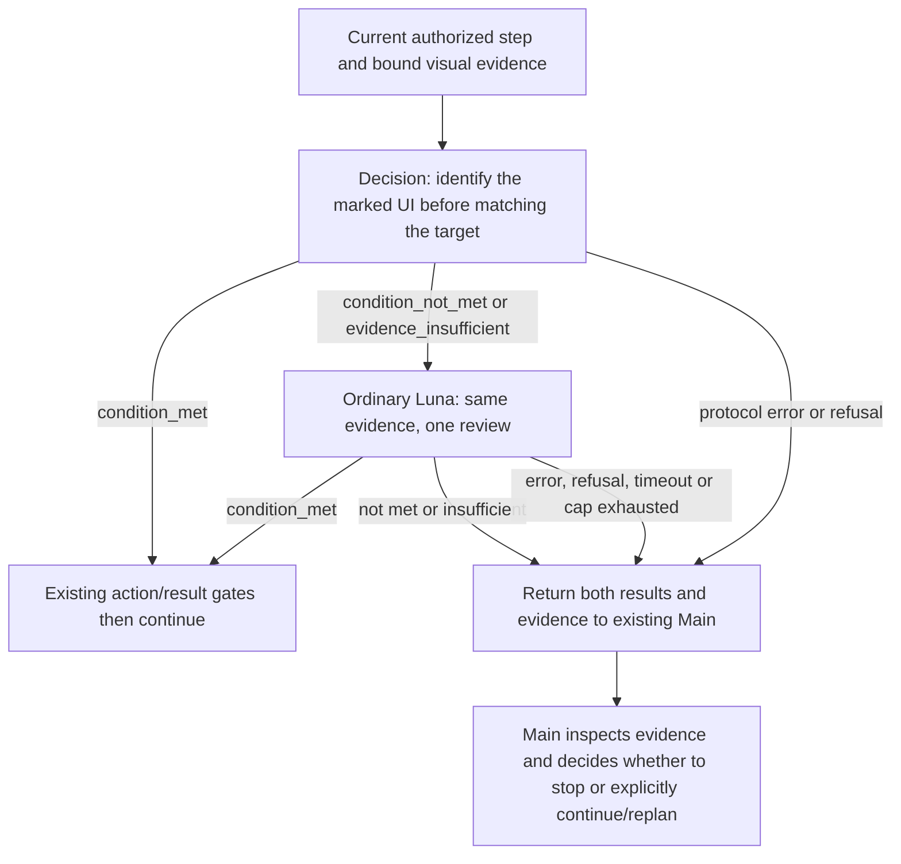

# Decision → ordinary Luna review / Decision → 普通 Luna 复核

2026-10-14最新：新示例为普通复核单独提供12秒，primary保持8秒，外层总截止仍约束两者；真实3次复核均正常返回（2.37–2.60秒），正确地址栏难例仍被两层误拒。当前目标采用已实测较好的短单问，未改阈值或裁剪。 / Latest source gives review a separate12s cap under the original outer deadline. Three live reviews completed; the difficult correct-field image still failed semantically. See [时限修复 / Deadline evidence](../verification/ORDINARY_REVIEW_TIMEOUT_20261014.md) and [提示词选型 / Prompt selection](../verification/TARGET_CHECK_PROMPT_20261014.md). 以下同日早期实验为历史，不代表当前方案。 / Earlier experiments below are historical.

2026-10-15连接补充：同一provider的Decision和普通Luna继续共用原HTTP client，空闲连接保留从默认5秒改为60秒，避免正常定位间隙让连接过期。连接数量、并发门禁、请求和外层截止、超时、代理隔离及零重试不变。真实本机回环HTTP测试确认闲置6秒/59秒后复用、61秒后重连，以及关闭释放socket和transport线程；仅测试时钟控制闲置判断，真实deadline仍有效。未测量外网TLS收益，不增加请求或token。 / The existing client now retains idle connections for60s. Local loopback verifies reuse, expiry and cleanup without changing request deadlines or retry behavior. Internet latency gains remain unmeasured.

## Routing / 路由



候选提示词先看 Detail 标记中心下的实际图形、文字或控件，再与目标比较；Overview 用于必要上下文及局部遮挡。标记本身不是控件或成功证据，不要求焦点、空框或前后流程成功。实际候选问题仍是通用目标匹配，不能把两张「＋/×」图片的分类结果宣称为通用准确率。

Candidate prompts inspect the underlying shape, text or control at the Detail marker center before matching the intended target. Overview supplies necessary context and local obstruction evidence. An annotation is not UI or proof. No focus, empty-field or earlier/later workflow requirement is added. This is a general target-match prompt; the two-image plus/cross experiment is not a general accuracy benchmark.

普通 Luna 使用同一 provider 的 `/v1/responses`，模型 `gpt-6-luna`、`reasoning.effort=none`、最多 32 输出 token、`store=false`。复用完全相同的当前步骤证据与问题，只加选项输出格式，不传第一层答案，避免诱导；不重新截图或定位。输出必须是 `condition_met` / `condition_not_met` / `evidence_insufficient` 之一，不接受解释、额外工具调用或伪造概率。

Ordinary review uses `/v1/responses`, `gpt-6-luna`, no reasoning, at most 32 output tokens and no storage. It reuses the same current-step images and question, adding only option-output formatting. The first answer is withheld; no recapture or grounding occurs. Only one exact existing Choice label is accepted, with no explanations, tools or fabricated probabilities.

第一层通过即继续；第一层有效的非通过才调用第二层。第二层通过覆盖第一层模型非通过，不平均分数、不改旧阈值。否则返回原主 Agent，并保留原图绑定及两层判断；运行时不自动另起主 Agent 或发第三次模型请求。协议损坏、缺证据、权限拒绝不通过多问一个模型来掩盖。

A first-stage pass continues; a valid negative/uncertain choice invokes the second stage. Its pass overrides the first model conclusion without averaging or changing thresholds. Otherwise the existing Main receives the bound evidence and both results. The runtime does not start another Main or automatically issue a third model call. Protocol, evidence and permission failures remain explicit.

## Configuration and contracts / 配置与合同

- `decision_profile.v2` + `decision_format: "choice"` + `mode: "auto"` + `ordinary_review: "on_reject"` enables the cascade. The three maintained Choice example profiles now specify this field. / 三份维护中的 Choice 示例配置已显式启用。
- Missing `ordinary_review` means off; old serialized profiles/digests and frozen sessions remain unchanged. Existing hosts must load a new explicit profile in a new session to use this path. Predicate, off, shadow and always-main behavior remains unchanged. / 缺省关闭以保留旧摘要；重载配置需新会话，不能把已保存配置当作当前进程已加载。
- Legacy combined `field_content` review remains unsupported for ordinary review and hands back to Main; the current replace-all visual input route is supported. / 历史合并空框识别请求不扩展到第二层，当前默认全选替换路线使用通用链路。
- A secondary request counts toward the same session cap. Explicit `ordinary_review_timeout_seconds` gives it a complete stage cap (12s in maintained examples); primary uses `timeout_seconds` (8s). Both remain bounded by the original caller/assessment/temporal total deadline. Omitted/null secondary caps retain legacy shared timing. Preparation, queuing and HTTP consume the stage allowance; late results never continue. / 第二次调用仍计入总次数；新配置提供独立12秒额度，主层8秒，外层原总截止不刷新；省略或null保持旧共享模式。
- Dispatch reservations and encrypted results survive interruption/reopening. An unresolved dispatched request stays unknown; the same request is never sent twice. / 中断保留派发标记，重开不重派。
- `choice_result` preserves the original Decision reply; `ordinary_review.review_result` preserves the ordinary reply, and `judged_by` records the final source. Final authenticated `adopted`/`disposition` control continuation. / 两层原始结果各自保留，续行读取认证后的最终结论。
- `primary_usage` and per-review usage retain each call; top-level usage sums known reported usage, including validated late-response usage in timeout diagnostics. Without usage, spend is unknown rather than zero. Primary and secondary HTTP/server timings remain separate; `elapsed_ms` records the service operation. / 汇总仅计已返回的合法用量，包括迟到但已返回的计量；未知不当作零。超时诊断固定记录phase/code及已知计量，不记录异常原文。
- Source image hashes, window identity, coordinate checks, explicit permissions, cancellation and action receipts remain enforced. A model pass is not input authorization. / 图像、窗口、坐标、权限、取消和动作回执约束继续生效。

## Known defect / 已知缺陷

**DECISION-FALSE-ACCEPT-001 — open, explicitly deferred by the user.** If Decision incorrectly selects `condition_met`, ordinary review is skipped. A second-stage false pass is also possible. This cascade targets false refusals and Main handoffs; it does not establish false-accept protection or guaranteed accuracy. No pass sampling, double-model agreement or additional model calls are introduced for this defect.

**DECISION-FALSE-ACCEPT-001 — 未修，用户明确暂缓。** Decision 将错误目标判为通过时，不会触发普通模型；普通模型本身也可能误放。本轮解决误拒后的复核与交接，不宣称误放防护或准确率保证，不增加通过样本抽检和双模型一致性策略。

## Verification / 验证

Offline regressions cover both real provider request schemas via mock HTTP, unchanged images/questions, second-stage adoption and Main handoff, malformed/refused replies, timeouts, shared caps, interruption, closure/reopening, tamper rejection and zero replay. Input consumers must use the final authenticated choice. / 离线覆盖模拟 HTTP 下的真实适配器、原证据复用、两级续行/交接、异常、共享预算、关闭重开和防重派；输入消费者采用认证后的最终选择。

2026-10-14 Main verification: **659 passed in 46.89s** across the judgment/provider/configuration/task-plan/input scope. A final wording alignment in the image-view preamble was followed by **146 passed in 2.12s** in the affected provider/candidate/cascade tests. These are overlapping suites, not 805 distinct tests. / Main 本轮相关回归 659 项通过；最后统一图像说明措辞后，受影响范围 146 项复测通过。两次范围重叠，不相加为独立测试数。

The regression work reproduced a closure/reopen mismatch and three consumers that incorrectly required the first choice to pass. Their regressions now pass. Default-profile task-plan integration confirms that a secondary pass queues the next step without a Main review roundtrip. / 已复现并修复关闭后认证恢复失败，以及三处输入消费者仍强制首层通过的问题；默认配置的真实计划运行器在模拟 HTTP 联调中能采用第二层通过并排入下一步。

Final affected-scope command / 最后受影响范围命令:

```text
D:/agent-gui-runtime/.venv/Scripts/python.exe -m pytest tests/test_openai_decisions.py tests/test_luna_choice_review_provider.py tests/test_decision_candidate_view.py tests/test_decision_graphic_first_prompt.py tests/test_ordinary_review_cascade.py -q --disable-warnings --maxfail=2
```

Next acceptance: retained-image API replay for accuracy, latency and tokens, followed by an authorized continuous real flow. Offline contract success is not a measured speedup or a desktop success claim. / 下一步先做保留图真实 API 对比，再做授权连续实测；离线通过不代表速度提升或实机通过。
