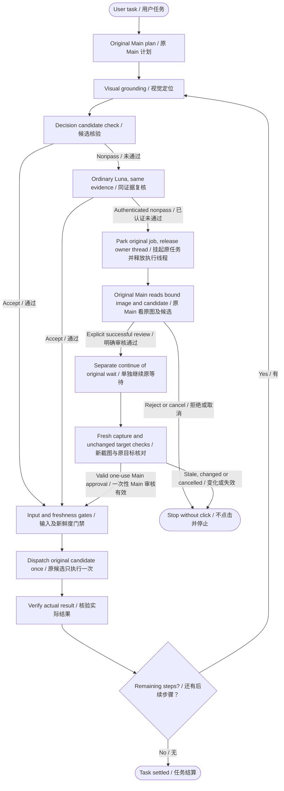

# Main review before a rejected click / 点击前的 Main 兜底

Status: candidate05 installed acceptance passed for direct Runtime and native
Amadeus Pi; see the [results and limits](../verification/MAIN_PRE_ACTION_REVIEW_20261023.md).
Included in Runtime 0.1.6 and extension 0.0.4; catalog approval remains separate. The earlier candidate03 field-result test is
separate. Decision/Luna thresholds, prompts and provider selection are unchanged.

## Intended behavior / 目标

When both authenticated candidate checks complete without accepting the target,
the original planning agent can inspect the bound screenshot and candidate,
explicitly review it, and separately continue the original task. This replaces
the semantic decision for that one candidate; it does not waive input
authorization, target identity, cancellation, geometry or freshness checks.

Decision 与普通 Luna 均完成但不接受当前候选时，交回原规划 Agent 看原绑定截图与候选。
Main 先审核，再单独继续原任务。它只裁决本次候选的语义正确性，原输入授权、窗口身份、
取消、几何和截图新鲜度检查仍必须通过。

## Execution boundary / 执行边界

- The first local call returns a verified no-input receipt before waiting. The
  serial Runtime owner must be available to process status, review and cancel;
  it must not be blocked waiting for Main.
- The original AgentCommandJobs job, plan run, step, attempt and grounding claim
  remain the owners. A separately recorded local resume invocation may re-enter
  the owner, but does not create another planning attempt or native click.
- A new pre-action packet binds the original before image, candidate point and
  box, original assessments, plan/profile/window identities and evidence hashes.
  The original refusals remain refusals. Main approval is a separate fact.
- Only the live original job can issue a private, one-use Main capability after
  a correctly bound review and explicit continuation. JSON, a saved packet, a
  caller boolean or a restarted host cannot create this capability.
- Continue re-enters the original route, takes a fresh maintained screenshot and
  checks it against the frame Main actually reviewed. It preserves existing ROI
  tolerances and all identity, mapping, visibility and input gates. Changed or
  expired evidence stops the job; there is no silent new candidate or model retry.
- Main waiting and the short post-capture dispatch lease are separate budgets.
  The dispatch lease starts at the fresh capture, not after expensive checks.
  Cancellation or shutdown revokes approval before native input.
- Review alone performs no input. Repeated review/continue/status calls cannot
  replay a click. Result verification and subsequent steps use their existing
  routes, including the separately supported field-result Main review.

## Acceptance / 验收

Offline checks must cover one successful click after review/continue; Main
rejection, cancellation and shutdown with zero clicks; mismatched run/job/image/
candidate/profile; changed ROI/geometry; expiry; duplicate controls; old-host
packets; and preservation of the two authenticated refusals and the separate
Main decision. Pending image delivery must return the bound original before PNG.

The completed installed acceptance uses the updated Amadeus and the real Pi → HTTP MCP
→ Runtime route, with a new four-step 7-Zip workflow: Documents → Reports → Up →
Receipts. A TEST proxy forces one exact candidate's primary and ordinary checks
to decline; all other provider calls remain real. The original Pi must view the
bound image and issue its own review and continue. Neither the harness nor a
terminal script may invent the verdict. Original command identities, single
native dispatch, complete suffix and owned-window/Runtime/HTTP cleanup are
independently checked. TEST recovery is not a natural-accuracy or speed benchmark.

Evidence for this round is separate from the previous candidate:
`amadeus-marketplace-20261023-02/`.
The direct five-step workflow and Pi four-step workflow passed using candidate05.
Store materials are prepared separately; publication and independent catalog
review remains pending. Previous 0.0.3 wheel bytes and candidate03/04 evidence stay frozen.
