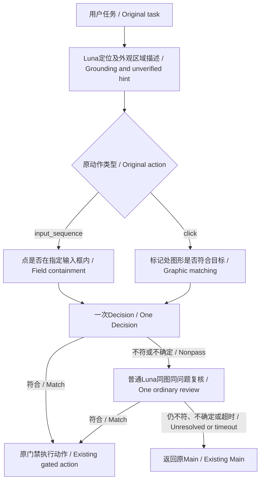

# 当前目标的两条核验路线 / Two current-target checks

2026-10-14 未发布源码；替代此前默认生成身份干扰类别的实验。 / Unreleased source replacing automatic distractor classification.

最新问题改为简短单问：输入框问 `Is the cyan marker center inside the target input field?`，图形问 `Does the icon or button at the cyan marker center match the target?`，后附原目标JSON。固定选项、其他正文和图片不变；提示词版本v2防止复用旧缓存。52次受控API选型后采用，保留集8/8对旧6/8；仅4个截图组，不保证通用准确率。普通复核独立12秒、受外层总截止约束；真实3次正常返回，但最难地址栏仍误拒。 / The empirically selected short question changes only instructions. Fixed options/evidence remain; prompt versionv2 isolates prior caches. Limited held-out results improve, with unresolved hard cases. [提示词证据 / Prompt evidence](../verification/TARGET_CHECK_PROMPT_20261014.md) · [复核时限 / Review deadline](../verification/ORDINARY_REVIEW_TIMEOUT_20261014.md).

真实检查：同一保留Edge窗口第一轮地址栏误拒后普通复核超时，第二轮heapq搜索与官方文档打开自动完成（34.4秒、18,568 token），其中一次复核纠正误拒。尚未连续两轮通过；不是通用准确率或速度收益证明。 / Live testing found one pre-input failure followed by one successful distinct task with an actual secondary correction. Continuous reliability is unproven. See [真实证据 / Live evidence](../verification/TARGET_CHECK_LIVE_20261014.md).

定位 Luna 的同一次回复返回坐标和 `target_description`： / A single grounding reply supplies coordinates and:

```json
{"kind":"input_field","appearance":"An elongated URL text field","container":"Browser toolbar below the tabs"}
```

这只是未核实的外观和所属区域提示，不是目标定义、正确答案或多个备选身份。原任务中的 `goal/field_goal` 原文始终定义目标；默认 v3 的原动作决定路线，input_sequence走输入框，click走图形/按钮。即使定位描述的kind错误，也不能把按钮任务改为输入框核验。 / This is an unverified hint, not a target definition or answer. The exact original action goal remains authoritative; input_sequence chooses field containment and click chooses graphic/button matching. Locator hints cannot switch those routes.

| 路线 / Route | 唯一问题 / Single question | 本次不核对 / Separate concerns |
|---|---|---|
| graphic | 标记处图形/按钮是否符合原目标？ / Does the marked graphic/button match the original target? | 输入框包含关系、未来结果 / Field containment or later results |
| input_field | 标记中心是否在指定输入框内？ / Is the marker center within the specified input field? | 键盘焦点、输入内容 / Keyboard focus or entered text |

两条路线每次只取其一；固定Choice结果为 `condition_met / condition_not_met / evidence_insufficient`。Choice决定路由，不加概率阈值。Decision非通过时普通Luna对相同图文、相同问题复核一次；复核通过继续，否则交回原Main。 / Exactly one route runs. Fixed Choice outcomes control routing; one ordinary Luna review handles nonpass, with the same evidence/question and no first answer. A secondary pass continues; unresolved cases return to the existing Main.

2026-10-15 输入框前置候选核验改用点击点中心的局部Detail：从原图取最多384×160像素，边缘夹紧且不丢原点，最多放大2倍至768×320；完整Overview继续保留。局部图可裁掉长框远端，映射如实记录 `detail_includes_complete_bbox=false`，裁剪边不作为UI边界；原point、bbox、marker、goal、问题、选项与阈值不变。只有已normalize的 `target_check.kind=input_field` 选择该内部视图，两层审核使用相同图像字节；graphic与输入值整框 `field_value_view` 路线不变。 / The input-field precheck now uses a point-centered source crop of at most 384×160 pixels, clamped to retain the original point and enlarged by at most 2× to 768×320, alongside the complete overview. The crop may omit distant field ends; mapping reports incomplete bbox coverage and distinguishes crop edges from UI boundaries. Original geometry, marker, goal, questions, choices and thresholds remain unchanged. Only the normalized input-field route selects this view; both review layers receive identical image bytes. Graphic and whole-field value views are unchanged.

映射版本为 `decision_candidate_view.v2`，recipe为 `overview_input_field_point384x160_zoom2.v1`；认证策略使用 `decision_prompt.target_check.input_field_view.v1` 并纳入recipe，旧视图账本不能认证为新视图，也不会因此重新派发。相关四组离线回归101项通过，包括legacy、graphic、value两层共6个完整wire SHA保持不变。首败原图重建仅验证框高从约11.06像素恢复至68像素和坐标绑定，真实准确率与速度收益尚未验收。 / Mapping v2 and the named recipe are included in the new authenticated field-view policy, preventing old ledger entries from authenticating as the new view or triggering redispatch. All 101 related offline tests pass, including six unchanged full-wire hashes for the legacy, graphic and value routes across both layers. Reconstructing the original failure image verifies field height and geometry only; live accuracy and speed gains remain unverified.



内部契约 `target_check.v1` 保存 `kind/target/appearance/container`。它只从当前内部定位原件生成，绑定原任务、截图、候选与判断认证；任意action/candidate字典不能注入或改写。输入值核验使用独立的 `target_check_binding` 保留已认证来源，Enter回锚复用该绑定，无新增定位。值、页面结果和新鲜度继续使用各自问题。 / The internal contract binds original intent and unverified context to authenticated evidence. Value checks preserve provenance locally, and Enter reuses it without another grounding call; other assertions remain separate.

Luna示例配置开启 `target_description:true`。启用后found必须返回合法描述，出现未声明的 `identity_options`（包括null）明确拒绝；错误不静默降级或重试。旧profile省略新字段时保持序列化形状；旧显式身份分类仅作诊断兼容，不是新默认路线。 / The Luna example requires the new description and rejects undeclared identity options. Legacy serialized profiles and explicit diagnostic identity requests remain compatible.

2026-10-14提示词改动未修改裁剪；2026-10-15仅输入框前置视图按上述规则调整。标记原坐标、阈值、输入权限或终提交门禁不变。首层误放绕过第二层仍为此前已记录缺陷。历史截图离线回放只证明请求与路由合同，不证明真实模型准确率或时延。 / The October14 prompt change preserved cropping; the October15 change adjusts only the field precheck view described above. Original marker coordinates, thresholds and input gates remain unchanged. The previously deferred first-stage false-pass limitation remains. See [离线验证 / Offline verification](../verification/TARGET_CHECK_OFFLINE_20261014.md).
