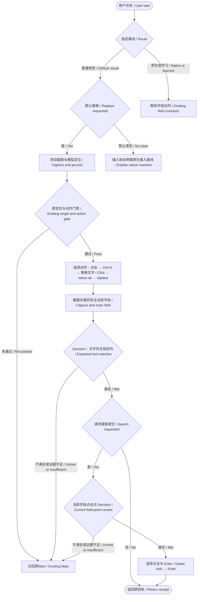

# 默认视觉输入闭环 / Default visual input loop

**执行 0.1.2 尚未发布。提交绑定的三次地址回归及全新 Bing→中文维基百科流程首次整套两轮、零输入取消与正常收尾通过；安装与独立验收待完成。 / Execution 0.1.2 is unpublished. Three-address regression and a fresh Bing→Chinese Wikipedia flow passed two rounds, zero-input cancellation and normal cleanup; installed and independent acceptance remain pending.**

普通视觉输入：定位审核通过 → 同一次动作连续点击输入框、Ctrl+A、替换文字 → Decision只核对规定文字 → 如请求提交，复用字段位置并审核当前点击点 → 连续点击与Enter。点击和键入之间不插入Decision、截图、重新选窗或激活；不增加点击后的吞点击确认、焦点外观或空框/OCR检查。 / After target approval, one runtime action clicks the field, selects all and replaces text. Decision then checks only the requested value. If submission is requested, reuse the field geometry for a fresh candidate review and execute click→Enter. No intervening model call, capture or activation; no post-click click-consumption, focus-style or empty-field check.

## 完整字段与独立点击点 / Full field and independent click point

定位输入框时，`bbox` 覆盖整个可见字段及已有文字区，`click_point` 独立落在请求的空白或其他可点击子区，不要求居中。输入后文字核验继续使用该字段的裁剪图；不能用右侧空白子框代替字段范围。外部 grounding 提示词及既有字段描述明确此通用合同，协议字段、版本与阈值不变，非字段目标语义不变。 / For an input field, `bbox` covers the whole visible field and its existing text; `click_point` independently selects the requested blank or other clickable subregion and need not be centered. The value check still uses the field crop, so a blank-only sub-box cannot stand in for the field extent. The external grounding prompt and existing field descriptions clarify this common contract without changing protocol fields, version, thresholds or non-field semantics.

Explorer 首次第 1 步已输入正确路径，但旧框只含右侧空白，193×53 ROI 漏掉左侧文字，Choice 因而返回 `condition_not_met`；0 完整轮，正常关窗与宿主收尾均成功，首败保留。Main 6 模块 197 项离线通过；4 次只读 API 诊断（1 grounding、3 Decision，0 桌面动作）不计首验或通用 benchmark。未加 UIA、全屏回退或焦点检查；本地 48px 点框及 bbox 中心路线未改。下一真实验收换全新 Notepad 文档输入→File→Save，覆盖两轮、取消和正常收尾。 / Explorer's first step entered the correct path, but the old blank-only box yielded a 193×53 ROI without the left-hand text, so Choice returned `condition_not_met`. Zero rounds completed; normal window and host closure succeeded, and the first failure remains. Main passed 197 checks across 6 modules. Four read-only API diagnostics (1 grounding, 3 Decision, no desktop actions) are not first-attempt acceptance or a general benchmark. No UIA, full-screen fallback or focus check was added; the local 48px box and box-center route are unchanged. Next acceptance uses fresh Notepad document input→File→Save, two rounds, cancellation and normal closure.

## 当前候选问题 / Current candidate question

候选 Choice 只判断标记点击点是否落在当前请求的目标内，以及是否被直接遮挡、禁用或存在明确的先决交互。与目标无关、没有遮挡或阻止该点位的弹层，不单独成为否决理由。输入动作仅补充该点击将开始字段输入，不推测一次点击是否只会关闭弹层。/ Candidate Choice checks whether the marked point is inside the requested current target, with direct obstruction, disabled state or an explicit interaction prerequisite. An unrelated nonblocking popup alone is not a rejection reason. Input actions state that the click starts field input; they do not ask the model to predict whether a click would merely dismiss a popup.

同一次请求只上传一张概览与目标细节合成图；原图和坐标认证在本地保留。当前规则替代 2026-10-12 的吞点击预测问题，旧问题与两图对照留在[验收记录](../verification/EXECUTION_STABLE_012_20261012.md)。修订后的一个旧弹层样本改变了预设选择，不能据此宣称所有反例通过，也不能用静态图证明实际点击送达。/ One existing request uploads one overview/detail image, while source and coordinate authentication remain local. This replaces the old click-consumption prediction, whose evidence is retained in the acceptance record. One old popup label changed; static images alone cannot prove click delivery or establish that every counterexample passed.

普通执行使用当前截图和模型定位。UIA字段、控件树与原生读值属于学习或显式原生路线。 / Ordinary execution uses screenshots and visual grounding. UIA and native reads remain available to learning or explicit native routes.

点击、全选、键入组合沿用原识别点击门禁；请求搜索提交时，再经新候选审核连续点击与 Enter。内部绑定本次目标身份、坐标和原请求文字，保留窗口身份、几何、前台窗口、取消、截止时间和剪贴板检查；这些本地检查不判断控件焦点外观，也不重复请模型审核。 / The click/select-all/type action retains the recognition gate. Requested search submission adds a fresh candidate review and gated click→Enter. It binds the target, coordinates and requested text, retaining local identity, geometry, foreground, cancellation, deadline and clipboard checks without judging field-focus appearance or another model call.

输入后上传一张完整字段裁剪标注图；符合带边距的大小上限时放大2倍，把历史点击刻度画在图外沿以免遮字；只检查规定文字，紧贴输入的灰色未接受补全交Main，忽略独立快捷提示；过大字段保持既有请求。完整原图、SHA、窗口身份、坐标变换及真实点击/全选/键入阶段回执保存在本地。不满足或证据不足交回原Main，不按Enter，不自动重复点击或输入。 / After replacement, one complete marked field crop is enlarged 2× within padded size limits, with historical-click ticks in an added margin to preserve field glyphs. Its one text-only question routes an attached gray unaccepted continuation to Main, ignoring separate shortcut hints; oversized fields retain the existing request. Preserve full source, hash, identity, mapping and real dispatch receipts locally. Unmet or uncertain results return to Main without Enter or automatic replay.

字段结果检查一次，不包含原定位/动作门禁或外层任务结果检查，因此不等于整个任务仅一次API。组合回执区分已点击、已全选、已键入及未知阶段；不能把点击成功记成文字成功。 / One field-result check excludes target/action and outer task checks. The compound receipt distinguishes click, selection, typing and unknown stages; a completed click never proves text entry.

默认 `clear_existing=true` 始终全选替换。普通视觉 `clear_existing=false` 在输入前返回 `visual_field_append_requires_explicit_native_route`；显式原生与学习路线保持原插入语义。旧分步点击Decision证明和 `visual_typing_strategy.v1/v2` 仅按旧回执语义认证，不作为新路线执行要求。 / Default replacement always selects all. Visual no-clear input is rejected before dispatch; native/learned insertion keeps its semantics. Historical split-step and strategy proofs retain their original validation only.

阈值不变，同一独立浏览器资料目录及缓存保留。状态见[正式版验收记录](../verification/EXECUTION_STABLE_012_20261012.md)；此前[白名单单轮成功](../verification/RECORDING_OVERLAY_ALLOWLIST_20261012.md)和[旧两轮失败](../verification/EXECUTION_TWO_ROUNDS_20261012.md)不转计本次通过证据。 / Thresholds and persistent browser data remain unchanged. Prior runs do not certify this revision.

## Receding-occlusion contract / 遮挡退缩合同

Only a post-capture occlusion completely contained in the original mask union can reuse the single captured frame. Keep the original mask; reject new/moved/unknown occlusion and any window binding change. Before Decision or input, the common action route rejects a point inside that source mask, with an authenticated not-dispatched receipt. Unmasked ROI routes remain unchanged; unknown masked-ROI mapping is rejected. No additional capture, wait, API request or normal-path PNG decode is added. / 仅后遮挡完全包含于原遮罩并集时保留单次截图，继续使用原遮罩；新增/外移/未知遮挡与窗口绑定变化仍拒绝。通用动作入口在Decision或输入前拒绝原遮罩内点，并认证未派发回执；无码ROI保持既有路线，带遮罩的未知ROI映射拒绝。不新增截图、等待、API或普通路径PNG解码。

Verification / 验证：worker红阶段5失败3通过；Main最终8文件153通过（含损坏路径、坐标/摘要/遮罩篡改、罩内零输入、罩外继续、无图像IO快速路径）；原19份Decision请求离线逐项一致。源码新流程尚待实际验收。 / These checks validate the common capture/input contract; fresh live acceptance remains pending.
