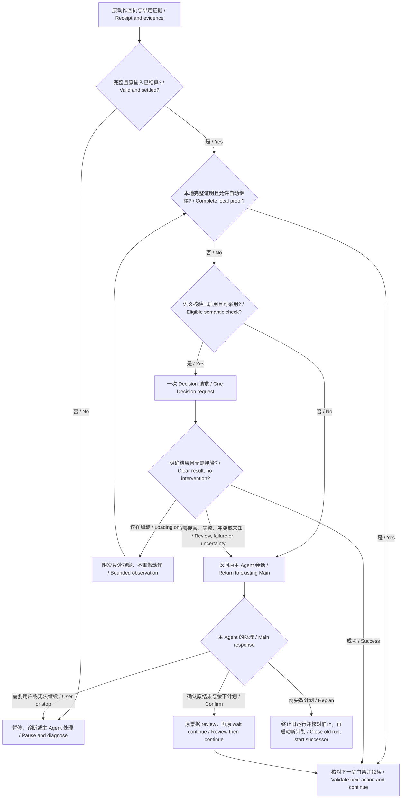

# Decision 主动交主 Agent 审核：详细设计 / Adaptive Decision review design

日期 / Date: 2026-10-09

状态 / Status: **用户已批准，按阶段实施中；尚未发布 / User approved, staged implementation in progress; unreleased**

**2026-10-10 用户补充：默认编排 / User amendment: default orchestration.** 本图为新任务默认架构，Decision API 可选。新调用采用 v2，新 v2 配置默认 auto/proactive/adaptive；完整本地证明直接继续，需要语义核验才调用已配置的 Decision。无配置/off 时沿用本地证明及原 Main 审核；已有明确策略、v1 和冻结会话不静默迁移。条件/模板批准和待审学习草稿不自动放行。源码及离线证据见[默认路由检查点](../../verification/DEFAULT_ADAPTIVE_ROUTING_20261010.md)，不代表已发布或已安装生效。 / New tasks use this architecture by default with optional Decision. New v2 configuration defaults to auto/proactive/adaptive, while local verification and original-Main review remain available without API. Explicit and frozen legacy policies retain their meaning; approval boundaries remain unchanged. Linked source/offline evidence does not imply deployment.

源码基线 / Source baseline: `codex/dev-decision-api` @ `5689d33738e75b722de7433454b2cc2661fd07da`

发布基线 / Release baseline: execution `0.1.2-preview.3`, optional learning `0.1.0-preview.3` (`learning-v0.1.0-preview.3`).

## 1. 目标与边界 / Goal and boundaries

**让程序处理稳定步骤，让 Decision 判断当前结果与是否需要调整，让已有主 Agent 只在需要理解、改计划或恢复时介入。** 核心变化是把“结果是否成功”和“是否需要主 Agent 审核”分开。Decision 可以很确定地识别出登录页，同时很确定地要求主 Agent 接管；不必伪装成识别不确定。

**Keep stable execution in the runtime, use Decision to assess outcomes and observable reasons for intervention, and involve the existing Main Agent when interpretation, replanning or recovery is needed.** Outcome and escalation are independent. A confidently recognized login screen can still require Main.

初稿只交付设计；用户于同日批准开发并要求将流程图加入 README，当前进入[实施计划](../plans/2026-10-09-adaptive-decision-review.md)。下文是目标合同；某项是否已实现、已验证，以实施计划证据为准，不能把设计当作已发布接口。

The initial draft delivered design only. The user subsequently approved development and the README diagram; work now follows the implementation plan. The sections below specify target contracts, not a claim that every feature is implemented or shipped; consult implementation evidence.

- 执行模式与可选学习模式继续独立；本地识图、外部视觉 API 与 Decision 判断保持不同职责。 / Execution and optional learning remain independent; grounding and Decision judgment stay separate.
- 复用现有运行器、动作队列、主会话和票据，不建立第二个执行器，不逐步新建 Agent。 / Reuse the runner, queue, current Main conversation and receipts; no second executor or per-step Agent creation.
- 本设计不增加任意循环、自动跨窗、动态字段提取或完全自主规划；不以判断模型代替输入授权。 / No arbitrary loops, automatic cross-window execution, dynamic extraction or general autonomous planner; judgment does not grant input authority.
- 目标是减少真实主 Agent 介入、误判与整段任务耗时，不以 API 调用数量增长作为进度。 / Optimize real Main interventions, errors and end-to-end time, not API call count.

## 2. 当前已经具备什么 / Existing capabilities

| 项目 / Area | 已有 / Current | 本设计增加 / Proposed |
|---|---|---|
| 判断 / Judgment | 显式条件的 success / failure / uncertain；自动采用受配置约束。 / Explicit-condition verdicts with configured adoption. | 独立的主动审核信号与明确路由。 / Separate proactive review signal and routing. |
| 执行 / Execution | 1–8 步线性计划；原生核验与 Decision 条件分属不同路径。 / Linear 1–8 step plans; separate native and semantic paths. | 在有效语义不匹配处允许声明 Decision 接续；不掩盖坏证据。 / Declared semantic continuation after valid mismatches. |
| 学习 / Learning | 图像优先；有效普通图像不匹配可接续 Decision；已审核版本固定。 / Image first, eligible mismatch continuation, pinned reviewed versions. | 可编辑语义条件及审核选项；现场调整可提出新草稿。 / Editable conditions and review policy; optional draft from a repair. |
| 接管 / Handoff | 不确定后按原票据 review，再显式 continue；取消后可重新规划。 / Bound review, explicit continue and cancellation/replanning. | 高置信结果也能请求 Main；交接包与客户端提示一致化。 / Escalation independent of verdict confidence, consistent packets. |
| 限额 / Budget | 默认 cap 20；执行侧按宿主会话累计；状态未列实际用量。 / Default cap 20 per execution host scope; usage not exposed in status. | 显示 used/remaining；新观察受每步及会话预算约束。 / Visible usage and bounded per-step observation. |

当前只有“未能自动判断 → 主 Agent”，尚无完整的“判断明确，但计划需要变更 → 主 Agent”协议。规则编辑器目前保留已有 `decision_condition`，尚没有完整编辑入口。单张 after 图不证明时间推进或音视频正在播放。

The current fallback to Main does not implement this proactive planning signal. The rule editor preserves existing conditions but lacks a full editor. A single after image cannot establish temporal progress or audio/video playback.

## 3. 谁负责什么 / Responsibilities

| 组件 / Actor | 职责 / Responsibility | 权限边界 / Boundary |
|---|---|---|
| Runtime | 执行已提交步骤、核对身份与证据、选择核验路径、记录结果和等待。 / Execute submitted steps, validate evidence, route and persist. | 只能执行已支持、已获授权的动作。 / Supported, authorized actions only. |
| Decision | 判断可观察条件、错误、计划外障碍；返回概率。 / Assess observable outcomes, errors and off-plan obstacles. | 不生成点击坐标、工具调用、新计划或授权。 / No coordinates, tool calls, plans or permissions. |
| Main Agent | 理解任务，审核交接材料，核对动态内容，修订剩余计划。 / Interpret, review, inspect dynamic content and replan. | 继续走同一维护接口及输入门禁。 / Uses the same maintained gated interfaces. |
| 客户端 / Client | 把等待返回已有 Main 会话，携带原 ID 调用 review / continue / cancel。 / Return waits to the existing Main and send bound controls. | 回调不是模型唤醒器；宿主不自行创建 Main。 / A callback is not a model wakeup mechanism. |
| 人 / Human | 根据既有授权规则处理真正需要用户的选择或授权。 / Handle choices or authorization that actually require the user. | “主 Agent 审核”不等于“询问用户”。 / Main review is not human approval. |

## 4. 推荐审核逻辑 / Recommended review logic

### 4.1 先分类证据，再调用模型 / Classify evidence before calling a model

1. 先检查取消、原命令状态、窗口身份、票据关联与截图完整性。输入部分完成或结果未知时，不允许 Decision 把它改成完成，也不自动重放。 / First check cancellation, original input, identity and evidence. Partial or unknown input cannot be promoted to completed or replayed.
2. 有完整本地证明就继续。完整意味着覆盖该步骤所有必需结果、范围和已声明的阻挡条件；仅“出现一个按钮”不能证明整项业务成功。 / Complete local proof may continue; it must cover all required outcomes, scope and declared blockers, not merely a visible button.
3. 本地证据有效但只能证明部分目标，或出现正常语义不匹配，并且配置允许时，交 Decision。 / Valid but incomplete semantic coverage or a normal mismatch may use an explicitly enabled Decision route.
4. 采集失败、窗口不符、图像歧义、回执损坏等直接暂停并给 Main 明确故障；不付费请求模型掩盖故障。 / Acquisition, binding, ambiguity and receipt failures pause with an explicit diagnostic rather than semantic fallback.
5. Decision 接续只在条件可观察、策略允许、预算足够时派发。不符合自动采用范围的新条件，默认直接交 Main；只有显式 shadow / advice 调试才付费收集建议。 / Dispatch only for observable, eligible, budgeted conditions; unapproved conditions go to Main unless paid shadow/advice collection is explicitly selected.

策略前置检查：`always_main` 直接进入 Main 审核，默认不先付费；`shadow` 的新路由只作记录，实际仍按旧运行合同处理。第 4.3 节自动路由表只作用于 `auto + adaptive`；不能用高概率越过策略或条件允许范围。

Check policy before dispatch: always_main goes directly to review without a paid pre-check by default; shadow records hypothetical routes while retaining existing behavior. Section 4.3 controls execution only for auto + adaptive and eligible conditions.

本地核验不是通用异常检测器：未建模的弹窗可能漏检。因此“完整覆盖”必须写入核验合同和用例；无法证明下一步仍在原目标范围内时，不得走本地快速通过。

Local checks are not universal anomaly detectors. Full coverage must be explicit and tested; inability to establish the next action's target scope excludes the local fast path.



图中的只读观察循环受第 8 节硬限额约束，不是无限轮询。取消在任意节点优先：停止新派发，结算原票据，保留未知副作用。 / The observation loop is bounded by section 8. Cancellation takes precedence everywhere: no new dispatch, settle original tickets and preserve unknown effects.

### 4.2 Decision 一次判断哪些问题 / Independent predicates

| 字段 / Predicate | 提问内容 / Observable question |
|---|---|
| `condition_met` | 这一步声明的可观察目标是否达到？ / Is the declared observable outcome present? |
| `visible_error` | 当前活动流程是否有阻挡目标的错误？ / Is an error blocking the active flow? |
| `needs_agent_review` | 当前画面是否出现未包含在允许状态中的障碍、额外选择或需要新动作的变化，使原剩余计划不能直接执行？ / Is there an off-plan obstacle, choice or change requiring interpretation or a new action before the remaining plan? |
| `still_progressing`（可选 / optional） | 是否有该步骤预先声明的加载或处理中标志？ / Is a declared loading or processing indicator visible? |

前三项放在同一次请求；仅声明等待策略的步骤增加第四项。每项独立依据同一证据和冻结的目标/允许状态判断，不要求模型猜“自己是否聪明到能处理”。`still_progressing` 只说明加载标志，不等于证明最终一定完成。

The first three share one request; the fourth is included only for declared waiting policies. Questions independently assess evidence and frozen context, not model self-confidence. A loading indicator does not guarantee eventual completion.

OpenAI 官方文档支持在同一 `questions` 数组中评估多个独立问题；谓词返回估计概率。它不是任意说明文本或工具参数生成接口。因而 `reason_codes` 由程序依据回答和本地检查生成；复杂解释由 Main 补充。增加问题的实际耗时和费用变化尚未测量。[官方依据 / Official source](https://developers.openai.com/api/docs/guides/decisions#ask-multiple-questions)

Independent questions can share a request and predicates return estimated probabilities. Runtime reason codes are derived from checks and answers; Main supplies any narrative explanation. Added latency and cost remain unmeasured. The official API supports this shape, but the project's current two-question adapter still needs a versioned extension.

### 4.3 路由优先级 / Routing precedence

初始建议沿用 `high = 0.9`、`low = 0.1`；它们只是待校准阈值，不是“90% 实测准确率”。先验证本次应有字段、检测全部冲突、计算 verdict，再按下表计算 disposition；主动审核不能遮蔽冲突或把 uncertain 留成 success。missing / refusal / 非法数值不是 0。 / Start with provisional high 0.9 and low 0.1, not measured accuracy. Validate requested fields, detect all conflicts and compute the verdict first; then derive disposition in table order. Escalation cannot hide a conflict or preserve an invalid success. Missing/refused/invalid values are never zero.

| 优先级 / Order | 情况 / Condition | 结果与处理 / Result and disposition |
|---|---|---|
| 1 | 已取消，或硬输入限制不允许。 / Cancelled or input prohibited. | 停止新派发；原命令仍须结算。 / Stop dispatch, retain settlement. |
| 2 | 原输入未知/部分、身份/证据无效。 / Unknown/partial input or invalid binding. | `uncertain` + 诊断/Main；模型不能修复原事实。 / Diagnose/review, never promote input facts. |
| 3 | 缺字段、拒答、认证失败、超时、预算耗尽。 / Missing/refused/invalid/unavailable/budget exhausted. | `uncertain` + Main；不自动重试。 / Review, no automatic request retry. |
| 4 | 本次请求了 `needs_agent_review` 且结果 `> low`。 / Requested review signal is positive or gray. | 保留预先算出的 verdict 并交 Main；灰区原因单独记录。 / Retain the computed verdict and review, distinguishing gray from high. |
| 5 | `visible_error > low`，或互相冲突的回答。 / Error positive/gray or inconsistent answers. | 停止自动继续；使用预计算的 failure 或 uncertain（冲突）；均交 Main。 / Retain the precomputed failure/uncertainty and review. |
| 6 | `condition_met >= high`，无冲突，所有额外条件已证明，error 低，且审核问题低或被策略明确关闭。 / Outcome high, extra conditions proven, error low, review low or explicitly disabled. | `success` + 自动继续（auto 模式）；下一步仍单独过门禁。 / Continue in auto, subject to next-action gates. |
| 7 | 目标尚未达到；声明了等待，`still_progressing >= high`，error 低，且审核问题低或被策略明确关闭。 / Eligible declared progress, no error or active review signal. | `uncertain` + 有界只读观察，不重复点击。 / Bounded read-only observation, no repeated input. |
| 8 | `condition_met <= low`，且不是允许等待的加载状态。 / Outcome low, not eligible loading. | `failure` + Main 决定恢复/新计划；不自动重做。 / Main chooses recovery/replanning. |
| 9 | 其余。 / Everything else. | `uncertain` + Main。 / Review. |

成功与错误同时为高，或“已完成”和“仍在进行”在该步骤定义中互斥却同时为高，都算冲突。失败表示本步骤目标未满足；不代表动作没有发生。 / Conflicting success/error or mutually exclusive complete/progress signals require review. Outcome failure does not mean no input occurred.

verdict 预计算顺序：应有字段/必需证据不完整或回答冲突为 uncertain；无冲突的明确阻挡错误为 failure；成功条件及额外条件全部成立才为 success；仅合法加载为 uncertain；明确未满足且非合法加载为 failure；其余为 uncertain。模型接管概率不改变这套结果计算。 / Verdict order: invalid/incomplete required evidence or conflicting answers yields uncertain; an unambiguous blocking error yields failure; fully established outcomes yield success; eligible loading yields uncertain; a clearly unmet non-loading outcome yields failure; otherwise uncertain. Review probability does not change that calculation.

**因此：`verdict=success` 可以同时对应 `disposition=review_required`。** 这正是新增选项的价值。自动继续要求成功与不需接管同时成立。 / **A success verdict can coexist with review_required.** Automatic continuation needs both success and no need for intervention.

## 5. 配置与用户界面 / Configuration and UI

主选项：**“允许 Decision 在需要时交主 Agent 审核 / Let Decision request Main review”**。新建、明确启用自动 Decision 的配置默认开启；旧 profile 和正在运行的会话不静默升级。关闭仅取消主动语义审核问题；不取消原有不确定、坏证据或未知输入暂停。

Enable proactive review by default in newly created, explicitly enabled auto-Decision profiles. Existing profiles and sessions retain their behavior. Turning it off removes proactive semantic escalation, not existing uncertainty/error handling.

profile 快照显式冻结 `enabled_predicates`。策略未请求的字段记录 `not_requested`，按该关闭策略路由，不伪造概率 0；请求了却未返回的字段属于协议错误，必须暂停。`still_progressing` 未启用时同理，不允许由缺值推断“仍在加载”。 / Freeze enabled_predicates in the profile. Unrequested fields are not_requested and use the declared policy, never synthetic zeroes; a requested missing answer is a protocol error. An omitted progress predicate never implies loading.

保留 `off / shadow / auto`，另加 `review_policy = adaptive | always_main`。adaptive 是推荐日常模式；always_main 用于调试或明确要求逐步审核。shadow 仅记录模拟路由，不让新回答改变实际运行。off 或未配置仍正常使用已有本地/主 Agent 路径。

Retain off/shadow/auto with adaptive or always_main review policy. Adaptive is the everyday mode; always_main is explicit/debug use. Shadow records proposed routes without changing execution. Missing or disabled API preserves existing operation.

每步显示三项可编辑内容：可观察成功条件、允许等待的状态（可选）、交接策略；运行页显示“本地已核验 / Decision 核验 / 等待状态 / 主 Agent 接管 / 需要用户”。同时显示原因、原动作是否已执行、调用次数与剩余额度。默认英文，中文可切换。

Expose per-step observable success, optional allowed waiting state and review policy. Show Local verified / Decision verified / Waiting / Main review / User required, with reason, original input status and budget. English default with Chinese switching.

学习库修改条件、覆盖范围或交接策略后保存新不可变修订，相关步骤按依赖规则重新待审核；运行中的固定版本及旧发布版本不改变。Main 的现场处理只作用于当次运行；“保存为改进草稿”是独立动作，经审核才能采用。

Learning condition, coverage or policy edits create an immutable revision and invalidate affected review status. Pinned runs/releases stay unchanged. Runtime repairs affect only that run; saving a proposed improvement is a separate draft-and-review operation.

## 6. 数据合同 / Data contracts

### 6.1 新版本及兼容 / Versioning and compatibility

提议增加 `decision_profile.v2` 与内部 `decision_assessment.v2`；需要新语义的短计划用 `task_plan.v2`。严格验证器继续拒绝未知版本/字段，v1 读取和历史核验保留旧含义，不把缺少新字段解释为“无需 Main”。学习程序使用自己的版本化 verification 扩展，固定确切修订。

Introduce versioned profile, assessment and task-plan contracts; retain v1 readers and semantics. Strictly reject unsupported fields/versions. Missing new predicates are not negative answers. Learning verification is versioned within immutable revisions.

内部结果结构示意；这里的概率仅为示例，不是实测记录。 / Illustrative internal assessment; probabilities are examples, not observations.

```json
{
  "schema_version": "decision_assessment.v2",
  "phase": "after_action",
  "verdict": "success",
  "disposition": "review_required",
  "review_scope": "remaining_plan",
  "reason_codes": ["off_plan_intervention_high"],
  "predicates": {
    "condition_met": 0.98,
    "visible_error": 0.02,
    "needs_agent_review": 0.96
  },
  "adopted_for_continuation": false,
  "authorizes_action": false,
  "binding": {
    "run_id": "run-001",
    "step_id": "open-result",
    "execution_request_id": "execution-001",
    "evidence_set_id": "evidence-001",
    "assessment_round": 0
  }
}
```

外层持久合同还必须包含 plan/program 版本及 SHA、profile 快照 SHA、目标窗口出生身份、原回执 SHA、各 capture_id/SHA/时间/角色、请求 SHA、模型/提示版本、预算归属、完整原回答和认证信息。截图 URL/文件不以用户界面字符串替代身份。

The persisted envelope must also bind plan/program version and digest, profile snapshot, window birth identity, receipt digest, capture IDs/digests/times/roles, request hash, model/prompt version, budget scope, raw answers and authentication. Display labels do not substitute for identity.

`disposition` 由本地规则计算，枚举 `continue | observe | review_required | stop`；Decision 本身不直接选择操作。`review_scope` 区分 `effect | remaining_plan | effect_and_plan | runtime_diagnostic`。第一版不在主动审核前自动结算步骤：保留建议结果并进入原 `verification_required` 等待，由 Main review 原结果，然后决定 continue 或 cancel/replan。

Runtime derives disposition. Review scope separates outcome assessment, remaining-plan interpretation and diagnostics. Initially, proactive review suppresses automatic step settlement: keep the suggested outcome in the original verification wait, let Main review it, then continue or cancel/replan.

已结算后的新异常不得重新打开旧结果、伪装成效果审核；若以后支持这种场景，必须另加明确的规划等待合同，本次不实现。 / An anomaly discovered after settlement cannot reopen or rewrite the result; future support needs a distinct planning-wait contract and is outside the first slice.

### 6.2 条件来源与动态内容 / Conditions and dynamic content

第一阶段仍支持现有完整字符串 allowlist，明确展示“不允许自动采用”的原因。随后引入允许列表中的 `condition_template_id + revision + template_sha256 + typed_parameters`，同一模板可绑定不同记录号；模板文字、参数范围、允许状态及审核策略共同冻结到计划。Main 可以填入本次任务参数，不能通过随意换模板文字扩大允许自动采用的范围。

Initially preserve exact-text allowlists and expose ineligibility. Then support explicitly approved, versioned condition templates and typed parameters. Freeze template, scope and policy in the plan; parameter binding cannot expand template authority.

示例：“详情页记录号等于本次输入 `record_id`”，不写死上次 ID。要从画面读取新的金额、文件名或记录号时，仍用可信读取/OCR/主 Agent，得到真实值再绑定；是/否回答不能生成动态输出。

For example, compare the detail record to this run's input ID. Newly extracted values still require a reader/OCR/Main and validated output binding; predicate answers cannot supply extracted values.

只发送当前任务所需的目标、当前步骤、剩余计划摘要、允许状态和截图，不发送整段聊天、密钥或无关桌面内容。画面中的指令作为被观察数据，不能变成审核策略或授权。

Send only relevant task/step/suffix context, allowed states and scoped evidence, never the whole conversation or credentials. Screen instructions remain observed data, not policy or authority.

## 7. 主 Agent 如何接管和交回 / Main handoff and return

### 7.1 交接材料 / Review packet

返回 `review_packet.v1`：目标、步骤及预期结果；原输入状态；plan/program/profile 绑定；原 run/step/execution/wait ID；原回执、原 after 图及追加观察的独立引用；本地核验结果；Decision 原结果/理由码；剩余计划摘要；允许的下一控制操作；已用/剩余预算。

Return a review packet containing goal, expected outcome, original input facts, version bindings, original IDs, receipt/evidence references, local proofs, raw Decision assessment, suffix summary, valid controls and budget.

三栏分开展示“已知事实 / 模型建议 / 待处理事项”。原图与后续观察分别标注，不把后来截图写回原动作 after 字段。客户端重复查询返回相同 packet/wait，不重复计费、不重复触发审核回调。

Separate facts, model advice and required work. Label original and later evidence distinctly. Repeated queries return the same packet/wait without another charge or callback.

引入追加观察后，审核请求还必须绑定 `review_packet_sha256 + evidence_set_sha256 + assessment_round`，结算时与当前等待版本比较。原 wait 可保持；新证据生成新 packet revision，旧版 review 拒绝并返回当前版本。客户端按 wait + packet revision 去重：同版查询不再回调，新版可回调一次，不重新执行动作。 / With additional observations, bind reviews to packet/evidence-set digests and assessment round. Keep the original wait but revise the packet for new evidence; reject stale reviews. Deduplicate callbacks by wait plus revision, allowing one callback for genuinely new evidence without replay.

### 7.2 回到原会话 / Return to the existing conversation

Runtime 持久化等待并停止 suffix 派发，通过当前 MCP 工具返回 `review_required` 和 packet；已有 Main 收到工具结果后继续思考。客户端负责转交，不能把 Python event_callback 写成“自动调用 Astra”。没有活跃调用时等待保留，下次同一客户端查询取回；客户端断开不等于任务成功。

Persist the wait and stop suffix dispatch. Return review_required through the current MCP call so the existing Main continues. Client integration performs the handoff; a Python callback cannot itself invoke Astra. Without an active call, retain the wait until polled.

### 7.3 Main 的四种处理 / Four Main responses

| 处理 / Response | 协议动作 / Protocol |
|---|---|
| 原结果及剩余计划适用 / Confirm | 审核原票据及证据，`review` 结算；随后用同一 `wait_id` 显式 `continue`。review 本身不产生输入。 / Review the bound original, then explicitly continue the same wait. |
| 还缺观察 / More evidence | 只读观察请求，保留原命令；不把“再看一眼”实现成再次点击。 / Read-only observation, never replay input. |
| 要处理弹窗或改计划 / Replan | 先走取消/结算到静止，再用新 plan/run 处理恢复及未执行步骤。 / Close the old run, then start a successor for recovery and the unexecuted suffix. |
| 无法继续或需要用户 / Stop or user | 停止自动输入，给出具体欠缺；只有确实需要用户选择/授权才询问。 / Stop input, describe the missing decision; ask only when needed. |

**不原地修改运行中的 suffix。** successor 用新的 run/plan ID，记录 `successor_of`、旧计划 SHA、已结算 prefix 摘要和变更原因。旧历史保留原处，不复制为新计划“已经执行”的步骤。新计划不得包含已完成动作的隐式重放。

**Do not mutate the active suffix.** Use new run/plan IDs with lineage and a settled-prefix digest. Preserve original history instead of copying it as newly executed steps; do not implicitly replay completed input.

取消不是立即释放锁：必须确认原 queued/running/grounding/deferred job 和已准备票据都已结算或由现有未提交取消路径记为零输入。仍有未知在途输入时拒绝新输入。新 start 在锁内重新核对旧终态、prefix SHA、目标身份和唯一输入所有权；失败就保持无新输入，不能先输入再补记录。

Cancellation does not immediately release ownership. All prepared or queued/in-flight work must be settled or cancelled through existing paths. Reject new input while an original command remains in flight/unknown. Successor admission rechecks terminal state, prefix digest, identity and exclusive ownership atomically before dispatch.

为防止旧交接在后续被再次使用，新增持久 `successor_request_id`，绑定旧 run/plan/prefix、当前 `lineage_generation` 和新 plan SHA。同一逻辑请求回读原 successor，不因新的传输 request ID 重派；相同 ID 内容不同或 generation 已被消耗均拒绝。准入以 compare-and-swap 消耗该 generation，并在第一次输入前保存关联；崩溃后先协调原准入记录和队列，不新建 successor 猜测重试。

Persist a logical successor_request_id bound to parent run/plan/prefix, lineage generation and new plan digest. Return the original successor for repeats regardless of transport ID; reject conflicting content or consumed generations. Consume the generation with compare-and-swap and persist lineage before first input. Reconcile admission and queue records after a crash instead of creating a speculative successor.

原步骤结果即使经 Main 确认，等待仍可保留直到显式 continue；客户端不得把“backend ready、runner 仍保留旧 wait”的合法过渡误判为漂移。迟到的 Decision、review、continue 均需再核对取消和版本；已取消就不派发后续输入。

Reviewed backend state and an outstanding runner wait can coexist until explicit continue. Late Decision/review/continue results must recheck cancellation and version before any dispatch.

## 8. 等待、证据新鲜度和预算 / Waiting, evidence freshness and budget

本节属于第二阶段显式观察合同，第一阶段不得通过偷偷重新截图来扩展当前只接受原 after 图的核验器。 / This requires the phase-two observation contract; phase one must not silently extend an original-after-only verifier.

- 只有原输入已完成、窗口身份一致、声明了等待状态且没有 review/error，才允许只读观察任务。固定原 execution 关联，生成新 observation_id；禁止覆盖原回执。 / Observe only completed input in the same bound target with declared progress and no blocker. Append new observation IDs without overwriting receipts.
- 建议初始上限：每步至多两次追加采集，相对进入观察后的 500 ms 和 1500 ms；每次先尝试完整本地证明，成功即结束。实际采集慢时跳过过期采样点，不补发并发截图。 / Proposed maximum two additional observations at 500 and 1500 ms; check locally and stop early, skipping missed slots rather than bursting.
- 最后仍需要语义判断时，至多再发一次 Decision；每步最多两次付费请求（初判加一次新证据判定）。不是同图重试，也不每 500 ms 请求 API。 / At most one additional semantic call on new evidence: two paid calls per step in total, never periodic API polling or same-evidence retries.
- 建议整段验证预算 12 秒，从原回执可用开始计时，包括本地核验、网络及追加观察；每个请求 timeout 为 profile timeout 与剩余时间的较小值。超时立刻返回 Main，不能等待无限延长。数值必须在实测后再调整，不是当前速度承诺。 / Proposed 12-second verification deadline including local/network/observation time; bound request timeout by remaining time. Tune from measurements, not promises.
- 单张静图只证明静态条件。播放/跳转趋势须有显式配对观察、同一目标身份和真实时间间隔，或合适的原生状态读取；不能用“看起来像播放器”报告视频正在播放。 / Static images establish static conditions only; temporal claims require paired evidence or suitable native state.

幂等键纳入 session/run/step/execution、phase、assessment_round、evidence_set SHA、condition/template SHA、profile/prompt 版本。重复同键读取原结果；派发标记已有但结果未知时报告未知，不重新请求。追加观察生成新 evidence_set 和 round，预算先持久预留，网络请求不在执行锁内等待。

Bind idempotency to execution, phase, round, evidence set, condition and policy/prompt versions. Reuse exact results; unknown dispatched requests are not retried. New evidence creates a new round and reserves budget before network I/O outside execution locks.

保留宿主会话总 cap，新增每 run/每 step 限额且取最小值；新建计划不能重置宿主预算。状态公开 dispatched/available/unknown-dispatch 数量；不承诺根据不完整 token 记录得到精确美元余额。默认不自动补充限额、不自动改价格假设。

Keep the host-wide cap and intersect it with per-run/per-step caps; new plans do not reset host spending. Expose dispatched, available and unknown-dispatch counts, not an invented exact dollar balance.

## 9. 动作前审核与安全判断 / Pre-action review

本次主要解决结果审核及计划适用性。动作前可复用现有显式 `before_action` 检查：只在已声明需要语义辨别的候选上调用，如活动流程中可能具有最终确认含义的按钮；不为每次普通导航加请求。Decision 用 `unsafe_effect` 替代 `visible_error`，并允许请求 Main。

The main scope is outcome and plan applicability. Reuse explicit before_action checks for declared semantically sensitive candidates, not every navigation. Use unsafe_effect rather than visible_error, plus proactive review.

动作前返回审核时还没有输入，Main 处理后必须重新获取并验证当次窗口、候选和坐标；不能复用审核等待前的点击点。任何阶段的“安全概率低”都不等于授权；最终提交/发送/支付等既有硬限制继续有效。当前正式默认路径没有全面启用 AI 风险拦截，不能把本设计说成已经替换全部安全判断。

Pre-action review leaves input unexecuted; after Main returns, refresh and validate the target/candidate before acting. Low estimated danger is not authority. Existing hard limits remain; current default runtime does not globally enable AI risk interception.

## 10. 典型场景 / Worked examples

| 场景 / Scenario | 新逻辑 / Proposed behavior |
|---|---|
| 固定表单，值及页面状态均有完整本地证明。 / Stable form, complete local proof. | 零 Decision、零 Main 逐步审核，原运行器继续。 / No paid check or per-step Main review. |
| 按钮位置变了但目标身份有效；成功页语义符合条件。 / Changed layout, valid target, semantic success. | 本地识图定位；一轮 Decision 清楚通过后继续。 / Ground normally, one eligible semantic assessment. |
| 点击成功打开页面，但出现需要选择账号的弹窗。 / Page opens with account choice. | 结果可为 success，同时 needs_agent_review 高；停 suffix，Main 决定下一计划。 / Success plus review; Main replans. |
| 页面显示已声明的 loading。 / Declared loading indicator. | 限次只读观察，完成就继续；超限交 Main；不再点击原按钮。 / Bounded observation, no replay. |
| 点击后是错误页。 / Error page. | failure + Main；Main 可取消并提交恢复计划，不能自动重试付款等动作。 / Review and explicit recovery, no blind retry. |
| 当前窗口不符或截图空白。 / Wrong target or empty capture. | 直接报告证据故障，不调用 Decision 猜结果。 / Diagnose before any semantic fallback. |
| 读取本次订单金额。 / Read a current amount. | 实际读取并验证值；Decision 可核对已知条件，不能代替提取。 / Read/validate actual data, not predicate extraction. |
| 学习流程修复有效。 / Learned flow repaired. | 本次完成；可另存改进草稿，旧版本不变。 / Finish this run; optionally draft a new reviewed revision. |

## 11. 源码承接位置 / Implementation map

所有路径相对仓库根；这是后续修改范围，不是本轮修改记录。 / Paths are repository-relative future touchpoints, not files changed in this design slice.

| 层 / Layer | 文件 / Files | 修改方向 / Intended change |
|---|---|---|
| API 与服务 / Provider/service | `app/judgment/openai_decisions.py`, `profile.py`, `service.py`, `evidence.py`（同目录 / same directory） | 多谓词严格解析、v2 策略、理由码、预算、证据绑定；保留认证与无自动重试。 / Strict predicates, policy, reasons, budgets and bindings. |
| 计划 / Plan | `app/execution/task_plan_contract.py`, `task_plan_verification.py`, `task_plan_backend.py`（同目录 / same directory） | 显式策略、完整本地证明分类、原票据等待、successor 来源。 / Policy, proof classification, bound waits and successor lineage. |
| 输入所有权 / Admission | `app/execution/task_plan_admission.py`, `app/learning_memory/workflow_runtime.py`, `workflow_runner.py`（后两者同目录 / latter two same directory） | 复用唯一执行队列与 review/continue/cancel；审核期间停止 suffix。 / Reuse queue/control/ownership, block suffix on review. |
| 单步 / Direct step | `app/execution/decision_check.py`, `app/instant_mcp.py` | 统一理由及版本适配，保持原操作覆盖边界。 / Consistent reasons/versioning, preserve operation scope. |
| 学习 / Learning | `app/learning_memory/runtime_verification.py`, `decision_verification.py`, `workflow_verification.py`, `workflow_trial.py`（同目录 / same directory） | 图像优先、语义接续、额外条件和动态输出限制。 / Image first, eligible semantics, output constraints. |
| 编辑 / Editing | `app/learning_memory/workflow_rules_editor.py`, `workflow_program.py`（同目录 / same directory） | 条件及策略编辑、新版本重新审核。 / Condition/policy editing and re-review. |
| 客户端 / Client | `scripts/learning_benchmark_client.py`, `app/instant_mcp.py` | 原会话交接、同一等待去重、明确 continue；不自行 spawn Main。 / Same-conversation handoff, dedup and explicit continuation. |

两项前置修正：原生核验须区分“有效不匹配”和“证据坏了”，再允许语义接续；task-plan 的 provider/认证异常应像现有 direct-step 路径一样形成明确结构化等待，而不是只依赖外层 callback_error。先证据分类，后接续，不另建兜底执行器。

Prerequisites: distinguish valid native mismatches from invalid proof before semantic continuation; normalize provider/authentication failures into structured waits as direct-step already does, rather than relying solely on outer callback errors. No fallback executor.

## 12. 开发顺序与完成标准 / Delivery order and acceptance

### P1：核心主动审核闭环 / Core proactive review

新增三谓词评估和策略版本，统一路由；复用原 wait/review/continue，形成交接包；客户端返回已有 Main；用既有 cancel + 新 start 完成受控重新规划，增加不可变 successor 关联。先支持显式可自动采用条件，不把条件编辑器和更多等待状态作为这个闭环的前置工程。

Add three-predicate assessment, versioned routing and review packets; return to the existing Main, reuse bound controls and controlled cancel/new-start replanning with lineage. Begin with explicitly eligible conditions.

完成标准：相同已成功步骤可以分别走自动继续或主动审核；Main 审核后精确续接，必要时停止旧运行后启动剩余计划；无重复输入、无新主会话、无取消后动作、无已完成 prefix 重放。

Done when success can either continue or escalate, Main can resume or replan, and duplicate input, fresh Main sessions, post-cancel dispatch and prefix replay are excluded by tests.

### P2：可用配置与有限等待 / Usable configuration and bounded waiting

新增语义条件/策略编辑和模板绑定、预算显示；补有效原生不匹配接续；实现追加观察合同和有界 loading 处理。学习图像成功路径继续零 API；旧版本读取和固定引用回归。

Add condition/policy editing, template binding, budget status, valid native mismatch continuation and explicit bounded observations. Preserve zero-call complete image proofs and pinned-version compatibility.

### P3：真实连续验收和收益 / Continuous acceptance and benefit evaluation

先离线合同与集成，再 Main 在全新低风险应用/数据中的单项及连续任务，修复复测后由独立 Sol ultra 验收同一冻结候选。包含弹窗、变化数据、取消、重开、API 异常、限额耗尽及最终清理；首次失败与复测分开保留。减少反复打包，主链通过后再统一构建。

Run offline contracts/integration, then Main's fresh low-risk individual and continuous tasks, then independent Sol ultra acceptance of the same frozen candidate after repairs. Include dialogs, data changes, interruption, reopening, service failures, budgets and cleanup; retain first failures.

比较：A 当前 preview.3 流程；B 新 adaptive 方案；C 同候选 always_main（只用于测逐步主模型成本）。使用相同任务集、相同模型/截图配置、交替次序和独立结果判据。普通/变化/异常三类分别报告，不用脚本回调耗时冒充真实 Main 推理。

Compare current preview.3, adaptive routing and always_main on the same candidate/task setup with alternating order and independent outcome checks. Report ordinary, changed and exceptional cases separately; scripted callbacks do not measure Main reasoning.

必须记录 / Required metrics:

- 整任务首次成功率；错误自动放行次数；需要审核却漏交的次数；不必要接管次数。 / First-attempt completion, false automatic passes, missed reviews and unnecessary escalations.
- 每任务真实 Main 介入次数、调用次数/token、Decision 次数/token、证据采集及各段耗时。 / Actual Main and Decision use plus capture/stage latency.
- 冷启动与预热分开；median/p95、样本量及原始失败；成本按当时价与实用量另计。 / Separate cold/warm results, medians/p95, sample counts and failures; cost from actual usage.
- 常规完整本地证明零 API；重复 status/review 不增加请求；unknown/partial 不自动成功或重放。 / Zero-call local proofs, no repeated charges on polling, no promotion/replay of unknown input.

发布门槛：确定性合同用例全部通过；冻结标注集不能出现已知错误放行或绕过取消/所有权的回归；相对基线首次完成不下降，常规 Main 介入与端到端耗时实测下降。若速度无收益或漏交上升，应调条件/路由再测，不能靠多调用模型宣称完成。有限样本没有错误不代表现实中零错误。

Release gate: passing deterministic contracts, no known false pass or cancellation/ownership regression in the frozen labeled set, non-decreasing first completion and measured reductions in ordinary Main involvement and task latency. Retune if not achieved; finite zero-error tests are not universal guarantees.

## 13. 本轮核对与未验证项 / Review evidence and open validation

本设计基于上述源码的只读核对，以及执行/客户端和学习两条独立设计检查；codegraph 在该工作树未初始化，因此使用定向源码检索。官方文档确认多独立问题请求的能力；没有使用密钥或发送真实推理请求。

This design uses read-only source inspection and independent runtime/client and learning design checks. The codegraph index was unavailable in this worktree, so targeted source search was used. Official docs confirm multi-question support; no credential or inference call was used.

文档一致性复核发现并已补齐四项：未请求谓词与缺失回答的区别、verdict 先于路由计算、追加观察的审核版本绑定、successor 的持久逻辑幂等。它们是设计修订，不是运行故障已修复的声明。 / Document review corrected four design gaps: unrequested versus missing predicates, verdict-before-routing, review revisions for observations, and durable successor idempotency. These are design corrections, not runtime fixes.

**待实测：** 新谓词误判率、阈值、增加问题的延迟/费用、真实 Main 交接时延、追加观察适合的时间间隔、各客户端工具返回到主会话的行为。已有发布版的历史速度和通过数不能当成本设计的验证结果。

**Unverified:** new-predicate quality and calibration, added latency/cost, actual Main handoff time, observation timing and client return behavior. Previous release results do not validate this proposed design.

用户已批准上述行为并要求实施及 README 流程图；先限定源码开发，随后批准不操作电脑的离线测试。核心交接和编辑已有离线组合证据，有限追加观察按独立切片集成与验证；真实 API、复杂实机和收益仍待验收。本设计文档不代替实施计划及验证记录，也不代表已发布。

The user approved implementation and the README diagram, initially restricted work to source, then authorized offline tests without operating the desktop. Core handoff/editing have offline evidence; bounded observation is integrated and checked as a separate slice. Real API, complex live use and benefit evaluation remain pending. This design does not replace implementation evidence or imply publication.
