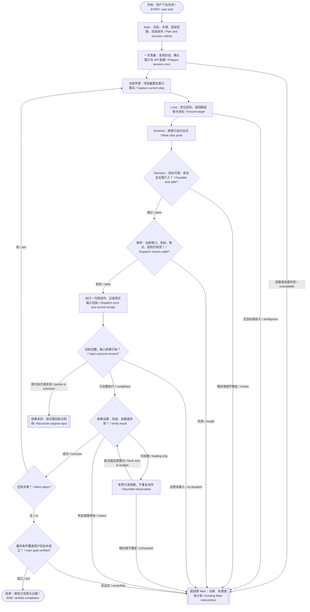
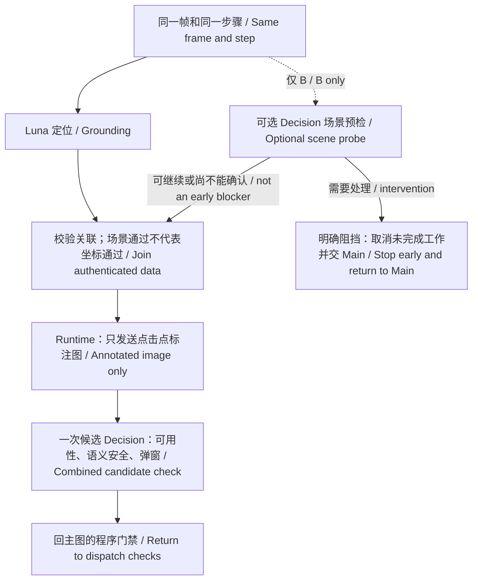
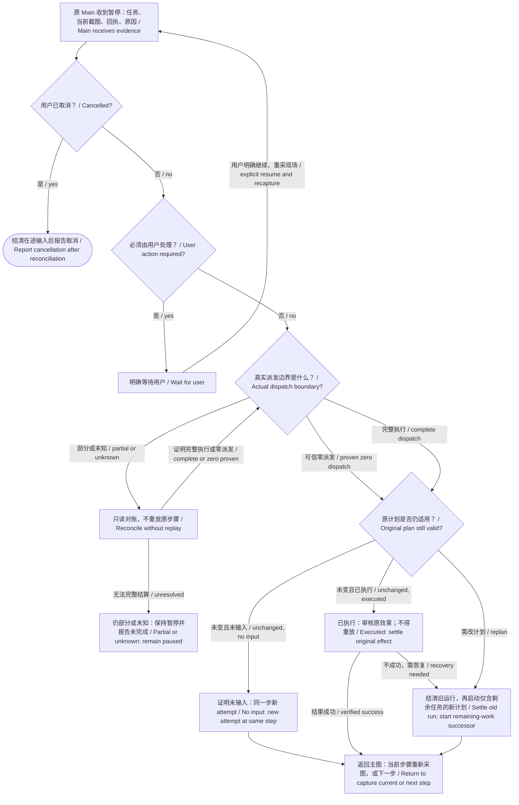

# 从任务到完成的视觉执行流程 / Task-to-completion visual execution

日期 / Date: 2026-10-11
状态 / Status: **2026-10-12：程序重复像素否决已清理，Decision语义误判仍待单独评估；本轮仅离线。 / Duplicate pixel vetoes removed; semantic accuracy remains to be evaluated. Offline-only update.**

2026-10-12未发布源码：清除认证Decision通过后的程序重复像素否决。合并点击审核不再重拍、二次调用Decision或用第三帧像素否决；独立auto入口采用同样绑定校验，shadow保留原规则。视觉字段不再按ROI像素/光标/整候选框遮挡触发freshness审核；仍校验已有原生字段身份、焦点、值与选区，Ctrl+A后的真实选区效果仍须证明。保留原截图摘要、窗口/进程身份与几何、动作点绑定、认证/期限/取消和实际点遮挡检查。Decision提示词、阈值、初始焦点与输入后语义判断未改；本轮仅离线，尚未复测真实API或桌面，不能宣称自动流程已通过或实测提速。 / Unreleased source removes duplicate post-approval pixel vetoes: one combined click review followed by binding checks, with the same behavior for adopted standalone auto decisions. Visual fields no longer trigger freshness decisions for ROI pixels, caret or full-box masks. Native field/focus/value/selection continuity, real selection verification, authenticated source/identity/geometry/point bindings, deadlines, cancellation and actual-point occlusion remain. Shadow behavior is unchanged. Decision prompts, thresholds and initial/result semantics are unchanged. Offline verification only; no new live API/desktop or automatic-flow performance claim.

实施入口 / Implementation: [分阶段计划 / Staged plan](../plans/2026-10-11-visual-execution-decision-flow.md)。前序设计 / Earlier design: [Decision 主动审核 / Adaptive review](2026-10-09-adaptive-decision-review-design.md)。本提案修正普通视觉执行的前置审核、恢复及最终完成语义；未覆盖的学习与兼容约束继续沿用前序设计。 / This proposal supersedes ordinary visual execution's pre-action review, recovery and final completion design; unrelated learning and compatibility rules remain unchanged.

## 1. 目标与边界 / Goal and boundaries

用户下达任务后，Main 一次生成可执行步骤和可观察的完成条件。运行时在同一会话中推进，Luna 负责视觉定位，Decision 负责语义可行性、安全与结果判断；只有异常、歧义或计划变化才返回原 Main。 / Main translates the user's task into executable steps and observable completion conditions once. One runtime session advances them, Luna grounds targets, and Decision assesses semantic feasibility, safety and outcomes. Exceptions, ambiguity and plan changes return to the original Main.

这里的“安全判断”不赋予新权限：授权范围、禁止动作、窗口身份、坐标边界、取消与真实输入回执仍由程序执行。Decision 可以判断弹窗是否影响当前动作，程序不得仅因“存在弹窗”拒绝；但实际点击落在遮挡物上、目标窗口已变或系统禁止输入时，模型的通过不能改变事实。 / Semantic approval grants no new authority. Authorization, prohibited actions, window identity, coordinate bounds, cancellation and input receipts remain enforced. Popup presence alone is not a refusal; actual occlusion, changed identity or OS input denial still prevents dispatch.

**全局约束 / Global constraints**

- 初版仅授权源码与离线；用户随后批准同范围桌面/API测试，2026-10-12最新要求先审核并清理重复规则。本次规则清理先做离线回归，不提交或发布。 / Initially source/offline only; later scoped live approval enabled the recorded trials. The latest 2026-10-12 instruction prioritizes redundant-rule cleanup with offline regression, without commits or publication.
- 普通执行以视觉定位为主；不强制安装学习组件，不把 UIA 整树扫描或学习检索加回每步前置流程。 / Ordinary execution is vision-first, without mandatory learning installation, full-tree UIA scans or per-step learning lookup.
- 复用原 Main、宿主、客户端、DecisionService、task_plan 和 WorkflowRunner；不建立第二套执行器。 / Reuse the original Main, host, client, DecisionService, task_plan and WorkflowRunner; do not create a second executor.
- 所有真实点击仍走维护的 gated action API；禁用原生 Codex Computer Use。 / All real clicks retain the maintained gated action API; native Codex Computer Use remains disabled.
- Decision 是条件判断服务；本地适配器组合条件，不假定上游新增工具调用、自由 JSON 或坐标生成能力。 / Decision evaluates predicates. Local composition does not assume new upstream tools, arbitrary JSON or grounding capabilities.
- 不静默更改冻结配置、阈值、付费上限或旧 task_plan.v1/v2 语义；英语默认、中文可切换。 / Preserve frozen configurations, thresholds, paid caps and old task_plan.v1/v2 semantics; English remains default with Chinese available.
- 新文档中英同步、UTF-8；保留既有未提交改动及首次失败证据。 / Keep new documentation bilingual and UTF-8, preserving unrelated edits and first-failure evidence.

## 2. 修正后的主流程 / Corrected main flow

**起点就是“用户下达任务”，不是“是否输入”，也不是某个动作的回执。图中异常出口的恢复规则见第 5 节。** / The start is the user's task, not an input-type question or an action receipt. Section 5 defines recovery from exception exits.

说明 / Notes:

- 候选问题只核对点击标记中心是否位于指定可见目标内部，图中不画矩形框。原图与点图仍同一次请求；安全及接管另用原有判断。 / Candidate feasibility checks whether the marker center lies within the intended visible target. No rectangle is rendered. Original and point image share one request; safety and intervention use their existing predicates.

- “结果证据”优先使用已声明且充分的本地证明；需要语义核验才调用 Decision。最后一步的同一次结果判断可同时覆盖最终目标，不默认再加一次结尾 API。 / Use declared sufficient local proof where available, otherwise Decision. The last assessment can also prove the user goal; no mandatory extra final API call.
- 本图展示已配置 Decision 的目标路线。未配置、关闭、额度耗尽、条件未获许可或 API 故障时，返回明确原因；完整本地证明或原 Main 审核是兼容路线，不能假装 Decision 已判断。 / This shows the configured-Decision route. Disabled, missing, exhausted, disallowed or failed service produces an explicit reason. Local proof or original-Main review is the compatible alternative, never a fabricated Decision verdict.
- Main/UNKNOWN 均不是结束节点，也不直接返回 ACTION。恢复必须按第 5 节重新核对当前步骤。用户取消始终优先，未解决问题必须报告未完成。 / Main and UNKNOWN are neither success nor direct routes to ACTION. Recovery follows section 5. Cancellation always wins; unresolved work is reported incomplete.

## 3. 并行可用性检查与调用次数 / Parallel availability and call count

保留用户提出的“Luna 定位时同时检查弹窗/遮挡”的方案，但明确两种证据的权限不同。场景预检只看到任务、动作描述和截图，看不到尚未生成的候选坐标；不能把它的通过冒充具体目标审核。 / Preserve the proposed parallel popup/occlusion check, distinguishing its scope. A scene check sees intent and the frame, not a future candidate. Its approval cannot stand in for candidate review.

**当前源码默认 A：定位后合并一次前置 Decision。B 已接入但默认 off，待真实对照证明收益后再决定启用；未改变已有冻结 profile。** / Source defaults to A with one post-grounding combined review. B is implemented but defaults off pending live comparison; frozen profiles remain unchanged.

| 路线 / Route | 动作前 / Before action | 动作后 / After action | 普通成功步骤的 Decision 请求 / Typical successful-step requests |
| --- | --- | --- | --- |
| A：合并审核 / Combined | Luna → Runtime标图 → 同一次Decision检查候选、弹窗影响和语义安全 / Candidate, obstruction and safety together | 本地充分证明或一次 Decision / Local proof or one Decision | 1 或 2 / 1 or 2 |
| B：并行预检 / Parallel probe | Luna 与场景预检并行；未提前阻挡时再审核候选 / Parallel scene check, then candidate review unless stopped early | 同 A / Same as A | 2 或 3 / 2 or 3 |
| 无 Decision / Without Decision | 原有授权及 Main/既有完整证明 / Existing authority and Main/proof | 本地证明或 Main / Local proof or Main | 0；不宣称同等自动化 / 0; no equal-autonomy claim |

这些是“逻辑步骤”的普通调用数，不是所有动作的固定账单。输入组合、动态观察、重定位和异常处理必须分项记账。不得用关闭必要的焦点/结果证明凑调用数。 / These are typical logical-step counts, not fixed charges for all operations. Compound input, temporal observation, re-grounding and recovery are counted separately; required proof must not be removed to meet a count.

并行 worker 只返回数据；原执行线程认证、签发并消费一次性许可。共享单调时钟截止时间，迟到、跨帧、跨窗口、跨 attempt 的结果不得采用。取消远端请求不保证免计费，已发请求照实记录。 / Workers return data only; the original execution thread authenticates and consumes one-use capabilities. One monotonic deadline bounds the attempt; late or mismatched results are inadmissible. Cancelling remote work does not imply no charge.

## 4. 证据、输入与职责 / Evidence, input and responsibilities

### 4.1 一次动作审核所需上下文 / Action review context

冻结用户任务、当前步骤、后续步骤摘要、授权动作类别、目标描述、候选 bbox/point、窗口出生身份、完整原截图、capture_id、截图文件 SHA、profile SHA、条件版本和 attempt_id。Decision 收到完整语义上下文；不能继续用当前动作的 goal 冒充整个任务或总是发送空 remaining_plan。 / Freeze the user task, current and remaining steps, allowed action class, target, candidate, window birth identity, original frame and its ID/hash, profile/condition versions and attempt ID. Do not substitute an isolated action goal or empty remaining plan for the real task.

程序只做可客观验证的门禁，不重新判断“这个网站是否适合任务”或“弹窗内容是否应该关闭”。截图内的 DOM 弹窗与原生弹窗均交 Decision；原生窗口信息提供 owner、位置和 enabled 等事实，而非一个“有弹窗就失败”的语义结论。 / Code enforces objective gates rather than re-judging website suitability or popup meaning. Decision sees DOM and native overlays; native checks contribute owner, bounds and enabled facts.

### 4.2 认证证据与输入绑定 / Authenticated evidence and input binding

- Luna候选与当前原图在Decision前完成绑定；Decision负责当前目标语义、可行性和是否需要介入。 / Bind grounding and current original evidence before Decision; Decision owns target semantics and feasibility.
- 采用通过结果后，不再采第三帧做像素否决，不追加目标变化语义请求，也不要求光标/边框/外围动画静止。 / Once adopted, no third-frame pixel veto, added freshness judgment or frozen caret/border/animation requirement.
- 输入边界核对认证结果、原文件摘要、同一窗口/进程及几何、原候选点、授权、取消和期限；原生读取后再检查期限。实际点击点遮挡、禁用父窗和系统拒绝仍阻止输入。 / Preserve authenticated proof, original bytes, native identity/geometry, original point, authority, cancellation and deadlines, including after native reads. Actual point occlusion, disabled parents and OS refusal still block dispatch.
- 已有native字段证据时继续核对当前焦点、身份、值、来源与选区。Ctrl+A改变了实际输入状态，仍核验选区；这不同于再次询问同一截图的语义。 / Recheck available native field facts; verify selection after Ctrl+A because it changes input state.
- 每步仍使用新的定位/判断，不跨动作复用通过。删除像素循环不证明模型判断到实际输入之间页面绝不改变；本轮也不声称Decision准确性或自动连续运行已通过。 / Each action uses new evidence and decisions. Removing pixel loops does not prove an atomically unchanged page between review and input, model accuracy or successful autonomous continuity.

### 4.3 普通输入不能被控件依赖卡死 / Vision-first text input

普通点击的主要定位继续来自 Luna。UIA 控件能力保留，明确的学习/控件路线继续使用；普通视觉输入不因 UIA 缺失就启动整树扫描。 / Luna remains the primary ordinary-click grounder. Keep UIA for explicit learned/structured routes; absent UIA must not trigger full-tree scans in the visual route.

文字输入已接通“选中字段 → 焦点可信 → 全选证明 → 填写 → 内容核对 → 必要时搜索 Enter”，保留原线程、一次性、窗口与动作绑定。UIA 仅做有界字段读取；缺失时焦点和全选由认证视觉证明支持，精确值需已预热维护 OCR 的 ROI 读取，否则交 Main。不能用动作前通过证明点击后的焦点，也不冷启动本地模型。 / Visual input now supports ordered focus, selection, replacement and exact-value proof with existing authority. Bounded UIA reads remain; missing value evidence may use prepared ROI OCR, otherwise Main is required. Pre-action approval cannot prove future focus and no cold model startup is introduced.

第一阶段视觉输入只覆盖可读普通文本字段。密码、无法精确核验的文字、不可见焦点、跨窗口热键以及非搜索的提交保持原约束或交 Main。浏览器地址栏输入与搜索 Enter 必须明确建模为导航/搜索，不能扩展成任意确认。 / Initially support readable ordinary text fields only. Passwords, unverifiable text, invisible focus, cross-window hotkeys and non-search submission retain existing constraints or require Main. Address-bar and search Enter are explicitly navigation/search, not arbitrary confirmation.

## 5. 主 Agent 介入后的恢复 / Recovery after Main intervention

| 状态 / State | 可做什么 / Allowed next action | 不可做什么 / Prohibition |
| --- | --- | --- |
| `blocked_before_dispatch`：可信回执证明未输入 / Proven zero dispatch | 原 Main 看证据并处理；同一步新 attempt 重新截图、定位、审核 / Main handles it; new attempt at the same step | 把拒绝当成功或直接复用旧坐标 / Promote refusal or reuse old coordinates |
| `effect_review`：已执行，结果未证明 / Dispatched, effect unverified | 只读观察或审核原结果；成功后推进 / Observe/review original result, then advance | 再点一次“试试看” / Replay to find out |
| `reconcile_required`：输入部分完成或结果未知 / Partial or unknown input | 保留原 ticket、已完成子动作和输入边界；核对权威回执与当前现场 / Reconcile receipt and current state | 根据 API 超时、Main 一句判断或截图变化推定零输入 / Infer no input from timeout, opinion or change |
| `waiting_user`：登录、验证码、用户选择 / User action required | 明确等待用户；恢复后重采 / Wait explicitly, then recapture | Main 与 Decision 无限往返 / Endless Main/Decision loop |
| `cancel_requested`：输入可能仍在执行 / Possible in-flight input | 阻止新输入并结清原票据 / Stop new input and reconcile | 提前宣称已取消所有实际输入 / Claim all dispatched effects cancelled |

这些是设计的审核原因/暂停类别，优先扩展既有 review packet、wait 和 runner，不平行维护另一套状态机。 / These are proposed review reasons/pause classes, implemented through existing packets, waits and runner rather than a parallel state machine.

Main 处理弹窗也是一个明确的恢复动作，仍走维护输入门禁、原授权和独立回执。处理完不得恢复旧候选。相同阻挡在一次明确恢复后仍重现，暂停并汇总证据，不自动再循环处理。需要新计划时，旧运行必须已结清或安全终止、命令队列为空且无未知输入；保留已完成前缀，不能把已完成输入复制到 successor。 / Main's popup handling is a gated, authorized recovery action with its own receipt. Recapture afterwards. Repeated obstruction after one recovery pauses instead of looping. Successors require settled/terminated parent state, a quiet queue and no unknown input, preserving the completed prefix.

现有 active-plan admission 会拒绝非原票据输入，因此必须增加受限恢复许可，不能让 Main 绕过活动计划：许可绑定 run/wait、恢复动作摘要、目标窗口、取消代次及单次 request；队列无在途输入时才可签发，每次只接纳该恢复动作，回执结清后才能重采原任务。恢复动作本身部分执行或未知则保持暂停。 / Existing admission rejects unrelated commands during an active run. Add a scoped one-use recovery permit tied to run/wait, exact recovery action, window, cancellation generation and request, admitted only without in-flight input. Settle that receipt before resuming the business task; partial/unknown recovery also pauses.

新恢复行为由任务启动时显式冻结的 `recovery_policy=intervention_v1` 启用；v1/v2 调用省略时保持 `legacy`，旧配置不静默升级。拟新增 v3 默认使用 intervention_v1。第一版不自动续跑部分输入：例如 focus 已执行但 type 未开始，仍是部分步骤，不能归类成零输入或完整执行；Main 可核对、终止并报告未完成，不直接重发整个 input_sequence。 / Freeze an explicit intervention_v1 recovery policy at start; omitted v1/v2 calls retain legacy behavior, while proposed v3 defaults to intervention_v1. Initial support excludes automatic partial-step continuation: focus-only is neither zero nor complete input. Main may reconcile or terminate as incomplete, never replay the entire sequence.

同一步恢复必须保留旧拒绝票据并创建新 attempt、新 execution_request_id 与新审核绑定；不能继续使用只由 run_id/step_id 生成的旧执行 ID，否则会重读之前的拒绝结果。对同一个恢复请求重试则返回同一新 attempt，不能生成两次真实输入。 / Preserve the old rejected ticket and create a new attempt, execution ID and review binding when resuming the same step. Reusing a run/step-only execution ID would replay the cached refusal. Retrying the same recovery request must return the same new attempt, never duplicate input.

## 6. 等待、额度与最终完成 / Waiting, budgets and completion

- 每个输入前 attempt 共享截止时间，Luna、可选预检、候选审核和新鲜度复核都扣同一余额。启动参数显式提供总预算，不能按串联的完整超时相加。首轮数值沿用已选配置并在测试前冻结；本计划不凭空承诺毫秒级响应。 / A single explicit per-attempt deadline covers grounding, optional probe, candidate review and freshness checks. Freeze configured budgets before testing; do not stack full per-call timeouts or promise unmeasured latency.
- 初始化只在任务/连接级执行一次；读取实际生效的 mode、allowlist、配置哈希、API 状态、host_session 剩余额度。每次派发仍原子检查并扣预算；预检成功不保留永久额度。 / Preflight once per task/connection, exposing effective mode, allowlist, hashes, availability and host-session balance. Each dispatch still atomically checks/debits budget.
- 用户于2026-10-12批准新 `before_action_pass_threshold=0.80`，仅调整动作前可行性；危险及接管阈值保持。`after_action_pass_threshold=0.80`、`after_action_review_threshold=0.70`仍仅适用于动作后。字段省略时保持旧profile摘要，不重解释旧回执。 / The user approved the independent0.80 pre-action feasibility threshold on2026-10-12; danger and review remain unchanged. After-action fields retain their scope, and omitted fields preserve legacy profiles and receipts.
- 当前普通加载观察是 12 秒总预算，最多两轮 Decision、最多两次跟进截图；动态内容链是独立的 8 秒预算。不得合并或把每轮重置成新预算。 / Existing ordinary observation has a 12-second total, at most two Decision assessments and two follow-up captures; dynamic evidence has its separate 8-second budget. Do not conflate or reset them.
- 最终条件必须在启动前定义为可观察的用户目标；“点击已发送”“窗口出现”“画面变化”均不能独立代替业务完成。纯三帧变化只能证明指定内容有变化，不能自动等价于指定视频正在播放。 / Define observable user-goal completion before starting. Dispatch, window appearance or generic motion is not business completion; three-frame change proves change in the specified region, not automatically the requested video playing.
- 新计划格式拟用 `task_plan.v3` 明确 `goal` 与 `completion`；v1/v2 不静默改语义。末步结果若已证明同一最终条件可复用原认证证据，否则进行只读最终审核。 / Proposed task_plan.v3 carries explicit goal/completion without silently changing v1/v2. Reuse authenticated last-step evidence when it proves the same goal; otherwise perform read-only final review.

## 7. 当前事实与缺口 / Current facts and gaps

| 当前源码事实 / Current source fact | 本计划补齐 / Proposed change |
| --- | --- |
| `popup_decision.py` 只覆盖原生 owned popup，位于定位后；不是并行全场景审核 / Native owned-popup check after grounding | 统一候选审核兼顾 DOM/原生遮挡；并行预检独立标记 / Unified candidate review with separately scoped optional probe |
| `input_sequence.py`、`local_text_focus.py`、`local_keyboard_target.py` 仍有控件身份/焦点依赖 / Existing control-identity and focus dependencies | 明确视觉字段证明边界，保留可用有界控件证据 / Explicit visual field proof with optional bounded control evidence |
| popup 等待前后使用整帧 SHA 相等 / Whole-frame equality around popup review | 完整性保留整帧认证，新鲜度改为相关证据 / Full integrity plus relevant freshness |
| 输入前拒绝可能把计划结为 failed / Pre-input refusal may terminate plan as failed | 可恢复的零输入暂停；不混淆未知或部分输入 / Recoverable zero-input pause, distinct from unknown/partial input |
| 目前最后一步成功即 completed / Last-step success currently completes the plan | 新格式显式最终条件，旧格式保持兼容 / Explicit completion contract in new format |

历史验证：此前弹窗/零输入/焦点相关 Main 集合 **218 passed / 8.01s**，证据 `D:/AgentReviewAcceptance/popup-decision-20261011-01/main-final.xml`。这是旧源码局部离线结果，不是本提案验收、整库全绿或真实桌面通过。本轮没有新增测试。 / The earlier focused 218-pass offline suite is prior evidence only, not acceptance of this proposal, whole-repository success or desktop validation. No new tests this turn.

## 8. 成功标准 / Acceptance

首先闭合原失败任务“地址栏输入 Google → 搜索 java → 第一个普通结果”。再用全新数据完成同会话连续场景：无关弹窗、真正遮挡、页面动画、目标移动、输入焦点变化、加载、取消、API 故障与 Main 恢复。记录首败、复测和收尾；不只验自建 demo。 / First close the original address-bar → Google → java → first ordinary-result failure. Then cover fresh same-session realistic variations, keeping first failures, reruns and cleanup separately.

准确性看任务首次完成、错误放行、误拒、未知输入重复执行和最终结果误报；速度看用户提交到首次有效动作、整任务完成、Main 往返及 p50/p95；成本看实际 Luna/Decision 调用和 usage。A/B 同任务、同模型/profile/候选比较，小样本只作诊断。B 只有在未观察到准确性退化且端到端收益抵消额外调用时才建议启用。 / Measure first-pass completion, false acceptance/refusal, duplicate unknown input and false completion; user-to-first-action and end-to-end latency including Main and p50/p95; and actual calls/usage. Compare frozen A/B cases, treating small samples as diagnostic. Enable B only with measured benefit and no observed accuracy regression.
