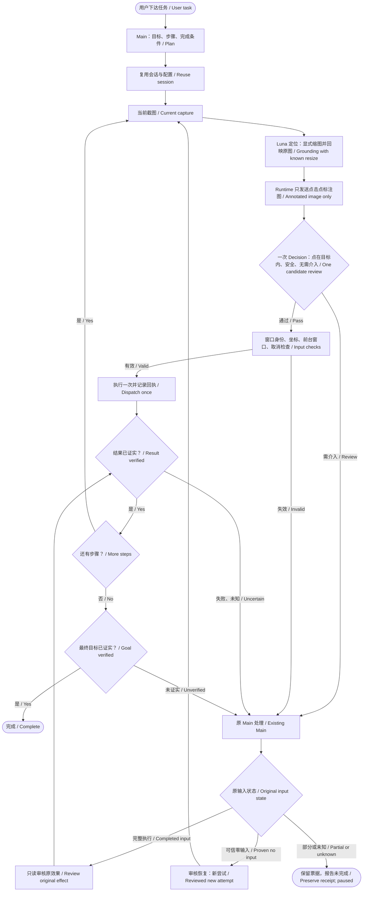

# Historical execution checkpoints / 执行开发历史记录

This is the pre-release README snapshot from 2026-10-12. Its successive checkpoints may supersede one another; current behavior is described in the repository README. / 此处保留历次候选原记录，当前行为以仓库首页为准。


**录屏白名单实测通过（未发布源码，2026-10-12） / Recording-overlay live rerun passed (unreleased source).** 精确 NVIDIA 覆盖窗白名单现覆盖截图与取整后1×1点击区域；保留实际点位命中、多像素原生区域和Decision审核。本轮首败暴露单像素区域漏接，已补修并通过237项离线回归；随后一次复测由用户关闭窗口中断；最终使用原保留Edge资料目录自动完成 Google网址→java搜索→首个普通链接3/3，抵达Java官网，零Main接管。各步均记录同一NVIDIA覆盖窗豁免，源码输入已使用“实际点击点在输入框内”条件。宿主及测试窗口正常收尾，缓存和阈值未改；仅成功复测一轮，不代表连续可靠性。 / The exact NVIDIA exemption now covers captures and outward-rounded1×1 click footprints, retaining hit tests, multi-pixel native-region checks and Decision review. The first run exposed missing pixel-scope wiring; it was repaired and237 offline checks passed. Another run was interrupted by the user's window closure. The final retained-profile rerun completed Google→java→first ordinary result3/3, reaching Java with zero Main intervention and recorded overlay exemptions. The new input click condition was exercised. Cleanup preserved cache and thresholds; this is one successful rerun, not continuous reliability. [证据与首败 / Evidence and first failure](../../docs/verification/RECORDING_OVERLAY_ALLOWLIST_20261012.md).

**默认全选替换（未发布源码） / Default replacement (unreleased source).** 2026-10-12，普通视觉输入改为：定位并点击 → 裁剪标注图确认实际点击点在目标输入框内 → Ctrl+A → 输入 → 只核对规定文字。删除执行中的空框/OCR分类及全选后模型审核；不再生成内容驱动的 typing_strategy。保留裁剪、真实派发回执、窗口绑定、取消、截止时间和输入后错误交回原Main。旧回执认证按原义保留；普通视觉 clear_existing=false 在点击前明确拒绝，插入须使用原生路线。未改阈值，本批尚未实机复测。 / Ordinary visual input confirms the recorded click inside the intended input, selects all, replaces text, then verifies the requested value. Runtime empty/OCR classification and post-selection model review are removed. Crop/receipt/window/stop bindings and Main handoff remain. Historical receipt validation is retained; visual no-clear input is rejected before clicking and insertion uses the native route. Thresholds are unchanged; this slice has not been live-tested.

本批最终24模块591项离线回归通过（27.71s，0失败/跳过）；未实机复测。 / Final offline regression: 591 passed across 24 modules; no live retest. [验证记录 / Evidence](../../docs/verification/DEFAULT_REPLACE_20261012.md)。

以下近期记录是各自历史候选的证据，当前输入流程以上方说明为准。 / The checkpoints below describe earlier candidates; the current input flow is defined above.

**OCR裁剪版本单轮实测通过（未发布） / OCR-crop single live run passed (unreleased).** 2026-10-12，原保留独立Edge资料目录：Google网址→java搜索→首个普通结果自动3/3完成，到达Java官网；无Main接管。两处输入实际走OCR nonempty后的原授权替换，未使用空框直接输入优化。测试窗口与宿主正常关闭，缓存和阈值未改。仅单轮，不替代连续稳定性验收。 / The retained isolated profile completed all3 steps automatically, reaching Java with no Main intervention. Both fields used OCR nonempty/replacement, so this does not validate the empty-field fast path. Normal cleanup preserved cache/thresholds; continuous reliability is not established. Evidence: [本轮记录](../../docs/verification/OCR_FIELD_CROP_20261012.md).

**两轮连续实测未通过（未发布） / Two-round live acceptance failed (unreleased).** 同窗口、同宿主、原保留profile：第一轮Google → java → Java官网3/3自动完成；第二轮点击地址栏后Decision返回不满足输入条件，未继续键入，并将已有网址误判为空。启动时发现的完整可见截图缺证明字段已修复，相关109项通过、1项符号链接权限跳过。阈值未改，正常关闭测试窗口与宿主，缓存保留。见[实测与失败证据](../../docs/verification/EXECUTION_TWO_ROUNDS_20261012.md)。 / Round1 completed3/3; round2 stopped at address-bar readiness with a false empty classification. A missing successful-capture evidence field was fixed and verified by109 checks with one permission skip. Thresholds/cache were preserved; cleanup completed.

**OCR 字段裁剪已接入源码（未发布） / OCR field crops integrated in source (unreleased).** 新视觉输入在未标注原图的完整字段及16px周边裁剪上运行本地RapidOCR；Decision不再判断空框，字段审核仅上传一张实际点击标注裁剪图。Main最终22模块536项离线回归通过（18.99s，0失败/跳过）。同一保留误拒网址图单次正式API返回可输入，OCR读出正确网址；本次HTTP更慢，不能归因裁剪或声称提速。已追加一轮完整浏览器3/3通过；此前两轮未通过事实保留，阈值与缓存未改。见[OCR裁剪记录与限制](../../docs/verification/OCR_FIELD_CROP_20261012.md)。 / Local RapidOCR checks the complete field with 16px padding; Decision no longer classifies emptiness and receives one marked field crop per field frame. Main's final 536 checks passed across 22 modules. One retained-frame API replay accepted the target with a correct OCR URL; it was slower and establishes no crop-only causality. A subsequent single browser run passed3/3, without establishing continuous reliability. Thresholds/cache and the failed two-round record are preserved.

**全流程源码审查完成（未发布） / Source flow audit completed (unreleased).** 已补齐候选审核混入未来计划、Decision前整图相等误拒、Enter签发前取消结算、最终截图校验跨期限四处缺陷，并更新当前v3/Choice调用指南。49个相关模块786项离线回归通过；本轮未调用真实API或操作桌面，未改阈值或浏览器资料。此前单轮3/3实测不转计本次修复，连续稳定性仍待验证。见[审查与证据](../../docs/verification/EXECUTION_FLOW_AUDIT_20261012.md)。 / Four defects were repaired: future-context leakage, a duplicate whole-image veto, pre-Enter stop settlement, and deadline expiry during final capture validation. All786 checks across49 relevant modules passed. No live API/desktop work, threshold or browser-data changes occurred; earlier live success does not certify these changes.

**输入前点击点审核已修正（未发布） / Pre-input click readiness corrected (unreleased).** 普通执行用一张真实点击标注图判断目标能否输入；不再要求光标/焦点样式或500ms补图。空框直接输入，输入后只核对规定文字。Main 479项离线回归通过；同一保留 Edge profile 的 Google网址 → java搜索 → 首个普通链接已自动3/3完成，抵达Java官网，零Main接管。窗口/宿主正常关闭，缓存保留，阈值未改。一次通过不代表连续稳定；前序失败保留。见[修复与实测证据](../../docs/verification/INPUT_READINESS_20261012.md)。 / Ordinary execution now reviews one executed-click image for input usability, without caret/focus styling or the 500ms follow-up capture. Empty fields type directly; value checks compare requested text only. Main passed479 offline checks; one retained-profile three-step flow completed automatically with no Main takeover. Normal cleanup preserved cache; thresholds unchanged. Continuous reliability remains unverified.

以下为前序检查点，状态仅对应各自批次。 / The following are historical checkpoints.

**启动判定与失败结算已修复（未发布） / Startup and failure settlement repaired (unreleased).** 283项相关离线回归通过；完整成功的选窗才启动，定位前截图失败可凭原零输入证据结算。使用原保留 Edge profile 的实测成功打开 Google，但搜索框点击后的 Decision 焦点审核两次返回 evidence_insufficient，仍未输入java或打开首个链接；一次为 Main 显式续接。两次已正常结算为 failed，无 unknown 卡住；宿主与窗口正常关闭，缓存保留，阈值不变。完整自动流程和连续稳定性仍未通过。详见[修复与真实结果](../../docs/verification/STARTUP_CAPTURE_SETTLEMENT_20261012.md)。 / Relevant offline checks passed (283). Live startup and Google navigation passed, but two focus reviews requested Main before java was typed. Both settled as failed; normal cleanup preserved cache. Full autonomous completion remains unverified.

前序失败（本轮修复依据）：选窗截图报 capture_window_occluded，测试驱动误按内部focused继续，输入流程也在截图处停止并记为unknown；未重复输入，正常收尾且缓存保留。上轮3/3成功仍保留，但连续稳定性未通过。 / A subsequent repeat failed at window capture. The test driver proceeded on nested focus status despite outer failure; runtime stopped with unknown input. No replay; normal cleanup retained cache. The prior success remains separate from this failed repeat.

**空框直接输入已实测（未发布） / Empty-field direct input verified (unreleased).** 纯视觉 Choice 在既有焦点请求内判断空／非空：空框直接输入，跳过 Ctrl+A 与全选核验；非空仍按原请求替换。公开接口支持已认证空框的 clear_existing=false，原请求与真实派发分别留存。572项去重离线检查通过；同一保留 Edge profile 的 Google网址 → java搜索 → 首个普通结果已自动3/3完成，抵达 Java | Oracle，零 Main 接管。窗口和宿主正常关闭，缓存保留；单次通过不代表长期稳定。阈值和安装器未改。见[本轮修复与验收](../../docs/verification/VISUAL_EMPTY_INPUT_20261012.md)。 / Choice classifies content in the existing focus request: empty fields type directly, nonempty fields retain replacement. Verified-empty no-clear requests are supported. 572 distinct offline checks passed; the retained-profile three-step live flow completed automatically with no Main takeover. Normal cleanup preserved the profile/cache; one run is not a long-term reliability claim. Thresholds/installers are unchanged.

**前序检查点：默认只发标注图 / Earlier checkpoint: annotated-only default.** 有候选点击点或真实点击回执标注的 Decision 帧，现在只上传标注整图；原图留在本地做来源与认证，不再同时上传原图和字段裁剪。无可用点击标注的结果/动态内容帧仍使用原图。输入后只核对规定文字，不检查焦点。Main 462项离线回归通过；正式 provider 对保留网址截图的4次真实API重放全部符合预期：正确内容2/2通过，错误域名和末尾多一字符各正确拒绝。HTTP约220–481ms，每次约2320输入token；同图对照比双视图少46.0%输入token。仅为固定截图证据，随后实机在空搜索框全选核验处中断，尚未完成搜索和打开链接；安装器未更新。见 [本轮证据与限制](../../docs/verification/DECISION_TEXT_ONLY_VALUE_20261012.md)。 / Marked frames now upload only the annotated full image, retaining original provenance locally; frames without a usable annotation retain originals. Text-only value checks passed 462 offline checks and four live retained-image replays through the unchanged production transport. HTTP was about220–481ms and2320 input tokens per request,46.0% fewer than the earlier dual-view comparison. Subsequent live execution stopped at the empty-search-field selection check before search/result opening; installers are unchanged.

前序失败记录（已保留，后续修复见上方）：2026-10-12 实机复测未完整通过：同一保留 Edge profile 中，Google网址输入及跳转自动通过；搜索java前，空框Ctrl+A后的 after_selection Choice 返回 evidence_insufficient，尚未输入java或按Enter。Main核对空框后显式改为 clear_existing=false 的剩余计划，被现有接口以 visual_input_append_unsupported 拒绝；没有绕过或重复原输入。首次失败保留，不能用此前固定截图4/4覆盖。失败层已定位，具体语义/证据原因待查。Decision共8次调用。窗口正常关闭、宿主exit0且cleanup_verified=true，profile与缓存保留；未改生产代码、阈值或安装器。 / The retained-profile live run did not complete: Google URL input/navigation passed, then Choice returned evidence_insufficient after Ctrl+A in the empty search field, before typing java or Enter. A Main-reviewed no-clear remainder was rejected as visual_input_append_unsupported. No bypass or replay occurred; retain this failure separately from the earlier4/4 fixed-image result. The failing layer is known, but the semantic/evidence cause remains open. Eight Decision calls; normal window close, host exit0 and verified cleanup, with profile/cache retained. No production-code, threshold or installer change.

**当前未发布源码：Decision Choice 直接路由 / Current unreleased source: direct Choice routing.** 普通执行默认视觉闭环；新的 Decision v2 示例配置使用一次三选一：`condition_met` 继续，`condition_not_met` 或 `evidence_insufficient` 交原 Main。原始 confidence/probabilities 只作诊断，不再经过旧概率阈值；省略 `decision_format` 的旧配置继续使用 predicate，旧冻结回执不重新解释。仍保留身份、坐标、原输入、认证、取消和期限约束。实现、测试及当前限制见 [Choice 合同](../../docs/development/DECISION_CHOICE.md) 与 [验收记录](../../docs/verification/DECISION_CHOICE_RUNTIME_20261012.md)。 / New Decision v2 examples select one of three labels per checkpoint. A met condition continues; unmet or insufficient evidence returns to the existing Main. Raw confidence/probabilities are diagnostic only. Omitted-format profiles retain predicate behavior and frozen evidence remains immutable. Identity, coordinates, original input, authentication, cancellation and deadlines remain enforced. See the linked contract and verification record; installers are unchanged.

本批验收：595项整合与61项相关回归通过；14个留存图条件变体匹配预期，但同资料目录的连续两轮仍在正确输入后的Choice值核验拒绝处交回Main，未完整跑通。测试窗口/宿主正常关闭，原profile与缓存保留。 / Batch checks passed (595 integrated and61 related); fourteen retained-image variants matched labels, but both live repeats required Main at value checks and did not complete. Owned-window/host cleanup succeeded; profile/cache retained.

**前序检查点：Decision 只审核本步结果 / Earlier checkpoint: step-scoped outcome review.** 2026-10-12 未发布源码：动作后仅上传当前条件与当前证据，不再把全局任务、前序流程和剩余计划交给结果审核；完整绑定仍在本地保留，动作前审核及阈值不变。485 项离线回归通过。独立 Edge 资料目录中，Google 网址 → java 搜索 → 首个结果首次 3/3 自动完成；同会话第二轮在原生字段读取 `text_field_geometry_changed` 处停止，尚未键入，未进入结果 Decision，连续稳定性尚未通过。测试窗口及宿主正常关闭，独立资料目录保留。 / Unreleased after-action checks now assess only the current condition and evidence, preserving full local bindings and existing pre-action checks/thresholds. 485 offline checks passed. One isolated-profile browser run completed all three steps automatically; the repeat stopped at a native field-geometry read before typing or outcome review. Continuous reliability remains unverified. The owned window/host closed normally and the test profile was retained. [前序证据与限制 / Earlier evidence and limits](../../docs/verification/DECISION_CURRENT_STEP_SCOPE_20261012.md)。以下为前序检查点；其中“未实测”等状态仅对应各自批次。 / Entries below are historical checkpoints with slice-specific validation status.

**前序检查点：程序重复拦截清理 / Earlier checkpoint: duplicate program-veto cleanup.** 2026-10-12未发布源码：清除认证Decision通过后的程序重复像素否决。合并点击审核不再重拍、二次调用Decision或用第三帧像素否决；独立auto入口采用同样绑定校验，shadow保留原规则。视觉字段不再按ROI像素/光标/整候选框遮挡触发freshness审核；仍校验已有原生字段身份、焦点、值与选区，Ctrl+A后的真实选区效果仍须证明。保留原截图摘要、窗口/进程身份与几何、动作点绑定、认证/期限/取消和实际点遮挡检查。Decision提示词、阈值、初始焦点与输入后语义判断未改；本轮仅离线，尚未复测真实API或桌面，不能宣称自动流程已通过或实测提速。 / Unreleased source removes duplicate post-approval pixel vetoes: one combined click review followed by binding checks, with the same behavior for adopted standalone auto decisions. Visual fields no longer trigger freshness decisions for ROI pixels, caret or full-box masks. Native field/focus/value/selection continuity, real selection verification, authenticated source/identity/geometry/point bindings, deadlines, cancellation and actual-point occlusion remain. Shadow behavior is unchanged. Decision prompts, thresholds and initial/result semantics are unchanged. Offline verification only; no new live API/desktop or automatic-flow performance claim. [修复与验证 / Verification](../../docs/verification/PROGRAM_DUPLICATE_VETO_CLEANUP_20261012.md)。

**前序检查点：Luna 坐标尺度修复 / Earlier checkpoint: Luna coordinate-scale fix.** 2026-10-12：Luna 默认 profile 已设置 `max_image_edge:1600`，复用既有显式缩图和按实际宽高回映；每次定位仍只调用一次模型。真实同图对照中，原尺寸复现尺度偏移，缩图后地址栏两次回映点为(1224,60)/(1225,59)，右侧小按钮点为(2446,180)。174项相关离线检查通过；共4次Luna API请求、零桌面输入，尚未验证点击或完整浏览器流程。自定义profile及已运行宿主不自动改变，需新连接加载；安装器未更新。 / The Luna default profile now sets `max_image_edge:1600`, reusing explicit resize and actual-dimension coordinate restoration with one model call per localization. Same-image API comparisons reproduced the original scale mismatch and restored address-bar points to(1224,60)/(1225,59), plus a right-side button to(2446,180).174 related offline checks passed; four Luna requests, no desktop input or full-flow acceptance. Custom profiles/running hosts do not change automatically; reconnect to load. Installers are unchanged.

**前序检查点：点击点审核 / Earlier checkpoint: click-point review.** 2026-10-12：候选 Decision 的问题改为“点击标记的中心是否落在指定可见目标内部”；派生图只画青色点击环/十字，不画矩形框。原图仍同请求上传。候选bbox仅保留于原绑定及坐标校验；0.80阈值、安全及接管规则不变。354项离线检查通过（6.64s），已用上轮截图验证点图，未新增API或桌面实测。此前.64失败属于框图版本，原始证据保留。 / Candidate Decision now asks whether the click-marker center lies inside the specified visible target. The derived image shows only the cyan point marker; the original remains in the same request. Bounding-box metadata is retained for binding and coordinate validation. Threshold0.80, safety and review rules are unchanged.354 offline checks passed in6.64s; the point preview uses the prior capture, with no new API/desktop test. The earlier.64 failure belongs to the box-rendering version.

[完整流程图 / Full diagrams](../../docs/superpowers/specs/2026-10-11-visual-execution-decision-flow-design.md) · [实施计划 / Plan](../../docs/superpowers/plans/2026-10-11-visual-execution-decision-flow.md) · [源码证据与限制 / Evidence and limits](../../docs/verification/VISUAL_EXECUTION_DECISION_FLOW_20261011.md) · [新配置示例 / New profile](../../configs/decision-profile.visual-execution.example.json)



**旧 v1/v2 兼容路线（本轮 v3 使用上方合并审核）：弹窗交由 Decision 判断。** 遇到同一应用的前台弹窗，已配置自动判断且批准固定弹窗条件时，询问能否不处理弹窗继续原动作；可以则沿原点击入口执行，需要处理、不确定或服务不可用则回当前 Main。无弹窗不增加 API 调用，输入前仍验证真实遮挡、窗口身份和坐标。尚未点击的明确拒绝现在可按零输入结算，避免卡成结果未知。见[配置与边界](../../docs/development/DECISION_API.md)。 / **Legacy v1/v2 route (v3 uses the combined review above): popup assessment.** An explicitly allowed popup condition checks whether the original action can proceed without interacting with the popup. Intervention, uncertainty or unavailable service returns to the current Main; normal steps add no API call. Native hit/occlusion checks remain. Explicit pre-input rejection now settles without inventing unknown input. Live retesting is pending.

**最新未发布源码：三张截图判断目标视频画面变化。** 显式 `task_plan.v2/video_playback` 在原输入完成及 `render_grace_ms` 结束后等待至少1秒采首图，再以至少500ms间隔采满三张新图；一次 Decision 判断目标视频画面有无变化，有变化按播放处理。新路径不再额外调用 Luna 定位，不依赖播放器控件、OCR、进度或本地播放证明。采样和判断共用原8秒预算；无 API 或 `always_main` 仍采三图交原 Main，迟到、拒绝或不确定不重放输入。新 profile 可显式配置 `after_action_pass_threshold: 0.80` 与 `after_action_review_threshold: 0.70`，省略时保留旧规则。 / **Latest unreleased source: three-frame target-video picture change.** After input completion and render grace, wait at least1s for the first fresh frame, then capture exactly three frames at intervals of at least500ms. One Decision checks target-video picture change without extra Luna localization, controls, OCR, progress or local playback proof. Sampling and assessment share the existing8s budget. No-API and always-main cases return all three frames to the original Main; late, refused or uncertain results never replay input. The two after-action thresholds apply only when explicitly configured in a new profile.

`video_playback` 已通过真实 YouTube 三图核验：5.234秒，其中 Decision HTTP 1.758秒，零Main审核。通用 `dynamic_content` 已接通，须指定目标内容；公开时钟变化自动通过，静态正文三图相同正确未通过。最终相关离线结果覆盖280个不同用例。暂停/恢复及完整Google→Bilibili链仍未验收，连续使用暴露的拒绝启动残留计划已修复并实机复测通过；不能据此宣称通用准确率或整流程通过。安装器未变。见[用法](../../docs/development/TASK_PLAN.md)及[本轮证据与限制](../../docs/verification/THREE_FRAME_DYNAMIC_CONTENT_20261011.md)。 / Real video verification passed in5.234s (Decision HTTP1.758s) without Main review. The explicit generic target-content interface passed a changing-clock positive and a static-document negative. Related offline results cover280 distinct cases. Admission repair passed same-session live retesting; pause/resume and the complete search flow remain open; installers are unchanged.

> **不强制使用本地模型。** 可以选择外部视觉 API、当前支持图像的 Agent，或客户端指定的视觉子 Agent；这些路线都不需要下载 VISTA 权重。只有选择 `local` 时，才需要安装本地识别依赖并准备模型。使用 API 仍需在本机运行执行框架，但识图由所配置的服务完成。
> **Local models are optional.** Choose an external vision API, the current image-capable agent or an explicitly selected vision delegate without downloading VISTA weights. Only `local` requires local recognition dependencies and weights. The execution runtime still runs on your PC when using an API; the configured service handles visual grounding.

| 使用方式 / Mode | 本地模型是否必需 / Local model required? | 需要准备 / Setup |
|---|---|---|
| 外部视觉 API / `external_api` | **不需要 / No** | 支持图像与 JSON 协议的服务端点、视觉模型 ID、密钥环境变量 / Image/JSON endpoint, vision model ID and secret environment variable |
| 当前 Agent 或视觉子 Agent / `agent_current`, `agent_delegate` | **不需要 / No** | 支持图像的当前 Agent，或客户端显式配置的视觉委派 / Image-capable current agent or client-configured vision delegate |
| 本地模型 / `local` | **需要 / Yes** | VISTA 权重、本地识别依赖与相应硬件 / VISTA weights, local recognition dependencies and suitable hardware |

**开发中，源码实机验证 / In development, source-level live validation:** 普通执行可直接复用 Luna API 会话，无需准备本地模型。本轮原图交付与证据依赖修复，相关离线测试311项通过。最新真实文档检索四步 **26.2秒、零Main中途审核**，Decision识别加载后自动观察并继续。Google→Bilibili→二次元→播放也已完成：42.5秒返回待审核，最后播放仍需Main确认，含审核与调用方间隔共254.4秒；不能称为全自动速通。默认等待和判断阈值未改，退化提示已撤回，未更新已发布安装器。见[实机记录](../../docs/verification/LUNA_EXECUTION_LIVE_20261011.md)、[完整用时与限制](../../docs/verification/LUNA_RENDER_GRACE_20261011.md)及[API接入](../../docs/development/EXTERNAL_VISION_API.md)。 / The persistent Luna route needs no local weights;311 focused offline tests passed. A real four-step documentation task completed in26.2s with automatic loading recovery and no Main review. Video search/playback completed but required one Main review:42.5s to its initial review wait and254.4s including takeover/caller gaps. This is not fully autonomous fast settlement. Defaults and thresholds remain unchanged, the regressing prompt was reverted, and released installers are unchanged.

**当前源码：** 最终取消门禁、学习上下文、HTTP总截止、显式v2原生超时语义续接及人工只读observe已实现。此前人工观察＋纯模板冻结联调1008 passed/1 skipped（共1009，失败/错误0，XML91.700秒，1048个Python文件SHA一致；唯一skip为无符号链接权限），包含纯类型模板96例，不验证随后模板接线。人工observe保留原wait/after/assessment_round，先持久claim、幂等不重拍；自动/手动共享2次且失败/未知计数，同步capture晚返回拒绝采用。仅completed且action_executed=True，暂不支持read_text=False；最新包审核，旧包仅可读认证图像。详见[P2源码证据](../../docs/verification/ADAPTIVE_P2_SOURCE_20261010.md)。此前756/1及Candidate01另存历史，初次P2重放图像失败和修复均保留。 / **Current source:** cancellation/context/HTTP/native repairs and manual observe are implemented. The earlier manual+pure-template freeze records1008 passed/1 symlink-permission skip out of1009, zero failures/errors, XML91.700s and unchanged1048-file hashes, including96 pure-template cases but excluding later wiring. Manual observe preserves original wait/after/assessment round, persists claims, never repeats logical captures and shares two automatic/manual attempts counting failures/unknowns. Late synchronous results are rejected; only completed action_executed=True is supported, excluding read_text=False. Review requires the latest packet; older authenticated images remain readable. Earlier freezes, Candidate01 and the original replay-image failure remain separate.

**模板接线与剩余：** 版本化类型模板的共享profile/service、执行计划绑定及编辑器已源码实现；完整condition_binding可引用冻结plan.inputs中的字符串record_id，自动采用仅认profile批准的template id/revision/SHA，不回退字符串allowlist。学习core也已接通并纳入Main冻结离线回归，随后还须冻结新候选完成真实单项/连续及同候选独立验收；这些新源码均未发布，人工observe、原生续接和模板接线尚无新候选实机证明。见[完整计划示例](../../docs/development/TASK_PLAN.md)与[匹配配置](../../docs/development/DECISION_API.md)。当前切片零付费/零桌面/未打包；加载正例及整任务收益未证明，此前两组均3次Main审核，无审核减少结论；付费12/12余0，下载仍preview.3。 / **Template wiring and remaining scope:** shared profile/service, caller-plan binding and the editor are implemented in source. Full condition_binding may reference a string record_id in frozen plan.inputs; auto adoption requires the approved template ID/revision/SHA, never string-allowlist fallback. Learning-core integration is also implemented and included in Main's frozen offline regression, followed by a frozen candidate's live single/continuous and independent acceptance. This source is unreleased and has no new-candidate live proof or measured benefits; examples/configuration are linked above. No paid calls, desktop actions or package were added; prior Main review counts remain three versus three, usage12/12 and downloads preview.3. Main完整离线组合 **1319通过/1跳过**；[本次源码证据](../../docs/verification/CONDITION_TEMPLATES_SOURCE_20261010.md)。 / Main's integrated offline result: **1319 passed/1 skipped**; see the source checkpoint.

窗口不符、坏证据或未知输入不能靠模型猜测通过。主 Agent 审核与用户授权分开，学习库改进另存待审核修订。新谓词准确率与整任务耗时尚待实测。 / Wrong-window evidence, invalid receipts and unknown input cannot be guessed into success. Main review is separate from user authorization; learning edits create reviewable revisions. New-predicate accuracy and end-to-end latency remain unmeasured.

### 外部视觉 API / External vision API

此路线不需要本地 VISTA 模型或模型权重。每次定位会把当前截图发送给配置的服务，并把返回候选交给现有公共执行器；`read_text` 仍返回原图，由调用方阅读。请求错误会明确停止，不自动重试，也不回退到本地模型或其他服务。请勿发送包含私人页面、凭证或账户信息的截图。

This route needs no local VISTA model or weights. Each grounding request sends the current screenshot to the configured service and passes its candidate through the shared executor. `read_text` still returns the original image to the caller. Errors stop clearly without retry or fallback to a local model or another provider. Do not send screenshots containing private pages, credentials or account information.

将下例保存为 `D:\AgentReviewConfig\vision-api.json`，按服务商替换完整请求端点和视觉模型 ID。密钥只通过运行 MCP 的进程环境提供；不要把密钥写入配置文件。

Save the following profile as `D:\AgentReviewConfig\vision-api.json` and replace the full request endpoint and vision model ID for your provider. Supply the key only through the MCP process environment; never put it in the profile.

```json
{
  "protocol": "chat_completions_json",
  "endpoint": "https://YOUR_PROVIDER/v1/chat/completions",
  "model": "YOUR_VISION_MODEL_ID",
  "api_key_env": "AGENT_REVIEW_VISION_API_KEY"
}
```

在程序目录运行以下命令。它会安装无本地模型的轻量执行依赖并生成 MCP 配置；连接所用进程必须能读取上述环境变量。管理员宿主也必须在其自身环境中取得密钥。

Run this from the application directory. It installs the lightweight execution dependencies without local model weights and creates the MCP configuration. The process connecting to MCP must inherit the named environment variable; an elevated host must receive it in its own environment.

```powershell
.\scripts\setup_instant.ps1 -RecognitionSource external_api -ApiProfile "D:\AgentReviewConfig\vision-api.json" -DataDirectory "D:\AgentReviewInstantData"
```

配置示例不会发送请求，也不证明服务商连通性。接入格式不等于对任意服务商兼容、识别准确率、速度或费用的承诺；详见[API 接入说明](../../docs/development/EXTERNAL_VISION_API.md)。 / Creating a profile sends no request and proves no provider connectivity. Protocol support does not guarantee compatibility, accuracy, speed or cost for any provider; see the API guide.

| 功能 / Capability | 执行模式 / Execution mode |
|---|---|
| Agent 接入 / Connection | MCP stdio，7 个工具；客户端须支持工具调用及图片内容，逐客户端验证 / Seven tools; image/client compatibility requires verification |
| 窗口 / Windows | 发现、启动、选择、聚焦、最大化，正常关闭本会话启动的确切窗口 / Discover, launch, select, focus, maximize, owned-window close |
| 观察 / Observation | 原始窗口截图、可见内容 OCR、文字框、before/after 原图与 SHA-256 / Original images, visible OCR, text boxes and hashes |
| 点击 / Clicking | 自然语言定位单击、双击、右击；使用当次截图和窗口身份 / Grounded single/double/right click with current evidence |
| 输入 / Input | 文本填写与替换、23 种编辑导航键、定点滚动 / Text entry/replacement, 23 editing/navigation keys and scoped scrolling |
| 组合动作 / Input sequence | 默认视觉：定位点击 → 裁剪标注图确认点中输入框 → 全选替换 → 核对文字 → 可选 Enter / Default visual: locate/click, confirm the recorded click in the cropped field image, select all and replace, compare text, optionally Enter |
| 回执 / Receipts | 一次返回精简结果与原图，按需读取完整诊断，不自动重放 / Compact result plus images; full diagnostics; no automatic replay |
| 模型 / Models | 显式准备、驻留复用、释放与清理验证 / Prepare, reuse resident models, release and verify cleanup |

### 本地兼容能力 / Local compatibility

以下本地能力继续保留；逐版本历史单独归档，不替代本轮新视觉来源验收。 / Local capabilities remain supported; historical acceptance does not substitute for this release’s new visual-route checks.

- 自动发现开始菜单／桌面快捷方式及 Windows App Paths；按名称、发现 ID 或本地 `.exe/.lnk` 路径启动。同名返回候选，默认复用唯一现有窗口。
- `desktop_capture` / `desktop_click` 无需调用方预先绑定；运行时自动确认桌面图标宿主，沿用现有识别执行链。
- 模型启动错误包含阶段、错误码和日志位置；清理错误包含进程身份、Job、PID 文件与采样证据。
- 关闭失败进入 `cleanup_pending`，保留原 owner，允许显式重试清理；旧会话未解决时返回结构化启动拒绝。
- 修正模型下载参数及跨机器配置说明。
- `form_fill` supports 1–32 text/date/dropdown/radio/checkbox fields with partial receipts and no automatic final submission. See [form-fill contract](../../docs/verification/EXECUTION_FORM_FILL.md); historical test.7 acceptance remains separately archived.

The published test.7 and test.8 acceptance records preserve results for those exact historical packages. Current v0.1.1 progress belongs in the [v0.1.1 acceptance record](../../docs/verification/V011_RELEASE_ACCEPTANCE.md); do not infer universal website/widget support.

## 3. 系统架构 / System architecture

```text
Connected Agent / 外部 Agent（计划、决策、结果判断）
    | MCP stdio: instant_* / JSON + original PNG
    v
MCP adapter / 协议层               app/instant_mcp.py
    | 参数验证、请求 ID、命令与回执落盘
    v
Session host / 会话宿主            scripts/run_local_step_session.py
    | 串行命令、目标状态、进程采样
    v
Coordinator + Runtime owner / 协调器与串行运行线程
    |-- Window/app lifecycle / 应用发现、窗口准备
    |-- Capture + OCR + UIA / 原图、文字、可访问性结构
    |-- Explicit grounding route / 显式定位路线
    |     |-- local: VISTA worker / 本地模型
    |     |-- agent_current: caller reads original image / 当前 Agent 读原图
    |     `-- agent_delegate: client-selected vision delegate / 客户端显式委派
    |-- Pending grounding -> resolve -> resume / 暂停→回传→续接
    |-- Existing action API / 点击、输入、按键、滚动
    |-- After observation / 操作后截图与诊断
    v
Receipts + original images + cleanup evidence / 回执、原图、清理证据
    +---------------------> Agent judges success / failure / uncertain
```

### 各层职责 / Responsibilities

1. **MCP 层**验证参数、管理请求 ID、落盘与查询回执。管理员入口通过 stdio 中继连接提权宿主，UAC 由用户确认，不给整个 Agent 提权。
2. **会话／执行层**串行处理命令，维护目标窗口和进程身份。专用线程维持原生资源生命周期；不要求每次点击都关闭、重载模型。
3. **观察／定位层**以截图提供当前像素，OCR 提供文字与框，UIA 提供可用控件和焦点；识别来源必须显式选择。`local` 可用 VISTA；`agent_current` 由当前图像 Agent 读取原图；`agent_delegate` 由客户端按指定 profile 调用视觉子 Agent。unknown/unsupported 只停止所选路径，不隐式回退。Agent 路线的 `read_text` 返回图像，不运行本地 OCR。
4. **动作层**复用现有窗口与输入实现，不为每个网站另写点击引擎。输入已派发、后图有变化、任务成功分别表达。
5. **证据／资源层**持久化命令、pending grounding、续接状态、回执、原图和清理记录。暂停/恢复续用同一命令并保留已完成项，不能自动重放。`verified=null` / `awaiting_agent_review` 把任务判定交给 Agent；进程资源清理则按自身证据验证。

The adapter validates/persists requests; the serial coordinator owns native resources; capture, OCR, UIA and VISTA supply distinct observations; existing handlers dispatch input. Dispatch, observed change, task success and cleanup success are separate concepts. Elevation applies to the host, not the whole client.

| 代码位置 / Location | 职责 / Role |
|---|---|
| `app/instant_mcp.py`, `app/instant_receipt.py` | MCP tools, admission, compact/full receipts |
| `scripts/start_instant_mcp.py`, `scripts/start_instant_mcp_admin.py` | Normal/elevated entrypoints |
| `scripts/run_local_step_session.py` | Session loop and evidence |
| `app/execution/` | Eight maintained execution modules; legacy imports alias the same objects / 八个维护执行模块，旧导入为同对象别名 |
| `app/desktop_review/` | Coordinator and app preparation; compatible execution imports / 协调器、应用准备与执行兼容导入 |
| `app/core/`, `app/agent/` | Capture, Win32/UIA, input, target identity |
| `app/vision/`, `modules/ocr/` | Model service/worker and OCR contracts |
| `app/api/`, `app/application_profiles/` | Maintained action handlers and shared dependencies |
| `tests/`, `docs/verification/` | Regression and acceptance evidence |

v0.1.1 收拢八个既有执行模块，沿用原 owner、公共动作 API、七个 MCP 工具及全部视觉路线；不增加执行器。可选 `OptionalJudgment` 与 `ModelUsage` 仅为共享合同，未生产接线，默认不调用判断模型；未知用量保持 null，不代表全量 Agent 用量。见 [模块边界](../../docs/EXECUTION_MODULE_BOUNDARIES.md) 与 [判断／用量合同](../../docs/OPTIONAL_JUDGMENT_AND_MODEL_USAGE.md)。 / v0.1.1 consolidates eight existing execution modules while retaining the original owner, action API, seven MCP tools and all vision routes. Optional judgment and usage are unwired shared contracts: no default judgment-model invocation; unknown usage stays null and does not represent total Agent usage.

稳定 v0.1.1 源码中部分历史命名模块仍为执行模式共用依赖，不能因目录名含 `learn` 就删除。该稳定源码包不配送学习启动入口；已经发布的学习预览由上方独立安装器提供。

Historically named modules remain shared execution dependencies in stable v0.1.1, whose source bundle excludes learning startup entrypoints. The published learning preview is provided by the separate installer above.

## 4. 模型与环境 / Models and environment

- 所有路线都需要 Windows x64、**Python 3.11** 和本机执行框架。**外部 API / Agent 路线安装轻量执行依赖，不需要 VISTA 权重、CUDA 或用于本地识图的 GPU**；服务或 Agent 自身的要求由其提供方决定。
- **以下模型、CUDA、显存和磁盘规划只适用于 `local` 路线，不是 API / Agent 使用门槛。** 本地路线使用仓库 `uv.lock`，不随意替换依赖版本。
- 本地视觉定位使用官方 [inclusionAI/VISTA-4B](https://huggingface.co/inclusionAI/VISTA-4B)，走 Transformers 格式，不是 GGUF；保留配置、分词器、处理器、模板与全部权重。
- OCR 是另一个本地组件，UIA 是 Windows 可访问性接口，决策大模型由外部 Agent 提供。因此“只下载一个 VISTA 目录”不等于只有一个算法，**也无需额外部署三套大模型**。
- 锁定 GPU 路径使用 CUDA 13.0 PyTorch；CPU／AMD／所有 NVIDIA 驱动组合尚未认证。本机最近生命周期测试使用 RTX 4070 SUPER 12 GB，不代表该显存满足所有截图与并行负载。
- 模型约 9.1 GB；Python、依赖、缓存和截图另外占空间。可按 32 GB RAM、16 GB VRAM、35–45 GB 空闲磁盘做试用规划，**不是已验证最低配置**。

All routes require Windows x64, Python 3.11 and the local execution runtime. API/Agent routes use lightweight dependencies without VISTA weights, CUDA or a GPU for local grounding. The model, GPU and disk estimates above apply only to `local`; they are not API/Agent requirements or certified minima. The local route uses locked dependencies. See [full setup guidance](../../FRIEND_SETUP.md).

## 5. 安装与配置 / Install and configure

安装 [uv](https://docs.astral.sh/uv/getting-started/installation/)，解压到例如 `D:\AgentReviewInstant`。路径均为示例，请按本机修改。/ Install uv, extract the source and adjust paths.

**按所选识图方式执行其中一组命令，不需要全部安装。** / **Choose one setup route; you do not need to install every option.**

### A. 使用外部视觉 API，不下载本地模型 / External vision API, no local weights

先按上方“外部视觉 API”说明准备 JSON 配置和密钥环境变量，然后运行： / Prepare the API profile and secret environment variable described above, then run:

```powershell
Set-Location "D:\AgentReviewInstant"
.\scripts\setup_instant.ps1 -RecognitionSource external_api -ApiProfile "D:\AgentReviewConfig\vision-api.json" -DataDirectory "D:\AgentReviewInstantData"
```

这一路线不传 `-ModelDirectory` 或 `-DownloadModel`，无需执行下方本地模型下载步骤。 / Do not pass `-ModelDirectory` or `-DownloadModel`; skip the local-model download steps below.

### B. 使用当前 Agent 或视觉子 Agent，不下载本地模型 / Current or delegated agent, no local weights

当前 Agent 确实支持图像时使用： / When the current agent supports images:

```powershell
.\scripts\setup_instant.ps1 -RecognitionSource agent_current -DataDirectory "D:\AgentReviewInstantData"
```

客户端已配置视觉委派时，可改用 `-RecognitionSource agent_delegate -DelegateProfile "vision-luna"`；`vision-luna` 是示例配置名。 / For a client-configured delegate, use `-RecognitionSource agent_delegate -DelegateProfile "vision-luna"`; the profile name is an example.

### C. 使用本地 VISTA 模型 / Local VISTA model

**只有选择本地识图才需要以下模型安装与下载。** / **These model installation/download steps are required only for local grounding.**

```powershell
Set-Location "D:\AgentReviewInstant"
.\scripts\setup_instant.ps1 -RecognitionSource local -ModelDirectory "D:\AgentReviewModels\VISTA-4B" -DataDirectory "D:\AgentReviewInstantData" -DownloadModel -WhatIf
.\scripts\setup_instant.ps1 -RecognitionSource local -ModelDirectory "D:\AgentReviewModels\VISTA-4B" -DataDirectory "D:\AgentReviewInstantData" -DownloadModel
```

已有环境与模型，只生成配置 / Reuse existing environment and weights:
```powershell
.\scripts\configure_instant.ps1 -ModelDirectory "D:\AgentReviewModels\VISTA-4B" -DataDirectory "D:\AgentReviewInstantData"
```

手动下载官方模型 / Manual official download:
```powershell
.\.venv\Scripts\hf.exe download inclusionAI/VISTA-4B --local-dir "D:\AgentReviewModels\VISTA-4B" --include "*.json" --include "*.safetensors" --include "*.jinja"
```

每种模式重复 `--include`，不要把后两项写成位置参数。完整手动安装、无输入 smoke、普通／管理员配置见 [安装指南](../../FRIEND_SETUP.md)；CLI 语义见 [官方说明](https://huggingface.co/docs/huggingface_hub/guides/cli#download-to-a-local-folder)。

将生成的 `mcp-config.local.json` 或 `.toml` 中 **`agent-review-instant` 单个条目**合并到客户端，保留其他服务器，已有同名条目就更新。脚本不会自动修改 Agent 全局设置。随后重新连接，必要时新开客户端会话加载工具。

Repeat `--include` per pattern. Merge the generated server entry without replacing other servers or copying another machine's paths. Reconnect or start a fresh client conversation as required.

## 6. Agent 使用流程 / Agent workflow

| Tool | 用途 / Purpose |
|---|---|
| `instant_start` | 启动／重连原会话 / Start or reattach |
| `instant_status` | 宿主、目标、待处理 ID、清理状态 / Host, target, pending IDs, cleanup |
| `instant_run` | 推荐：提交、有限等待、返回结果和图 / Submit, wait, return receipt/images |
| `instant_submit` | 分离式异步提交 / Separate asynchronous admission |
| `instant_result` | 按原 ID 查询结果，可带图与完整诊断 / Retrieve original result |
| `instant_image` | 读取绑定的 before/after 原图，不重新截图 / Retrieve fixed evidence |
| `instant_stop` | 停止；支持清理失败后显式重试 / Stop and cleanup recovery |

1. `instant_start` → 轮询到 `ready`。
2. `discover` → `launch` 或 `select` → `capture`，检查目标和原图。
3. 仅本地模型路线在需要识别时调用 `prepare_models`，同一会话保持驻留；API / Agent 路线无需加载本地模型。
4. `instant_run` 执行一项动作或一个支持的 `input_sequence`。
5. 根据回执与后图判断 success / failure / uncertain，再决定下一步。
6. 正常关闭本轮创建的测试窗口 → `instant_stop` → `cleanup_verified=true` 且宿主退出，再断连。

Start/reattach, inspect the target, prepare models only for local recognition, then execute and inspect each result. API/Agent routes do not load local models. Keep one connection and one desktop controller. Finish with verified owned-window and resource cleanup.

已选定并确认目标后，以下是 `instant_run` 参数示例，只提交搜索，不自动点击结果。/ After selecting and inspecting the target, this example submits a search only.

```json
{
  "request_id": "search-001",
  "command": {
    "kind": "input_sequence",
    "request": {
      "field_goal": "Search input",
      "text": "Google Maps",
      "clear_existing": true,
      "submit_search": true
    }
  },
  "images": "both",
  "detail": "compact",
  "wait_ms": 25000
}
```

普通组合输入默认由截图与 Decision 核验，不读取 UIA 字段或 OCR；UIA 仅用于学习或显式原生路线。拒绝、取消或过期时保留已完成部分，不重放输入，也不表示完全没操作。`wait_ms` 到期不取消命令；按返回的 `next` 查询同一 ID，**不要换 ID 重发**。完整参数见 [AGENT_GUIDE.md](../../AGENT_GUIDE.md)，视觉闭环见[说明](../../docs/development/VISUAL_EXECUTION_INPUT.md)。

Ordinary sequences use screenshots and Decision checks without UIA/OCR field reads. UIA remains for learning or explicit native routes. Refusal, cancellation or expiry preserves partial progress without replay. Wait expiry is not cancellation; follow `next` with the same ID and inspect evidence before another input.

## 7. 诊断、数据与边界 / Diagnostics, data and limitations

| 现象 / Symptom | 检查 / Inspect |
|---|---|
| Agent 没有工具 / Missing tools | stdio 配置、本地路径、客户端重连 / Config, paths, reconnect |
| 应用未注册／未发现 / App unavailable | 支持名称／绝对路径及同名消歧；不是 MCP 未注册 / App resolution differs from MCP registration |
| 模型拒绝连接 / Model connection refused | preflight/launch/readiness 阶段、日志和退出码，不只猜防火墙 / Stage, logs, exit status |
| 清理失败 / Cleanup failure | diagnostics、cleanup-evidence.json、PID/Job 观察，不能只看显存 / Resource evidence, not VRAM alone |
| cleanup_pending | 保留原会话，解除阻塞后 stop 只重试清理 / Retain owner; resolve blocker, retry cleanup only |
| 候选歧义／遮挡 / Ambiguity/occlusion | 原图、完整诊断、明确目标或恢复窗口，不盲点 / Inspect, clarify or restore |
| verified=null | 等待 Agent 判断，不是已经成功 / Await agent judgement |

- 数据目录保存命令、回执、截图、进程采样与清理记录。可能含用户输入；只用无敏感内容测试，反馈最小必要脱敏片段。
- MCP 图片可能由客户端发送给模型服务；“本地执行”不等于“所有数据永不离机”。
- 不提供全页 DOM、所有后台窗口可靠截图、任意热键／拖拽、无人值守或全部软件兼容保证。
- 未知结果、宿主退出、无画面变化分别处理；API 返回成功、画面变化或显存下降都不等于业务成功。
- 保留未清理会话与唯一失败证据；不要终止用户原有窗口，或删除指针来强行重开。

Data can contain private text/images and may reach the client's model provider. Visible OCR is not full-page extraction. Preserve unresolved state and unique failures; this is not a promise of universal or unattended automation.

## 8. 验证状态 / Verification status

v0.1.1 源码与隔离候选各 2086 项（覆盖重叠，不相加）；294 个项目模块来自独立包目录，739 项冻结清单摘要一致，STDIO 七工具通过。双方同冻结候选连续使用与清理及原始证据审计通过。外部 API 的真实输入使用本机回环测试服务，不等于真实供应商连通性或识别准确率验证。[v0.1.0 验收](../../docs/verification/V010_RELEASE_ACCEPTANCE.md) 另行保留为历史证据。 / v0.1.1 source and isolated candidate each passed 2086 overlapping checks; 294 project modules resolved inside the bundle, 739 manifest hashes matched and seven-tool STDIO passed. Main-agent and independent same-candidate continuous journeys, cleanup and original-evidence audit passed. Real API input used a loopback fixture, not a live-provider connectivity or accuracy benchmark; v0.1.0 acceptance remains separate historical evidence.


Published test.7 and test.8 results, failures and scope remain in their versioned acceptance records as historical evidence. See the [v0.1.1 acceptance record](../../docs/verification/V011_RELEASE_ACCEPTANCE.md) and [form contract](../../docs/verification/EXECUTION_FORM_FILL.md) for this patch's progress and limits; [v0.1.0 acceptance](../../docs/verification/V010_RELEASE_ACCEPTANCE.md) remains historical.

## 9. 可选学习模式 / Optional learning mode

**学习工作台 0.1.0-preview.3 与兼容执行 0.1.2-preview.3 独立安装；学习可选，不要求额外学习模型。 / Learning 0.1.0-preview.3 and compatible execution 0.1.2-preview.3 install independently; learning is optional and needs no extra learning model.**

Agent 操作可形成可复用工作流草稿，用户在学习工作台审核、修改并保存确切版本。独立界面、流程图和任务步骤分别管理；流程图引用固定界面版本，加入成员不自动增加跳转。编辑后仍需审核，旧确切版本不被新修改静默改变。 / Agent teaching can synthesize reusable workflow drafts for human review, editing and pinned saves. Standalone interfaces, graphs and task steps remain distinct; graphs pin interface versions without implicit edges. Edits require review and do not silently change existing pinned versions.

用户可以修改目标规则、参数、步骤关系及结果核验；有判别证据的跳转默认提议本地图像核验。图像明确匹配时可确认结果，不匹配或不确定时由 Agent 审核原请求；可人工修改稳定区域和阈值，也可关闭图像选项后保存重开。 / Users can edit target rules, parameters, step relationships and result checks. Distinguishable transitions propose local image verification; clear matches can verify results and inconclusive evidence retains the original request for Agent review. Regions/thresholds are editable and disablement persists.

学习工作台可离线管理库；真实采集与试运行显式连接兼容执行组件，复用现有执行器。支持简体中文与 English，数据根保存在安装目录外。 / The workbench edits libraries offline and explicitly attaches to compatible execution for teaching/trials, using the existing executor. Simplified Chinese and English are supported; keep data outside installation roots.

已知限制：English 默认界面中少量历史来源状态标签仍显示中文（“新学内容”“有修改”）。 / Known limitation: a few legacy origin-status badges remain Chinese in the English UI.

[preview.3 发行页与下载 / Preview.3 release and downloads](https://github.com/Desolate-Jix/agent-gui-runtime/releases/tag/learning-v0.1.0-preview.3) · [使用说明 / Quickstart](../../docs/LEARNING_PREVIEW_QUICKSTART.md) · [本轮安装验收与发布状态 / Installed acceptance and release status](../../docs/verification/CONTINUOUS_EXECUTION_RELEASE_20261009.md) · [preview.2 历史下载 / Historical preview.2](https://github.com/Desolate-Jix/agent-gui-runtime/releases/tag/learning-v0.1.0-preview.2) · [preview.1 历史下载 / Historical preview.1](https://github.com/Desolate-Jix/agent-gui-runtime/releases/tag/learning-v0.1.0-preview.1)

本轮性能与安装验证范围以本轮验收报告为准，上一版证据不转计为本轮结果。旧便携候选未知退出仍为历史未解决项，不承诺任意应用稳定性或通用收益。 / Use the current report for performance and installed scope; prior results do not count as this version's evidence. The old portable exit remains unexplained and universal benefits are not established.

## License / 许可证

[ISC License](../../LICENSE). Dependencies and model weights retain their own licenses and are obtained from official sources.
